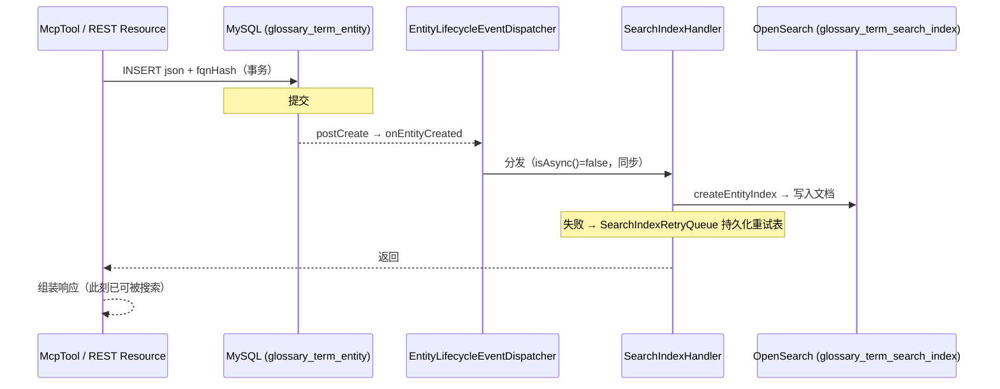

# MySQL 与 OpenSearch 索引协同机制

> 适用版本：OpenMetadata 2.0.4。回答：两者怎么分工、什么时候写 OpenSearch 索引（以新建术语为例）、索引失败怎么办。
> 关联文档：[MCP接口总览](MCP接口总览.md)、[MCP创建实体存储结构](MCP创建实体存储结构.md)。

## 1. 分工：MySQL 是事实源，OpenSearch 是派生的只读副本

| | MySQL（元数据库） | OpenSearch |
|---|---|---|
| 角色 | 唯一事实源：实体 CRUD、版本、关系边、历史快照 | 只读检索副本 |
| 写入 | 所有变更的唯一入口 | 只由实体生命周期事件驱动 + 全量重建 |
| 读取方 | `get_entity_details` / `get_entity_lineage` 等仓储直读工具、实体 REST API | `search_metadata` / `semantic_search` 工具、UI 搜索/列表 |

所有写操作先落 MySQL；OpenSearch 里的文档是 MySQL 数据的派生物，随时可以用全量重建恢复。

## 2. 新建术语后发生什么（时序）



**核心事实**（`events/lifecycle/handlers/SearchIndexHandler.java`）：

- `isAsync()` 返回 **false**：索引在 **MySQL 提交后、请求线程内同步执行**。代码注释原话：*保证 read-your-write，绝不让实体退化为最终一致*。
- 所以 `create_entity`（或任何创建入口）**返回的那一刻**，术语已经在 OpenSearch 里，紧接着调 `search_metadata` 就能搜到。

## 3. 各操作对应的索引动作

| MySQL 侧操作 | OpenSearch 动作（SearchIndexHandler） |
|---|---|
| 创建 | `createEntityIndex`（批量 `createEntitiesIndex`，bulk 优先、失败降级逐条） |
| patch / PUT 更新 | `updateEntityIndex`（原位更新文档；批量 `updateEntitiesIndex` 带 relationshipRevision） |
| 软删除 / restore | `softDeleteOrRestoreEntityIndex`（更新 deleted 标记，不从索引删文档） |
| 硬删除 | `deleteEntityIndex`（从索引删文档） |

索引命名：每个实体类型一个索引（`glossary_term_search_index`、`mcp_server_search_index` 等），通过 `om_` 前缀的索引模板 + 别名管理（`SearchRepository` 的 indexMapping）。

## 4. 失败兜底

1. **同步索引失败不影响 MySQL**：异常被捕获并记日志，操作以 `(entityId, entityFqn, operation, failureReason)` 写入 `SearchIndexRetryQueue` 的**持久化重试表**（在 MySQL，不是内存队列），由重建/协调组件（`DistributedSearchIndexCoordinator` 等）后续重放。
2. 极端表现："MySQL 里有、搜索暂时搜不到"——此时 `get_entity_details`（走 MySQL）完全正常，`search_metadata` 短暂缺失，重放后补齐。
3. 命中率指标：重试入队会计数 `search.retry.enqueued`。

## 5. 哪些实体会被索引

每个实体的 `EntityRepository` 有 `supportsSearch` 标志（默认 false）：glossary、glossaryTerm、mcpServer、table 等为 true；不设置该标志的实体类型不进 OpenSearch（只存在于 MySQL）。

## 6. 全量重建

`SearchIndexingApplication`（apps/bundles/searchIndex）负责**按实体类型批量重建索引**：mapping 变更、数据漂移、重试表积压修复时使用；支持分布式分片执行（`DistributedSearchIndexCoordinator` / `DistributedJobParticipant`）、BulkSink 批量写入。

## 7. 对接方需要知道的时序结论

| 场景 | 表现 |
|---|---|
| `create_entity` 返回后立刻 `search_metadata` | **能搜到**（索引同步完成才返回） |
| 索引同步失败（OpenSearch 故障） | 创建本身成功（MySQL 已提交），搜索短暂缺失，重试表补齐 |
| 宽表读详情（`get_entity_details`） | 永远走 MySQL，与索引状态无关 |
| OpenSearch 宕机期间新建的实体 | 重启后由重试表 + 全量重建恢复一致性 |

## 8. OpenSearch 里存的是什么（存储与数据结构）

### 8.1 索引布局

- **一个实体类型一个索引**：`glossary_term_search_index`、`mcp_server_search_index`、`table_search_index`……（常量定义在 `search/SearchClient.java`）
- 索引由 `om_` 前缀模板创建，走别名读写（`getIndexOrAliasName`）；`table` 额外把**列拍平成独立文档**写入 `table_column` 索引（`ColumnSearchIndex`，列 docId = 列 FQN 哈希）
- Mapping 按语言分四套：`openmetadata-spec/src/main/resources/elasticsearch/{en,jp,ru,zh}/`，由设置 `ELASTICSEARCH_INDEX_MAPPING_LANG` 选择（POC configmap 里是 `EN`）

### 8.2 文档 _id 与 _source

- **`_id` = 实体 UUID 字符串**：`createEntityIndex` → `searchClient.createEntity(writeIndexName, entityId, doc)`（SearchRepository.java:1147-1182）
- `_source` = 文档本身（各实体 builder 产出的扁平 Map 序列化），没有嵌套的"原始实体"

### 8.3 文档结构（以 `glossary_term` mapping 为例，47 个顶层字段）

Mapping 文件：`openmetadata-spec/src/main/resources/elasticsearch/en/glossary_term_index_mapping.json`

| 字段组 | 字段 | 类型要点 |
|---|---|---|
| 标识 | `id`, `name`, `displayName`, `fullyQualifiedName`, `fqnParts`, `href`, `entityType` | `name` 是 text + 三个 multifield（`keyword`/`ngram`/`compound`）；`fullyQualifiedName` 是 keyword + `lowercase_normalizer`（精确过滤用） |
| 内容 | `description`, `synonyms`, `descriptionStatus`, `descriptionSources` | text，om_analyzer 全文分析 |
| 关系（拍平） | `owners`, `ownerName`, `ownerDisplayName`, `domains`, `glossary`, `children`, `relatedTerms`, `reviewers`, `parentId`, `childrenCount` | 关系数据从 MySQL 回填后**拍平进文档**，不是嵌套实体 |
| 标签/分级 | `tags`, `classificationTags`, `glossaryTags`, `tier`, `tagSources`, `tierSources` | keyword |
| 治理/统计 | `usageCount`, `totalVotes`, `votes`, `entityStatus`, `deleted`, `mutuallyExclusive`, `fingerprint` | |
| 向量/LLM | `textToEmbed`, `textToLLMContext`, `chunkIndex`, `chunkCount` | 语义检索（`semantic_search` kNN）的向量来源；长描述分块（chunk）存储 |
| 自定义属性 | `extension`（`enabled:false` 不索引）, `customPropertiesTyped`（类型化可查） | |
| 变更 | `version`, `updatedAt`, `updatedBy`, `changeDescription`, `incrementalChangeDescription` | |

与 MySQL 行的对应关系：**同一份实体的两种投影**——MySQL 存全量 JSON（含被剥离的关系字段），OpenSearch 存"检索视角"的扁平文档（关系字段已回填拍平、加了 suggest/向量/多语言分析字段）。

### 8.4 分析器（决定"怎么搜得到"）

| 分析器 | 组成 | 用途 |
|---|---|---|
| `om_analyzer` | standard + word_delimiter + kstem 词干还原 | 全文匹配主分析器 |
| `om_ngram` | ngram(3~20) + lowercase | 子串/中缀匹配（如输入 `cust` 命中 `customer`） |
| `om_compound_analyzer` | standard + compound word_delimiter + flatten_graph | 驼峰/复合词拆分（`dimAddress` → dim address） |
| `lowercase_normalizer` | keyword 小写归一 | `fullyQualifiedName`/tag 的精确 term 过滤 |

检索打分按字段加权（如 synonyms=5.0、glossary.name=5.0，见 `indexes/GlossaryTermIndex.java:56-59`）。

### 8.5 一份文档示例（构造，字段名取自 mapping）

```json
{
  "id": "3c4083b9-facb-4524-8683-bb0e73df468c",
  "name": "ActiveCustomer",
  "displayName": "活跃客户",
  "fullyQualifiedName": "Finance.ActiveCustomer",
  "fqnParts": ["Finance", "ActiveCustomer"],
  "entityType": "glossaryTerm",
  "description": "近90天内有成交行为的客户",
  "synonyms": ["活跃客户"],
  "glossary": { "id": "...", "name": "Finance", "displayName": "财务术语表" },
  "owners": [{ "name": "john.doe", "displayName": "John Doe" }],
  "ownerName": ["john.doe"],
  "domains": [{ "fullyQualifiedName": "Sales" }],
  "tags": [{ "tagFQN": "Tier.Tier1" }],
  "deleted": false,
  "version": 0.1,
  "updatedAt": 1760000000000,
  "textToEmbed": "ActiveCustomer 活跃客户 近90天内有成交行为的客户 ...",
  "chunkIndex": 0, "chunkCount": 1
}
```

`search_metadata` 的 `query`/`queryFilter` 最终就是对这个索引的 OpenSearch DSL 查询（`queryFilter` 直传 DSL，字段名以上表为准）。

## 9. 源码索引

| 文件 | 职责 |
|---|---|
| `openmetadata-service/.../events/lifecycle/EntityLifecycleEventDispatcher.java` | 生命周期事件分发（同步/异步 lane、bulk 分发、失败入重试队列） |
| `openmetadata-service/.../events/lifecycle/handlers/SearchIndexHandler.java` | 五种索引操作 + 失败入队（`isAsync()=false` 注释即 read-your-write 依据） |
| `openmetadata-service/.../search/SearchIndexRetryQueue.java` | 持久化重试表写入（search.retry.enqueued 指标） |
| `openmetadata-service/.../search/SearchRepository.java` | 索引命名/模板/别名、单条与 bulk 索引 API |
| `openmetadata-service/.../apps/bundles/searchIndex/` | 全量重建应用与分布式协调 |
| `openmetadata-service/.../jdbi3/EntityRepository.java`（postCreate，:3958） | 创建后生命周期分发入口 |
| `openmetadata-service/.../search/SearchRepository.java`（createEntityIndex，:1147） | 门禁检查、doc 构建（_id=实体UUID）、索引写入、失败入队 |
| `openmetadata-spec/src/main/resources/elasticsearch/en/glossary_term_index_mapping.json` | 索引 mapping/分析器权威定义（47 字段） |
| `openmetadata-service/.../search/indexes/GlossaryTermIndex.java` | 文档字段构建与打分权重 |
| `openmetadata-service/.../search/indexes/ColumnSearchIndex.java`（经 SearchRepository.indexTableColumns） | table 列拍平为独立索引文档 |
