# 迁入 Import · 调用链（页面 + Init 下发汇入）

> **主路径（页面）：** 基本信息 → 对象映射 → 提交 → Adapter → Import MQ → **Consumer 写库**（File / Issue **二选一**）。  
> **旁路（Init/下发）：** Receive → INIT-IMPORT Topic → 自动映射/`createImportTask` → **合流** Adapter + Import MQ → 通常进 **Issue**（见 **§7**）。  
> 读法：第一部分时序 → 第二部分 §0～§6 → **§7 Init** → 第三部分映射数据 → **第四部分表与 ER（I.x）**。  
> File **§6.5.6**（`fileimport`）/ Issue **§6.5.7**；附录 [appendix.md](./appendix.md)；产品概要见 [概要设计.md](./概要设计.md)。  
> 页面截图：`…/迁移助手/页面/迁入1.png`（对象映射步）。  
> 预览点链接：`Ctrl+Shift+V`。

---

## 页面步骤 ↔ 接口（对照截图 · 导入向导 2 步）

| 页面 | 区块（截图顺序） | 左源 / 动作 | 右目标 / 接口 |
|---|---|---|---|
| 创建任务·1 | 基本信息 | 任务名/用途等前端本地 | 提交时进 `createImportTask` body |
| 创建任务·2 | **工程映射** | `analyzeFile` → `srcProjects` | **`POST`** `/prepare/dwplan/data/project/selectList?authFilter=true` |
| 创建任务·2 | **数仓数据源映射** | `srcDWDataSources` | **`POST`** `/prepare/dwplan/data/source/list`（前端按数仓过滤） |
| 创建任务·2 | **业务数据源映射** | `srcBIZDataSources` | **`POST`** `/prepare/dwplan/data/source/list`（前端按业务源过滤） |
| 创建任务·2 | 提交规则 | 截图仅标题、无字段 | **待前端确认**（非本 Controller） |
| 创建任务·2 | 下一步 | — | `POST .../createImportTask` → Adapter → MQ |
| 任务列表/详情 | 状态/报告 | — | `pageList` / `detail/{id}` / `getImportReport` / `detailObjectList` / `detailMappingList` |

**勿混用：** `GET .../findProjects` 查治理库任务工程表，**不是**映射页目标工程下拉。

**ImportTaskController 全量（相对 `/migrationassistant/import/task`）：**

| 方法 | 路径 | 主链？ |
|---|---|---|
| POST | `/uploadChunkFile`、`/mergeFile` | §0 |
| GET | `/signature` | OBS 直传旁路（非分片必经） |
| POST | `/analyzeFile` | §1 |
| POST | `/createImportTask` | §4 |
| POST | `/pageList` | §5 |
| GET | `/detail/{id}` | §5 |
| POST | `/getImportReport`、`/detailObjectList`、`/detailMappingList` | §5 详情 |
| GET | `/clear` | File 清理旁路 |
| GET | `/manual/rollback/{taskId}/{tenantId}/{orgId}` | File 手动回滚 |
| GET | `/testImport` | **调试**：直接 `FileImportService#processImportTask`（在本 Controller，非 TestController） |
| GET | `/getImportTaskId` | 发布/deploy：packageId+version → importTaskId |
| GET | `/findProjects` | 附录：任务工程表，非映射下拉 |

**ReceiveController**（`/migrationassistant/receive`）：`POST /` 汇入 §7；另有 `GET /release/state`、`/rollback`、`/rollbackState`（见 §7.5）。  
**Issue 回滚：** `GET /migrationassistant/issue/import/task/rollback?taskId=`（§6.5.7.16）。

---

## 第一部分：端到端完整链（时序图）

> **读法：** 下图是「**页面**操作 + 异步写库」一整条链；Init/下发旁路见 **§7**（不经上传映射页，最终仍进 Adapter + §6）。  
> MQ 只解耦线程——**消费侧同属本调用链**。细节：§4（发 MQ 前）/ **§6（消费后）** / **§7（Init 汇入）**。

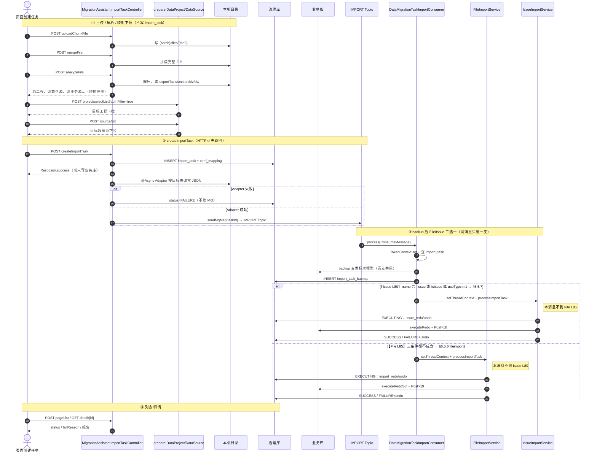

**阶段怎么串起来（MQ 不解耦「业务含义」，只解耦线程）：**

| 阶段 | 触发 | 是否写业务库 | 对应章节 |
|---|---|---|---|
| ① 上传/解析/映射下拉 | 页面 HTTP | 否 | §0～§3 |
| ② 建任务 + Adapter + **发** MQ | 页面 HTTP + `@Async` | 否（只改包内 JSON / 任务表） | **§4** |
| ②′ Init 自动建任务 | Receive → INIT MQ → `createImportTask` | 否（合流 ②） | **§7** |
| ③ **收** Import MQ → backup → **File/Issue 二选一**（L85/L80） | Consumer | **是** | **§6**（路由 §6.5.4） |
| ④ 列表/详情 | 页面 HTTP | 否（只读状态） | §5 |

**和截图的对应关系（对象映射步，顺序同页面）：**

| 页面区块 | 左侧「源」 | 右侧「目标」 |
|---|---|---|
| 工程映射 | `analyzeFile` → `section` 嵌套 `project` | **`POST`** `/prepare/dwplan/data/project/selectList?authFilter=true` |
| 数仓数据源映射 | `dwDataSource.json` | **`POST`** `/prepare/dwplan/data/source/list` |
| 业务数据源映射 | `bizDataSource.json` | 同上（前端分组） |
| 提交规则 | （截图仅标题） | 待前端确认 |

步骤 **1 + 2 + 3** 的目的：左边是**包里有什么**，右边是**新环境里已有什么**，供用户做映射；**还不写迁入任务**。  
步骤 **4 发 MQ 之后必须接步骤 6 消费**——迁入业务到「写进目标库」才算走完；pageList 只是观察结果。  
**注意：** 页面建任务若 `useType==1` 或 `isIssue`，消费时进 **Issue L80**，不是「凡页面必 File」。

**旁路 Init（不上图主链，单独画）：** 不经 ① 映射页，Receive → INIT Topic → 自动映射 → 合流 `createImportTask` → 仍走 Adapter + IMPORT Topic → **Issue**。详 **§7**。

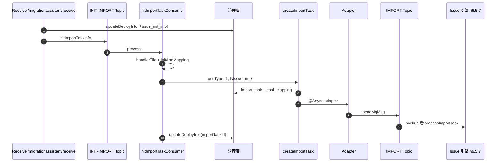

---

## 第二部分：按调用顺序逐接口

> **目录约定：** `### N.` = 页面步骤/接口或核心入口；其下 `#### N.1～N.4` = 干什么/问题/参数/流程图；**子方法一律挂在 `#### N.5` 下**（`##### N.5.x`），不与 N.1～N.4 或其它节平级。  
> 步骤 0 的 `0.1` / `0.2` 是两个**平级 HTTP 接口**（分片上传、合并），不是同一方法的子调用。  
> **§6** 不是页面 HTTP，而是 §4 发 MQ 之后的 **Consumer 写库核心**（与 §4 同等重要）。

### 总目录

| 序号 | 接口 | 服务 | 作用 |
|---:|---|---|---|
| 0a | `POST /governance/migrationassistant/import/task/uploadChunkFile` | governance | 分片上传 ZIP |
| 0b | `POST /governance/migrationassistant/import/task/mergeFile` | governance | 合并分片为完整 ZIP |
| 1 | `POST /governance/migrationassistant/import/task/analyzeFile` | governance | 解压已上传文件、取出包内数据，供页面左侧展示 |
| 2 | **`POST`** `/prepare/dwplan/data/project/selectList?authFilter=true` | **prepare** | 目标工程列表（映射右侧） |
| 3 | **`POST`** `/prepare/dwplan/data/source/list` | **prepare** | 目标数据源列表（映射右侧；body 过滤业务/数仓） |
| 4 | `POST /governance/migrationassistant/import/task/createImportTask` | governance | 落库任务 + 映射 + 异步 Adapter + 成功发 MQ（见 §4） |
| 5 | `POST pageList` + `GET detail/{id}` + 报告/明细 APIs | governance | 列表轮询 + 详情（见 §5） |
| **6** | **MQ `DataMigrationTaskImportConsumer#process`** | governance | **★写库核心** backup 后 **二选一**：L80 Issue / L85 File（`fileimport`） |
| **7** | **Receive + INIT MQ + InitImportTaskConsumer** | governance | **Init/下发汇入** → `createImportTask` → 合流 §4/§6（通常 Issue） |

> Controller 前缀：`@RequestMapping("/migrationassistant/import/task")`，网关/context 常见为 `/governance`。  
> 2、3 属于 **prepare**（`DataProjectController#selectList` / `DataSourceController#list` 均为 **POST**）；Feign 上若仍写 GetMapping **勿照抄**。  
> **§4 发完 MQ 并未结束迁入**——真正改业务库在 **§6**；**§7 不替代 §6**，只是另一条建任务入口。

---

### 0. 上传迁出文件

#### 0.1 `uploadChunkFile`

| 项 | 说明 |
|---|---|
| **干什么** | 接收 ZIP 的一个分片，落到本机临时目录 |
| **解决什么问题** | 大包一次 HTTP 易超时/超限；失败可只重传单片 |
| **HTTP** | `POST .../import/task/uploadChunkFile` |
| **实现** | `MigrationAssistantImportTaskController.uploadChunkFile` → `uploadFile` → `FileUtils.uploadFile` |
| **落盘** | `{migrationDownloadFilePath}/{batchNumber}/files/{fileMd5}` |

#### 0.2 `mergeFile`

| 项 | 说明 |
|---|---|
| **干什么** | 按分片序号拼成完整 ZIP |
| **解决什么问题** | 得到可供 `analyzeFile` 解压的单文件 |
| **HTTP** | `POST .../import/task/mergeFile` |
| **实现** | `mergeFile`：排序分片 → 追加写入 `{batchNumber}/{fileName}` → 删 `files/` |
| **边界** | 当前不严格校验 partNum/fileSize；ZIP 是否完整靠下一步解压暴露 |

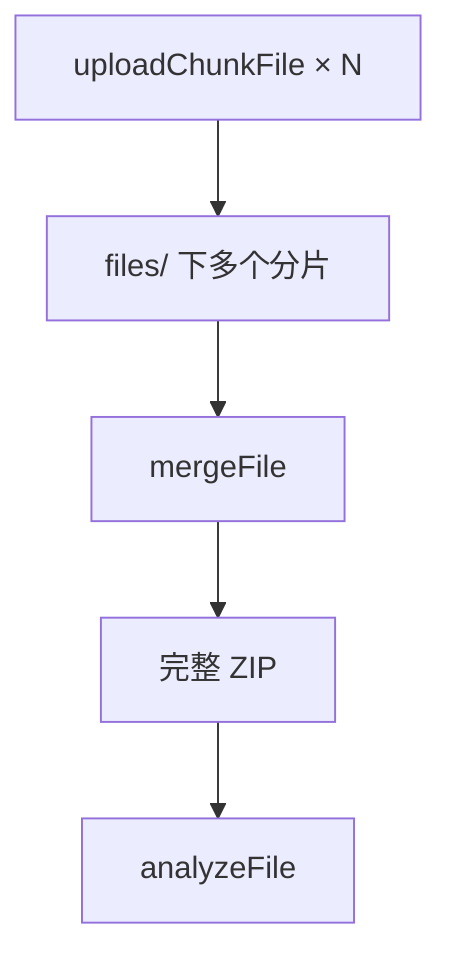

---

### 1. `analyzeFile`（解压上传文件 → 取包内数据 → 页面左侧）

一句话：**解压上传文件 → 取出里面的数据 → 在页面左侧展示。**  
实现类：`com.glodon.gdmp.migrationassistant.service.file.impl.DataMigrationFileAnalyzeServiceImpl#analyzeFile`  
（Controller → `MigrationAssistantImportTaskServiceImpl.analyzeFile` 仅转发）。

目录约定（与 [export-callchain.md](./export-callchain.md) 一致）：**1.1～1.4** 写本接口本身；**子方法全部挂在 1.5 下**，不与 1.1～1.4 平级。

#### 1.1 干什么

解压步骤 0 已合并的 ZIP，从解压目录读出源工程 / 业务源 / 数仓源等，组装 VO 返回前端。对象映射页**左侧**展示这些源对象；右侧「目标」由步骤 2、3 prepare 接口另查。

#### 1.2 解决什么问题

用户必须先看到「包里有什么」，才能做源→目标映射；把「上传落盘的二进制包」变成「页面可勾选的源对象列表」，且与真正建任务解耦——失败不污染 `import_task`。

#### 1.3 参数

| 项 | 说明 |
|---|---|
| HTTP | `POST .../import/task/analyzeFile` |
| 入参 | `MigrationAssistantFileAnalyzeFileRequest`：`batchNumber`、`fileName`、`useType`、`isIssue` |
| 配置 | `object-storage.migrationDownloadFilePath`（默认 `/gdmp_file/migration/import`） |
| 出参 | `DataMigrationFileAnalyzeFileVO`（见下表） |
| 副作用 | 解压目录保留；ZIP 在 finally 删除；**不写**任务表 |
| 异常 | 解压失败 → `MIGRATION_FILE_DECOMPRESS_FAILED`；用途不符 → `MIGRATION_FILE_USE_MISMATCHING`；缺 `exportTask` → `MIGRATION_FILE_NOT_FOUND` 等 |

**读哪些文件：**

| 文件 | 谁读 | 用途 |
|---|---|---|
| `exportTask.json` | `checkUse` / `getSourceSystem`（经 `getExportTaskJSONObject`） | 用途校验、`sourceSystem` |
| `section.json` | `getSrcBizSections` / `getSrcProjectJsonObjects`（经 `getJsonArray`） | 板块 + **嵌套** `project`（无根级 `project.json`） |
| `bizDataSource.json` | `getJsonObjects(BIZ_DATASOURCE, …)` | 源业务数据源（映射左侧） |
| `dwDataSource.json` | `getJsonObjects(DW_DATASOURCE, …)` | 源数仓数据源（映射左侧） |

**出参 `DataMigrationFileAnalyzeFileVO`：**

| 字段 | 来源方法 | 页面左侧 |
|---|---|---|
| `sourceSystem` | `getSourceSystem` | 随任务带回，不直接画列表 |
| `srcBizSections` | `getSrcBizSections` | 板块（映射辅助） |
| `srcProjects` | `getSrcProjectJsonObjects` | **工程映射**左侧 |
| `srcBIZDataSources` | `getJsonObjects(BIZ…)` | **业务数据源映射**左侧 |
| `srcDWDataSources` | `getJsonObjects(DW…)` | **数仓数据源映射**左侧 |

#### 1.4 流程图

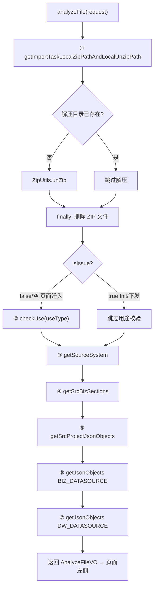

> `checkSystemVersion` 在源码中**整段注释**，跨版本迁移不做主/次/补丁版本拦截；方法体仍保留（见 [1.5.8](#158-未启用checksystemversion--getsystemversion)）。

#### 1.5 子方法（按调用顺序）

以下均为 `analyzeFile` 内部调用（或内联步骤），TOC 上挂在本节下，不与接口 2/3/4 平级。

| 序号 | 小节 | 方法 | 作用 |
|---:|---|---|---|
| ① | 1.5.1 | `getImportTaskLocalZipPathAndLocalUnzipPath` | 算 ZIP 路径与解压目录 |
| — | 1.5.2 | `ZipUtils.unZip` / `FileDeleteUtils.delete` | 解压；finally 删 ZIP |
| ② | 1.5.3 | `checkUse` | 包内 `useType` 与请求比对（仅非 Issue） |
| ③ | 1.5.4 | `getSourceSystem` / `getExportTaskJSONObject` | 读 `exportTask` |
| ④ | 1.5.5 | `getSrcBizSections` | 读 `section.json` → 板块列表 |
| ⑤ | 1.5.6 | `getSrcProjectJsonObjects` | 从 section **嵌套** `project` 抽工程 |
| ⑥⑦ | 1.5.7 | `getJsonObjects` + 底座 | 读 biz/dw 数据源 + 字典校验 |
| — | 1.5.8 | `checkSystemVersion`（未启用） | 版本号检测（已注释） |
| — | 1.5.9 | 调用关系总图 | 子方法依赖一览 |
| — | 1.5.10 | 与页面左侧对照 | 收口 |

##### 1.5.1 ① `getImportTaskLocalZipPathAndLocalUnzipPath`

| 项 | 说明 |
|---|---|
| **干什么** | 由 `batchNumber` + `fileName` 拼出本机 ZIP 全路径与解压目录 |
| **解决什么问题** | 上传/合并与解析共用同一落盘约定，避免路径写死在业务里 |
| **参数** | `request.batchNumber`、`request.fileName`；根目录 = `migrationDownloadFilePath` |
| **返回** | `Tuple2`：`_1` = `{base}/{batch}/{fileName}`；`_2` = `{base}/{batch}/{fileName去后缀}` |

```text
例：base=/gdmp_file/migration/import, batch=b1, fileName=pkg.zip
ZIP  → /gdmp_file/migration/import/b1/pkg.zip
解压 → /gdmp_file/migration/import/b1/pkg
```

无 IO、不校验文件是否存在（存在性由后续 unZip / 读 JSON 暴露）。

##### 1.5.2 解压与删 ZIP（主编排内联，非 private 方法）

| 项 | 说明 |
|---|---|
| **干什么** | 解压目录不存在则 `ZipUtils.unZip(zip, unzipPath)`；**无论成败** `finally` 里 `FileDeleteUtils.delete(zip)` |
| **解决什么问题** | 省磁盘；重复点「解析」时目录已在则跳过解压，避免覆盖 |
| **边界** | 第二次解析时 ZIP 已被删、目录仍在 → 直接读目录；若目录被清且 ZIP 已删 → 解压失败 |

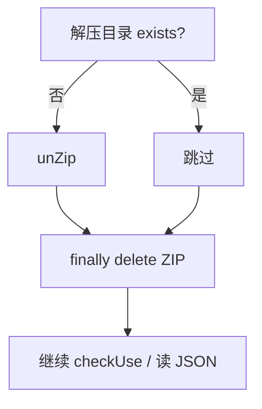

##### 1.5.3 ② `checkUse`

| 项 | 说明 |
|---|---|
| **干什么** | 读包内 `exportTask.useType`，与请求 `useType` 必须相等 |
| **解决什么问题** | 防止「迁出用途 A 的包」被当成用途 B 做映射/导入 |
| **何时调用** | 仅 `!request.getIsIssue()`（页面迁入）；Init/下发常 `isIssue=true` 跳过 |
| **参数** | `useType`（请求）、`localUnzipPath` |
| **子方法** | `getExportTaskJSONObject(true, …)` → [1.5.4.2](#1542-getexporttaskjsonobject共用读底座) |
| **异常** | 无文件 → `MIGRATION_FILE_NOT_FOUND("exportTask")`；无 `useType` → `MIGRATION_FILE_USE_NOT_FOUND`；不等 → `MIGRATION_FILE_USE_MISMATCHING` |

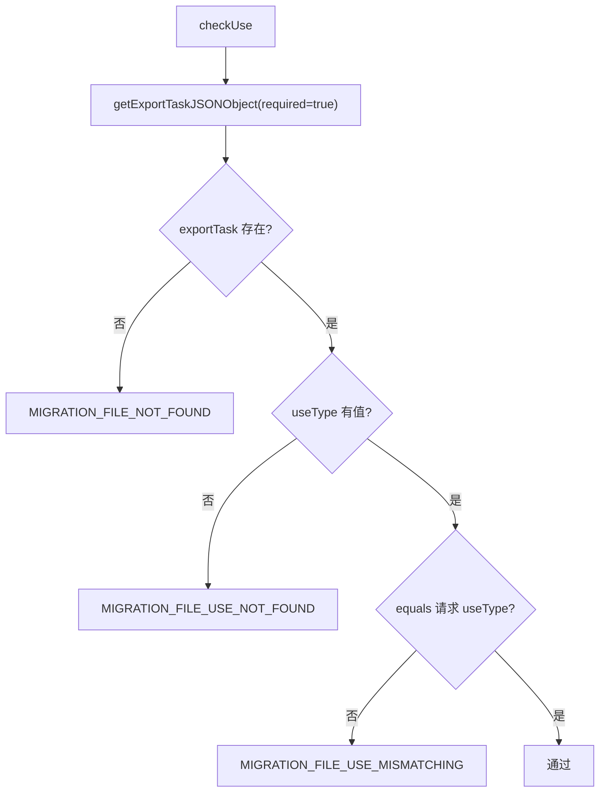

##### 1.5.4 ③ `getSourceSystem` / `getExportTaskJSONObject`

###### 1.5.4.1 `getSourceSystem`

| 项 | 说明 |
|---|---|
| **干什么** | 从 `exportTask.json` 取 `sourceSystem` 字符串 |
| **解决什么问题** | 后续历史 ID 映射、Finder 隔离依赖「来自哪套源系统」；页面建任务时带回 |
| **参数** | `required=true`（主编排写死）、`localUnzipPath` |
| **返回** | `jsonObject.getString("sourceSystem")`；文件缺失走 `getExportTaskJSONObject` 抛错 |

> 方法内局部变量 `sourceSystem = ""` 未使用，实际直接 `return jsonObject.getString(...)`。

###### 1.5.4.2 `getExportTaskJSONObject`（共用读底座）

| 项 | 说明 |
|---|---|
| **干什么** | 读 `{unzip}/exportTask.json` → `JSONObject` |
| **解决什么问题** | `checkUse` / `getSourceSystem` /（注释掉的版本检查）共用同一文件入口 |
| **路径** | `{localUnzipPath}/exportTask.json` |
| **required=true 且文件不存在** | **删整个解压目录**后抛 `MIGRATION_FILE_NOT_FOUND` |
| **读失败** | 删解压目录 + `MIGRATION_FILE_CONTENT_READ_FAILED` |
| **required=false 且不存在** | 返回 `null`（当前主编排对 exportTask 始终 required） |

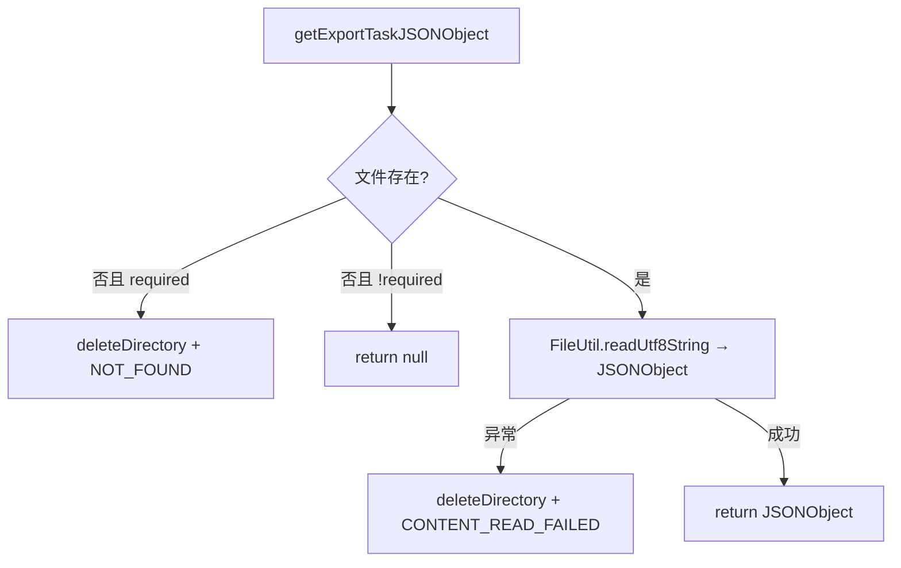

##### 1.5.5 ④ `getSrcBizSections`

| 项 | 说明 |
|---|---|
| **干什么** | 读 `section.json` 顶层数组，每条取 `record` → `DataMigrationFileAnalyzeBizSectionVO` |
| **解决什么问题** | 给页面/后续映射提供源业务板块清单 |
| **参数** | `localUnzipPath` |
| **子方法** | `getJsonArray(SECTION, required=true, …)` → [1.5.7.2](#1572-getjsonarray读-objnamejson-共用底座) |
| **边界** | `getJsonArray` 返回 `null`（文件不存在且 required）→ **空列表，不抛错**（与 exportTask 严格必需不同） |

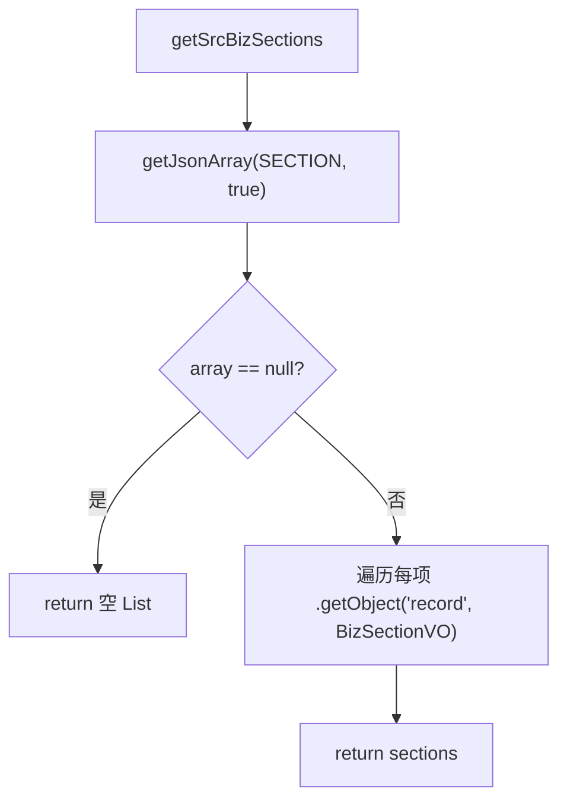

JSON 形态示意：

```json
{
  "section": [
    { "record": { "f_id": 1, "f_name": "...", "f_code": "..." }, "project": [ /* 见 1.5.6 */ ] }
  ]
}
```

##### 1.5.6 ⑤ `getSrcProjectJsonObjects`（工程映射左侧核心）

| 项 | 说明 |
|---|---|
| **干什么** | 再次读 `section.json`，遍历每个 section 下的 **`project` 嵌套数组**，取每条 `record` → `DataMigrationFileAnalyzeProjectVO` |
| **解决什么问题** | 迁出包**没有**根级 `project.json`；工程挂在板块下，必须从嵌套抽出，才能填「工程映射」左侧 |
| **参数** | `localUnzipPath` |
| **子方法** | `getJsonArray(SECTION, true, …)`（与 1.5.5 **各读一次文件**，无缓存） |
| **边界** | section 缺失 → 空列表；某 section 无 `project` 键 → 跳过该块 |

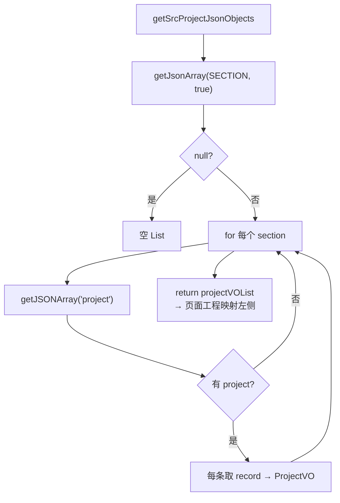

嵌套示意：

```json
{
  "section": [
    {
      "record": { "f_name": "某板块" },
      "project": [
        { "record": { "f_id": 10, "f_name": "物料数据工程", "f_code": "..." } }
      ]
    }
  ]
}
```

##### 1.5.7 ⑥⑦ `getJsonObjects` + `getJsonArray` + `checkBusinessTypeDictionary`

###### 1.5.7.1 `getJsonObjects`（业务源 / 数仓源）

| 项 | 说明 |
|---|---|
| **干什么** | 按对象类型读 `{typeName}.json` 数组 → 字典校验 → 每条 `record` 反序列化为 VO |
| **解决什么问题** | 统一抽数据源列表；映射页业务源/数仓源左侧同源模式 |
| **主编排两次调用** | `BIZ_DATASOURCE` → `srcBIZDataSources`；`DW_DATASOURCE` → `srcDWDataSources`；均 `required=false` |
| **参数** | `typeEnum`、`required`、`localUnzipPath`、`voClass`（均为 `DataMigrationFileAnalyzeDataSourceVO.class`） |
| **子方法** | `getJsonArray` → `checkBusinessTypeDictionary` → 逐条 `record` |

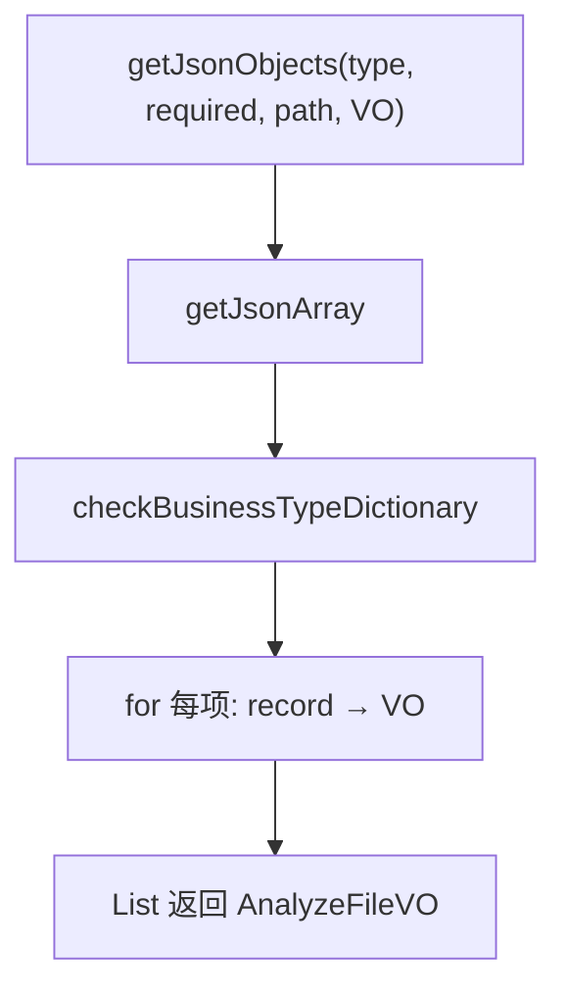

###### 1.5.7.2 `getJsonArray`（读 `{objName}.json` 共用底座）

| 项 | 说明 |
|---|---|
| **干什么** | 读 `{unzip}/{objName}.json`，取根上名为 `objName` 的 `JSONArray`（如键 `section` / `bizDataSource` / `dwDataSource`） |
| **解决什么问题** | 板块、数据源等同构文件格式共用一个读取器 |
| **objName** | `typeEnum.getDesc()`（空则删目录 + `MIGRATION_CONFIG_INFO_NOT_FOUND`） |
| **文件不存在** | `required=false` → **空 `JSONArray`**；`required=true` → 当前实现 **`return null`**（抛错代码被注释），由调用方消化 |
| **读/解析失败** | 删解压目录 + `MIGRATION_FILE_CONTENT_READ_FAILED` |

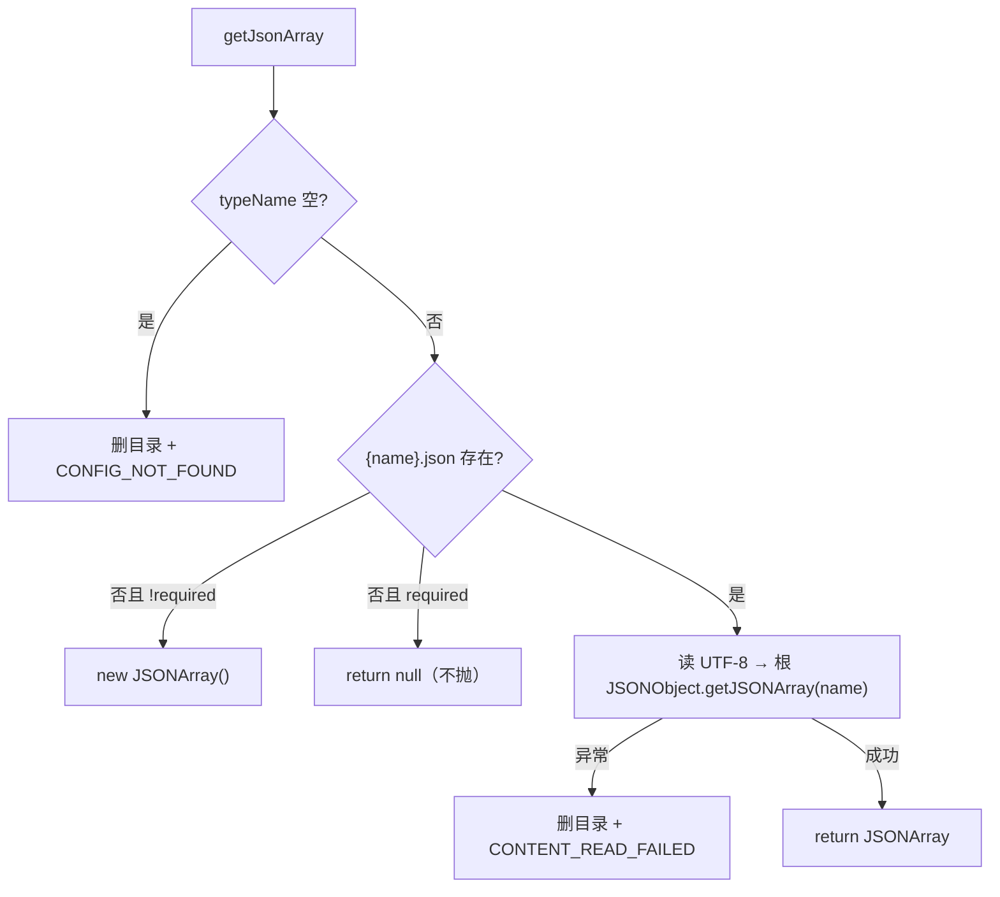

###### 1.5.7.3 `checkBusinessTypeDictionary`

| 项 | 说明 |
|---|---|
| **干什么** | 对数组每条 `record` 的字段：若该字段在「对象类型业务字典」中有配置，则取值必须落在允许集合内 |
| **解决什么问题** | 解析阶段尽早拦住包内非法业务类型值，避免进 Adapter/写库才爆 |
| **何时调用** | 仅 `getJsonObjects` 路径（即 **biz/dw 数据源**）；板块/工程路径**不**走此校验 |
| **查配置** | `dataMigrationObjectRuleDao.getObjectTypeList(IMPORT)` → 匹配 `typeName` → `dictionaryService.queryBusinessTypeDictionaries(objectTypeId)` |
| **异常** | 无对象类型配置 → `DATA_MIGRATION_OBJECT_TYPE_CONFIG_NOT_EXIST`；值不在字典 → `DATA_MIGRATION_ADAPTER_IMPORT_DATA_FAILED`（操作描述为 `ANALYZE`） |
| **空数组** | 循环 0 次，直接过 |

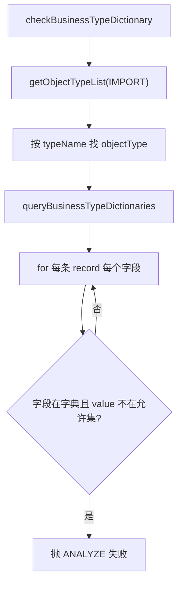

##### 1.5.8 （未启用）`checkSystemVersion` / `getSystemVersion`

| 项 | 说明 |
|---|---|
| **状态** | `analyzeFile` 内调用被注释：「做跨版本迁移，去除版本号检测」 |
| **若启用会干什么** | `getSystemVersion` ← `exportTask.systemVersion`；与配置 `systemVersion` 比主版本、次版本相等，补丁 `源 ≤ 目标` |
| **子方法** | `getSystemVersion` → `getExportTaskJSONObject` |

当前页面解析**不拦截**系统版本差异。

##### 1.5.9 调用关系总图

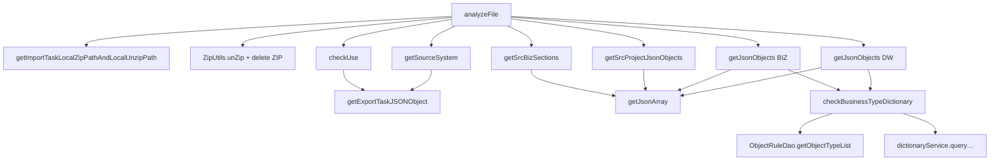

##### 1.5.10 与页面左侧对照（收口）

| 页面区块 | VO 字段 | 最终读到的包内结构 |
|---|---|---|
| 工程映射左侧 | `srcProjects` | `section[].project[].record` |
| 业务数据源映射左侧 | `srcBIZDataSources` | `bizDataSource[].record`（先字典校验） |
| 数仓数据源映射左侧 | `srcDWDataSources` | `dwDataSource[].record`（先字典校验） |

右侧下拉仍走步骤 2、3，与本节无关。

---

### 2. 目标工程列表（映射下拉）

| 项 | 说明 |
|---|---|
| **干什么** | 查**当前（目标）环境**用户有权限的工程，填「目标工程」下拉 |
| **解决什么问题** | 映射右侧必须是新环境已存在的工程，不能写死包内 ID |
| **HTTP** | **`POST`** `/prepare/dwplan/data/project/selectList?authFilter=true` |
| **服务** | **prepare** `DataProjectController`（数仓规划），非 governance 迁入包 |
| **`authFilter=true`** | 按权限过滤可选工程 |

与 `analyzeFile` 的源工程列表配对，构成截图中的「工程映射」两列。

---

### 3. 目标数据源列表（映射下拉）

| 项 | 说明 |
|---|---|
| **干什么** | 查目标环境已有数据源，填「目标业务数据源 / 目标数仓数据源」下拉 |
| **解决什么问题** | 源库连接不能原样带入；必须映射到新环境数据源 |
| **HTTP** | **`POST`** `/prepare/dwplan/data/source/list`（prepare `DataSourceController`） |
| **服务** | **prepare** |
| **页面展示** | 前端按业务源 / 数仓源拆成两块映射表（见截图） |

步骤 **1 + 2 + 3** 完成后：页面具备完整「源→目标」配置能力，用户选完并填负责人等，再调步骤 4。

---

### 4. `createImportTask`（执行导入 / 建任务）★核心

> **本文件最重点章节。** 页面点「下一步/提交」后，登记任务、固化映射、异步适配包内 JSON、成功才发 Import MQ——真正写业务库在 Consumer，但**能不能进 Consumer 全看这里**。  
> 实现入口：`MigrationAssistantImportTaskServiceImpl#createImportTask`。  
> 目录约定：`4.1～4.4` 写本接口；**全部子调用挂在 4.5**。

#### 4.1 干什么

1. 同组织无 `EXECUTING` 时，INSERT `t_data_migration_import_task`；  
2. 把页面「源→目标」映射批量写入 `t_data_migration_import_task_conf_mapping`；  
3. `@Async` 跑 Adapter：按目标库表结构裁剪/校验包内全部顶层 JSON（含子对象递归）；  
4. Adapter 成功才发 `DATA-MIGRATION-IMPORT-TASK-TOPIC`；失败标任务 `FAILURE` 且**不发 MQ**。

#### 4.2 解决什么问题

- 把映射页选择**落库**，供后续 Init 做源 ID→目标 ID 换算；  
- HTTP 线程不扛「扫全包 + 查元数据」；  
- 源包字段与目标版本表结构不一致时，在进引擎前失败或裁掉多余列，避免半套脏数据。

#### 4.3 参数

| 项 | 说明 |
|---|---|
| HTTP | `POST /governance/migrationassistant/import/task/createImportTask` |
| Controller | `MigrationAssistantImportTaskController.createImportTask` → **丢弃** Service 返回的 `taskId`，只 `RespJson.success()`（body 无 taskId） |
| Service | `MigrationAssistantImportTaskServiceImpl.createImportTask` → 返回 `Long taskId`（或 `null`） |
| 入参类 | `MigrationAssistantImportTaskImportRequest` |

**请求字段（校验 + 用途）：**

| 字段 | 校验 | 用途 |
|---|---|---|
| `name` | `@NotBlank` | 任务名；同组织重名：页面抛 `DATA_MIGRATION_TASK_NAME_EXIST`；`isIssue=true` 时 `insert` 返回 `null` 不抛 |
| `useType` | `@NotNull` | 0/1/2；Consumer 分流（`1`→Issue）；analyze 阶段已与包比对过 |
| `projectName` | 可选 | 写入任务 |
| `description` | 可选 | 写入任务 |
| `originalFileName` | `@NotBlank` | 算解压目录；须与 merge/analyze 一致 |
| `batchNumber` | `@NotBlank` | 同上 |
| `sourceSystem` | 可选（页面应从 analyze 带回） | Adapter Context / 历史 ID 映射边界 |
| `managerId` | `@NotNull` | 负责人；进 Context `f_manager_id` |
| `configMappingMap` | `@NotEmpty` + `@Valid` | `Map<objectTypeId, List<源→目标>>`，见 4.5.3 |
| `isIssue` | 默认 `false` | 是否下发任务；`createTask` 对 null 再补 false |
| `taskId` / `localUnzipPath` | `@Schema(hidden)` | 服务端回填，勿依赖前端传 |

**映射项 `MigrationAssistantImportTaskConfigMappingVO`：**

| 字段 | 校验 |
|---|---|
| `sourceId` | `@NotNull` |
| `sourceName` | `@NotBlank` |
| `targetId` | `@NotNull` |
| `targetName` | `@NotBlank` |

**配置：**

| 配置项 | 默认 | 用途 |
|---|---|---|
| `object-storage.migrationDownloadFilePath` | `/gdmp_file/migration/import` | 解压根目录 |
| `data-migration.import.task.mp.import-topic` | `DATA-MIGRATION-IMPORT-TASK-TOPIC` | Adapter 成功后发送的 Topic |

**副作用时间线：**

| 时刻 | 已发生 | 未发生 |
|---|---|---|
| HTTP 返回成功 | `import_task` + `conf_mapping` 已落库；`@Async` 已提交 | Adapter 未必完；MQ 未必发；业务表未写 |
| Adapter 失败 | 任务 `FAILURE` + `failReason` | **不发 MQ** |
| Adapter 成功 | 包内 JSON 已按目标表改写；原文件在 `backup/` | 业务写入仍在 Consumer |

#### 4.4 流程图（主编排 + 异步）

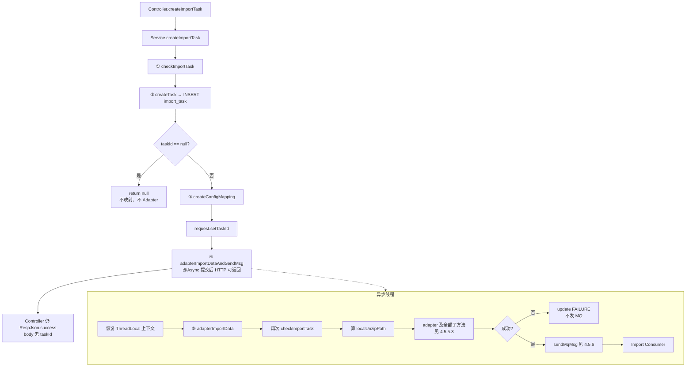

#### 4.5 子方法（按调用顺序，一个不漏）

| 序号 | 小节 | 方法 / 类 | 阶段 |
|---:|---|---|---|
| ① | 4.5.1 | `checkImportTask` | HTTP 同步 |
| ② | 4.5.2 | `createTask` → `insert` | HTTP 同步 |
| ③ | 4.5.3 | `createConfigMapping` → `batchSave` | HTTP 同步 |
| ④ | 4.5.4 | `adapterImportDataAndSendMsg` | `@Async` 入口 |
| ⑤ | **4.5.5** | **`adapterImportData`（适配全集，子方法全挂此节）** | 异步 |
| ⑦ | 4.5.6 | `sendMqMsg` / `createTaskContext` | 异步成功后 |
| — | 4.5.7 | HTTP 返回语义 / 竞态 / 路径细节 | 收口 |

> **`adapterImportData` 是适配核心入口**（类 `MigrationAssistantAdapterImportServiceImpl`）。其内部的 `adapter` / `handlerImportData` / `executeRecord` / JDBC 元数据等**全部下钻在 [4.5.5](#455--adapterimportdata适配核心全集)**，不再与 4.5.x 平级一带而过。

---

##### 4.5.1 ① `checkImportTask`

| 项 | 说明 |
|---|---|
| **类** | `MigrationAssistantImportTaskImportServiceImpl` |
| **干什么** | 统计当前组织下 `status = EXECUTING(1)` 且未删除的导入任务数；`>0` 抛 `DATA_MIGRATION_TASK_EXECUTING` |
| **解决什么问题** | 试图同组织导入互斥，避免两任务同时改配置 |
| **怎么查** | `DataMigrationImportTaskServiceImpl.importTaskCount(EXECUTING)`：`orgId`（`ProductContext.currentProduct()?.orgId` 优先，否则 `OrgContext`）+ `isDeleted=false` + `status` |
| **调用次数** | ① HTTP 同步一次；⑤ Adapter 异步再调一次 |

**边界（必读）：**

- **只拦 status=1，不拦 WAIT_EXECUTE(0)**。两个请求都可能在 Consumer 改成 1 之前通过检查并各建一条任务。  
- 第二次检查仍只看 1，**不是 DB 锁**，只能缩小窗口。  
- `request` 参数未使用，与具体任务无关。

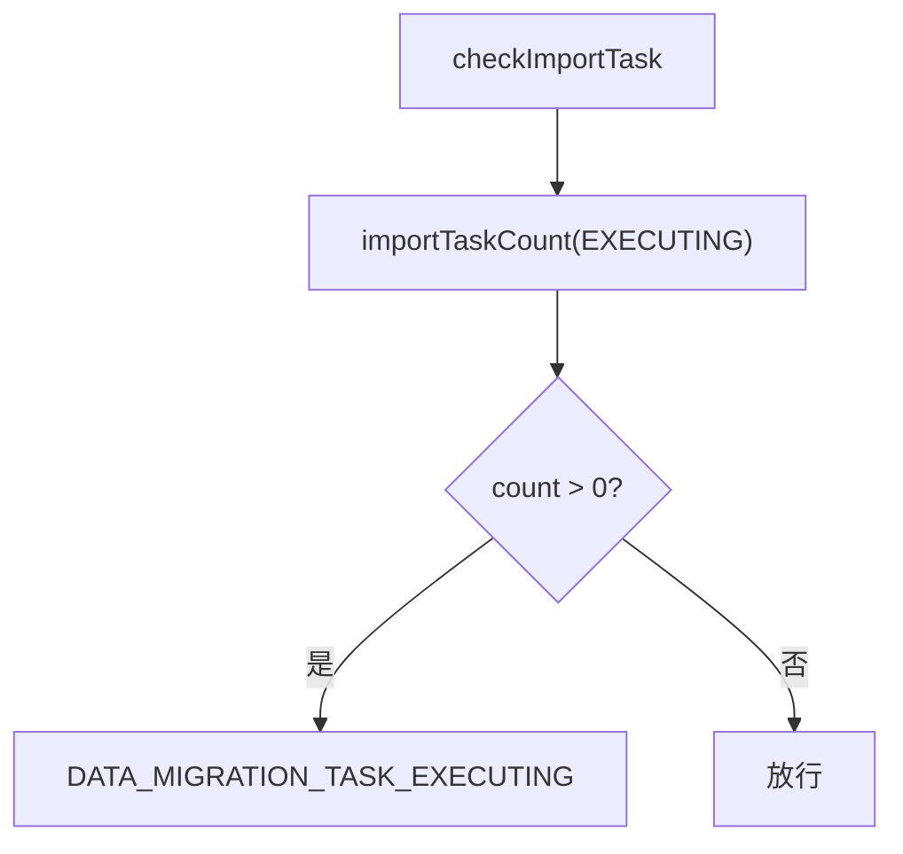

---

##### 4.5.2 ② `createTask` → `insert`

###### 4.5.2.1 `MigrationAssistantImportTaskImportServiceImpl.createTask`

| 项 | 说明 |
|---|---|
| **干什么** | 组装 `DataMigrationImportTaskRequest` 并 INSERT |
| **步骤** | ① `BeanUtils.copyProperties(request → saveRequest)`；② `isIssue==null` → `false`；③ 算 `importFilePath`；④ `iDataMigrationImportTaskService.insert` |
| **解压路径公式** | `{migrationDownloadFilePath}/{batchNumber}/{originalFileName去后缀}/`（**末尾带** `File.separator`） |
| **依赖** | 目录须已由 analyze 解压好；此处**不再解压**，只写路径进任务表 |

```text
例：base=/gdmp_file/migration/import, batch=b1, originalFileName=pkg.zip
importFilePath = /gdmp_file/migration/import/b1/pkg/
```

> 与 analyze 的 `getImportTaskLocalZipPathAndLocalUnzipPath` 相比：analyze 返回的解压目录**通常无尾斜杠**；Adapter 异步阶段会用 analyze 同款方法重算并 `setLocalUnzipPath`（无尾斜杠）。任务表里存的是 **createTask 带尾斜杠** 的路径，供 Consumer 使用。

###### 4.5.2.2 `DataMigrationImportTaskServiceImpl.insert`

| 项 | 说明 |
|---|---|
| **干什么** | 同组织任务名查重 → 拷贝实体 → `mapper.insert` → 返回雪花 `id` |
| **orgId** | `ProductContext.currentProduct()==null ? OrgContext : product.orgId` |
| **重名** | 同 org、未删除、同名：`isIssue==true` → **return null**；否则抛 `DATA_MIGRATION_TASK_NAME_EXIST` |
| **Service 对 null** | `createImportTask`：`if (taskId == null) return null;` → **不写 mapping、不调 Adapter** |
| **Controller** | 仍 `success()`——Issue 重名静默失败时页面也可能看到成功（页面路径一般会抛名冲突） |
| **初始 status** | 实体注释写 1/2/3；实际待执行依赖**库默认值 0**（WAIT_EXECUTE），代码 insert 未显式 setStatus |
| **自动填充** | `orgId` / `tenantId` / `product` / 创建人等 `FieldFill.INSERT` |

**写入 `t_data_migration_import_task` 关键字段：**

| 列/字段 | 来源 |
|---|---|
| `f_name` / `f_use_type` / `f_project_name` / `f_description` | 请求 |
| `f_original_file_name` | `originalFileName` |
| `f_import_file_path` | 上面算出的解压目录 |
| `f_source_system` | analyze 带回 |
| `f_is_issue` | 默认 false |
| `f_manager_id` | 页面负责人 |
| `f_status` | 默认 0（待执行） |

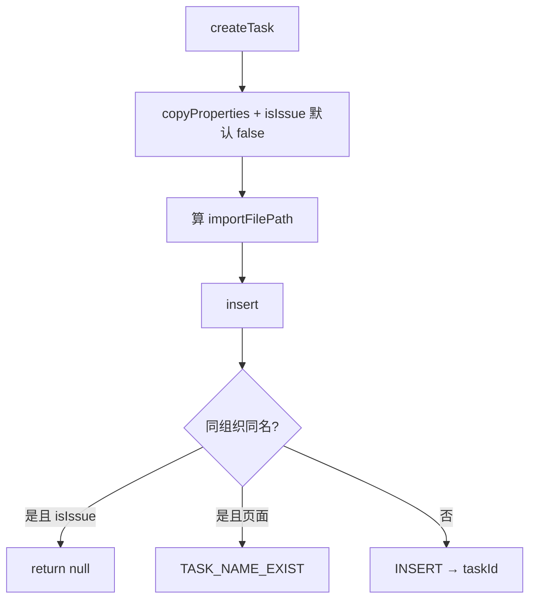

---

##### 4.5.3 ③ `createConfigMapping` → `batchSave`

| 项 | 说明 |
|---|---|
| **类** | `MigrationAssistantImportTaskImportServiceImpl` |
| **干什么** | 把页面 `configMappingMap` 展平成行，批量 INSERT `t_data_migration_import_task_conf_mapping` |
| **解决什么问题** | 固化「源工程/源数据源 → 目标工程/目标数据源」；Init 阶段用这些行做 ID 换算，**此处不改业务表** |

**遍历逻辑：**

1. `for (entry : configMappingMap)`：`key = objectTypeId`，`value = List<ConfigMappingVO>`；  
2. value 空 → `continue`；  
3. 每条 VO → `ConfMappingSaveRequest`：`taskId, objectTypeId, sourceId, sourceName, targetId, targetName`；  
4. 全部进 `confMappingSaveRequestList`；  
5. 列表仍空 → **直接 return**（不调 batchSave）；  
6. 否则 `iDataMigrationImportTaskConfMappingService.batchSave` → 逐条 `BeanUtils.copy` → `saveBatch`。

**与映射页对应：**

| 页面区块 | Map 的 key | 行内容 |
|---|---|---|
| 工程映射 | 工程对象类型 ID | 源工程 id/名 → 目标工程 id/名 |
| 业务数据源映射 | 业务源类型 ID | 同源 |
| 数仓数据源映射 | 数仓源类型 ID | 同源 |

> `@NotEmpty` 保证 Map 非空，但某个类型的 List 仍可能空并被跳过。  
> **空列表整体跳过 batchSave** 时，任务已创建但无映射行——后续 Init 缺映射会出问题；正常页面应把三类映射填满。

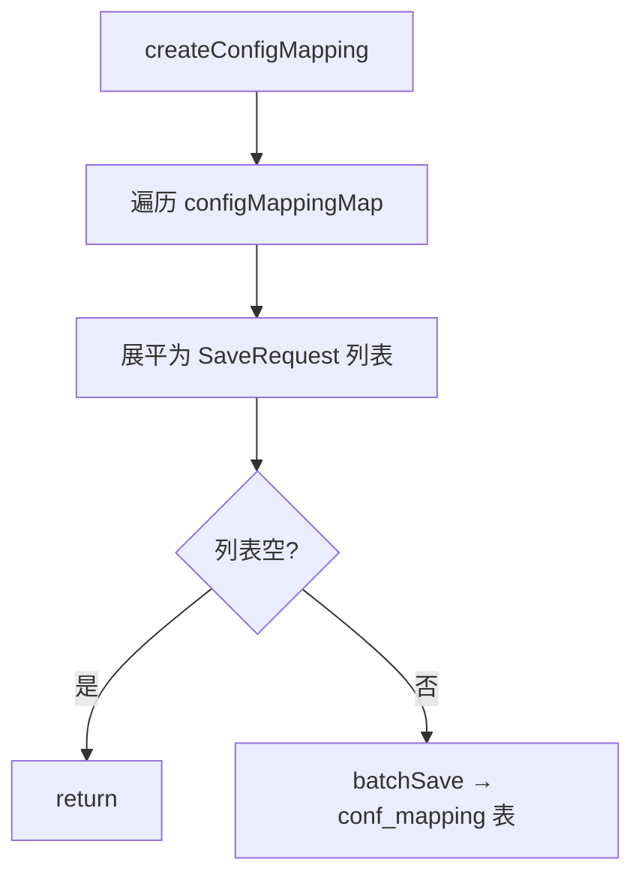

---

##### 4.5.4 ④ `adapterImportDataAndSendMsg`（`@Async` 入口）

| 项 | 说明 |
|---|---|
| **类** | `MigrationAssistantAdapterImportServiceImpl` |
| **注解** | `@Async`——调用返回即表示**已提交线程池**，不是 Adapter 做完 |
| **调用方入参** | `request`（已 `setTaskId`）+ 当前线程的 `User / Token / tenantId / orgId / productCode`（普通参数拷贝，因线程池不继承 ThreadLocal） |

**异步线程步骤：**

1. `UserContext / TenantIdContext / OrgContext / ProductCodeContext / TokenContext` ← 参数写回；  
2. `adapterImportData(request)`；  
3. 返回 `true` → `sendMqMsg(taskId)`；`false` → **不发 MQ**（无 else 日志以外的补偿）；  
4. `finally`：上述 Context **全部 set(null)**，防线程池串租户。

**未恢复的上下文：**

| Context | Adapter 是否 set | 影响 |
|---|---|---|
| user/token/tenant/org/productCode | 是 | 正常 |
| `ProductContext`（产品对象） | **否** | 后续 `createTaskContext` 里 `product` 可能为 null（见 4.5.6） |

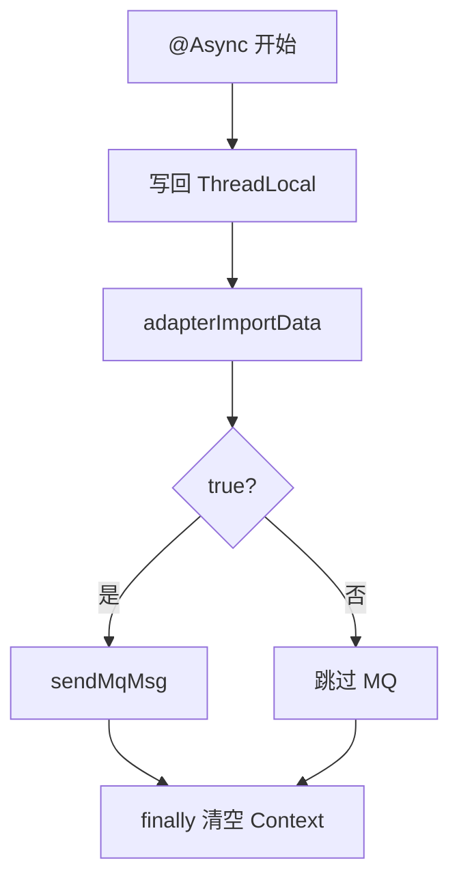

---

##### 4.5.5 ⑤ `adapterImportData`（适配核心全集）

> **类：** `com.glodon.gdmp.migrationassistant.service.impl.MigrationAssistantAdapterImportServiceImpl#adapterImportData`  
> 由 `adapterImportDataAndSendMsg` 在异步线程调用；返回 `boolean` → 决定是否 `sendMqMsg`。  
> **目录约定：** 本方法的全部子调用挂在 **4.5.5.x** 下，不再拆成与 4.5.5 平级的「⑥ adapter」一带而过。

###### 4.5.5.0 干什么 / 参数 / 主编排

| 项 | 说明 |
|---|---|
| **干什么** | 再校验互斥 → 重算解压目录写入 request → 调 `adapter` 改写包内 JSON |
| **解决什么问题** | 把「页面已落库的任务」与「目标库真实表结构」对齐；失败则任务 FAILURE 且上层不发 MQ |
| **入参** | `MigrationAssistantImportTaskImportRequest`（须已有 `taskId`、`batchNumber`、`originalFileName`、`managerId`、`sourceSystem`） |
| **返回** | `true`：适配完成；`false`：`adapter` 已标 FAILURE（或抛错被其吞掉后返回 false） |
| **源码三步** | ① `checkImportTask` → ② `getImportTaskLocalZipPathAndLocalUnzipPath` + `setLocalUnzipPath` → ③ `return adapter(request)` |

```java
// 源码骨架（MigrationAssistantAdapterImportServiceImpl）
checkImportTask(request);
Tuple2 zipUnzip = fileAnalyzeService.getImportTaskLocalZipPathAndLocalUnzipPath(
    AnalyzeRequest(batchNumber, originalFileName));
request.setLocalUnzipPath(zipUnzip._2);
return this.adapter(request);
```

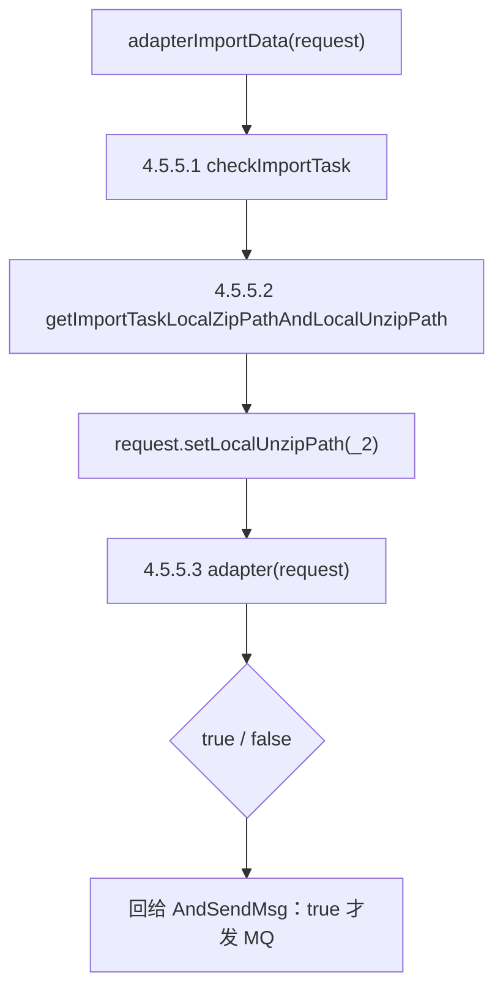

**子方法目录（全部在本节下）：**

| 小节 | 方法 | 作用 |
|---|---|---|
| [4.5.5.1](#4551-checkimporttask异步第二次) | `checkImportTask` | 异步侧再拦 EXECUTING |
| [4.5.5.2](#4552-getimporttasklocalzippathandlocalunzippath) | `getImportTaskLocalZipPathAndLocalUnzipPath` | 重算解压目录 |
| [4.5.5.3](#4553-adapter适配主编排--异常边界) | `adapter` | 适配主编排 + FAILURE 边界 |
| [4.5.5.3.1](#45531-initimportobjectcontext) | `initImportObjectContext` | 装规则元数据 Context |
| [4.5.5.3.2](#45532-handlerimportdata) | `handlerImportData` | 逐顶层：读→适配→backup→写回 |
| [4.5.5.3.3](#45533-readdatafromjsonfiletomap) | `readDataFromJsonFileToMap` | 扫全部顶层类型读 JSON |
| [4.5.5.3.4](#45534-getobjectlistfromjsonfilesource) | `getObjectListFromJsonFileSource` | 单文件读取 |
| [4.5.5.3.5](#45535-executerecord递归) | `executeRecord` | 递归适配；内含 **[recordHandler](#455351-再下钻-recordhandler)** |
| [4.5.5.3.6](#45536-checktableexist--querytables) | `checkTableExist` / `queryTables` | JDBC 元数据：表是否存在 |
| [4.5.5.3.7](#45537-gettargettablefieldmap--querycolumns--queryprimarykeys) | `getTargetTableFieldMap` / `queryColumns` / `queryPrimaryKeys` | JDBC 元数据：列与主键 |
| [4.5.5.3.8](#45538-backup-挪文件与写回) | backup + 写回 | 改磁盘 JSON |
| [4.5.5.3.9](#45539-失败落库--clearimportobjectcontext) | `updateImportTaskStatus` / `clearImportObjectContext` | 失败落库与清理 |

---

###### 4.5.5.1 `checkImportTask`（Adapter 线程里再调一次）

「第二次」不是指校验逻辑变了，而是指 **同一个方法在整条链路里会被调用两遍**：

| 次序 | 调用点 | 线程 | 文档位置 |
|---:|---|---|---|
| 第 1 次 | `createImportTask` 一进来 | **HTTP 请求线程**（同步） | [4.5.1](#451--checkimporttask) |
| 第 2 次 | `adapterImportData` 一进来 | **`@Async` 线程池**（异步） | **本节** |

两次都是同一实现：`importTaskCount(EXECUTING)`，`>0` 抛 `DATA_MIGRATION_TASK_EXECUTING`。  
第 2 次的用意：HTTP 返回后到 Adapter 真正跑起来之间可能隔一段时间，再拦一次「同组织是否已有执行中任务」，缩小并发窗口（仍不是 DB 锁，且仍只拦 status=1）。

若此处抛错：异常出 `adapterImportData`，`adapterImportDataAndSendMsg` **不会**把它写成任务 FAILURE（只在 `finally` 清 Context）；未捕获异常打在异步线程上，任务可能仍为 WAIT_EXECUTE(0)。  
（进入 `adapter` 之后失败，才会 `updateImportTaskStatus(FAILURE)`。）

---

###### 4.5.5.2 `getImportTaskLocalZipPathAndLocalUnzipPath`

| 项 | 说明 |
|---|---|
| **类** | `DataMigrationFileAnalyzeServiceImpl`（与 analyze 共用） |
| **入参拼装** | `MigrationAssistantFileAnalyzeFileRequest.builder().batchNumber(...).fileName(request.getOriginalFileName()).build()`——**只用 batch + 原文件名**，不传 useType/isIssue |
| **返回** | `_1` ZIP 路径；`_2` 解压目录（一般**无**尾斜杠） |
| **本处用法** | 只 `setLocalUnzipPath(_2)`；**不再解压、不删 ZIP**（analyze 阶段 ZIP 多半已删） |
| **与任务表差异** | `createTask` 写入的 `importFilePath` 常带尾 `/`；此处重算覆盖 request 字段，供 `adapter` 用；Consumer 读的是任务表路径 |

---

###### 4.5.5.3 `adapter`（适配主编排 + 异常边界）

| 项 | 说明 |
|---|---|
| **干什么** | `initImportObjectContext` → `setUnzipFilePath` → `handlerImportData` → `true`；任意异常 → FAILURE + `false` |
| **成功** | `handlerImportData` 跑完 → `return true`（上层发 MQ） |
| **失败** | `catch (Exception e)`：`BusinessException` → `failReason = e.getMessage()`，否则「适配导入数据失败」→ `dataMigrationImportTaskDao.updateImportTaskStatus(taskId, FAILURE, failReason)` → `return false`（**不发 MQ**） |
| **finally** | Context 非空 → `clearImportObjectContext` |

**这是发不发 MQ 的分界线。**

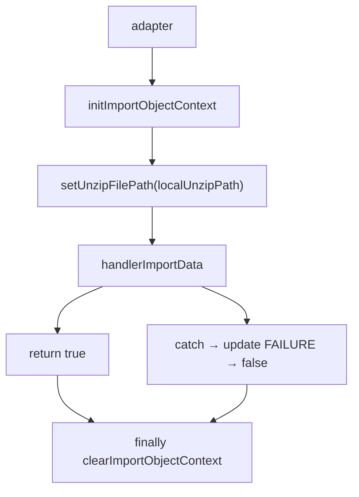

####### 4.5.5.3.1 `initImportObjectContext`

| 项 | 说明 |
|---|---|
| **类** | `DataMigrationObjectContextServiceImpl#initImportObjectContext` |
| **入参** | `request.managerId`、`request.sourceSystem` |
| **干什么** | 组装 `DataMigrationImportObjectContext`：运行时 Context JSON + 导入规则树 + 库表清单 |

**Context JSON（写入 `importObjectContext.context`）：**

| 键 | 来源 |
|---|---|
| `f_org_id` | `OrgContext.currentOrgId()`（异步线程已恢复） |
| `f_tenant_id` | `TenantIdContext` |
| `f_product` | `ProductCodeContext` |
| `f_manager_id` | 入参 managerId |
| `f_source_system` | 入参 sourceSystem |
| `f_record_creator_id` / `f_record_updater_id` | `UserContext.currentUser().getUserId()` |

**从治理库加载（DAO）：**

| 调用 | 用途 |
|---|---|
| `getObjectTypeList(IMPORT)` | 全量对象类型（含 dbName/tableName） |
| `getImportObjectRuleList` | 导入规则 |
| `getImportObjectRuleFieldList` | 规则字段 |
| `getImportObjectLocationRuleList` | 定位规则 |
| `dataMigrationImportBackupDao.getDbTableList` | 备份相关库表清单 → `tableListMap` |

**派生结构：**

| 字段 | 怎么来 |
|---|---|
| `topObjectTypeList` | `pid == null`，按 `order` 排序 |
| `objectTypeMap` | `typeName → ObjectTypeVO`（子类型递归靠它） |
| `importObjectRuleMap` / FieldMap / LocationRuleMap | 按 ruleId 索引 |
| `confMappingMap` | **`Maps.newHashMap()` 空 Map**——Adapter **不读**已落库的 conf_mapping |
| `objectTypeList` 等 | 全量列表原样放入 |

> Adapter **只改 JSON 字段形状**（对齐目标表列）；源→目标 ID 映射在 Consumer Init 用表数据。

####### 4.5.5.3.2 `handlerImportData`

| 项 | 说明 |
|---|---|
| **干什么** | `readDataFromJsonFileToMap` → 对每个顶层：空则 skip；否则 `executeRecord` → backup → 写回 |
| **写回体** | `new JSONObject(singletonMap(typeName, jsonArray))` 整文件覆盖 |
| **异常** | 文件 IO 失败见 [4.5.5.3.8](#45538-backup-挪文件与写回)；适配失败向上抛到 `adapter` catch |

```mermaid
flowchart TD
    H["handlerImportData"] --> R["readDataFromJsonFileToMap"]
    R --> F["forEach 每个顶层类型"]
    F --> E{array null/空?}
    E -- 是 --> SKIP["skip"]
    E -- 否 --> EX["executeRecord"]
    EX --> BK["move → backup/ + write 新 JSON"]
```

####### 4.5.5.3.3 `readDataFromJsonFileToMap`

| 项 | 说明 |
|---|---|
| **类** | `DataMigrationFileImportInitImpl` |
| **干什么** | 遍历 `topObjectTypeList`（**全部** `pid==null` 类型，按 order），逐个读文件 |
| **返回** | `Map<ObjectTypeVO, Tuple2<path, JSONArray>>`——**即使文件不存在也 put**（array 可为 null） |
| **path** | `{unzipFilePath}/{typeName}.json` |
| **与 analyze 差异** | analyze 只关心 section/biz/dw；此处含 paramDefine、auth、authority…凡顶层有文件都会进适配 |

####### 4.5.5.3.4 `getObjectListFromJsonFileSource`

| 项 | 说明 |
|---|---|
| **路径** | `{unzip}/{typeName}.json` |
| **不存在** | 返回 `null`（**不抛错**）；仍 `jsonArrayMap.put(objectTypeId, null)` |
| **存在** | `FileUtils.readJsonFile` → `JSON.parseObject` → `getJSONArray(typeName)` |
| **缓存** | `importObjectContext.jsonArrayMap` 按 objectTypeId 存一份 |

####### 4.5.5.3.5 `executeRecord`（递归）

| 项 | 说明 |
|---|---|
| **签名** | `executeRecord(JSONArray dataList, ObjectTypeVO type, ImportObjectContext ctx)` |
| **对数组每项** | 取 `record` → `checkTableExist` → `getTargetTableFieldMap` → **`recordHandler`（原地改，见下）** → 扫子 key |
| **子对象** | `jsonObject` 上 `key != "record"` 且 `objectTypeMap.get(key) != null` → 强制转 `JSONArray` 再递归 |
| **未知 key** | 规则树无此 typeName → **静默跳过** |
| **db/table** | 来自当前 `objectType.getDbName()` / `getTableName()`（规则四表 JOIN 结果） |

```mermaid
flowchart TD
    A["executeRecord(array, type)"] --> B["for i in array"]
    B --> C["record = json.record"]
    C --> D["checkTableExist"]
    D --> E["getTargetTableFieldMap"]
    E --> F["recordHandler 原地改<br/>见 4.5.5.3.5.1"]
    F --> G["for entry in json"]
    G --> H{key==record?}
    H -- 是 --> G
    H -- 否 --> I{objectTypeMap 有 key?}
    I -- 是 --> J["executeRecord 子数组"]
    I -- 否 --> G
    J --> G
```

**源码顺序（每条）：**

```
record = jsonObject.getJSONObject("record")
→ checkTableExist(dbName, tableName)
→ targetColumnMap = getTargetTableFieldMap(dbName, tableName)
→ recordHandler(record, targetColumnMap, objectType)   // 原地改 record
→ for (entry : jsonObject) 非 record 且类型树有 key → executeRecord(子数组, 子类型)
```

######## 4.5.5.3.5.1 再下钻：`recordHandler`

| 项 | 说明 |
|---|---|
| **类/方法** | `MigrationAssistantAdapterImportServiceImpl#recordHandler`（private） |
| **调用点** | **仅**由 `executeRecord` 调用；每条 record、每个对象类型（含递归子类型）各一次 |
| **干什么** | 按**目标表真实列**裁剪/校验包内 `record`，**原地**改写 JSONObject，供后续写回磁盘 |
| **解决什么问题** | 源包字段集合与目标版本表结构不一致（多列、缺主键、非空、业务字典） |
| **参数** | `record`（包内一行）、`targetColumnMap`（`getTargetTableFieldMap` 结果）、`objectType`（取 db/table/id） |
| **副作用** | 直接改传入的 `record`；不 return 新对象；失败抛 `DATA_MIGRATION_ADAPTER_IMPORT_DATA_FAILED`（操作描述 `CREATE`） |

**逐步逻辑（与源码一致）：**

| 步 | 代码意图 | 细节 |
|---:|---|---|
| 1 | 取列集合 | `originColumns = record.keySet()`（**Map 的 live view**）；`targetColumns = targetColumnMap.keySet()` |
| 2 | 删多余列 | `origin` 有、`target` 无 → `record.remove(column)`（先 `collect` 再删，避免 ConcurrentModification） |
| 3 | 拉业务字典 | `dictionaryService.queryBusinessTypeDictionaries(objectType.getId())` |
| 4 | 按目标列 forEach | 对 `targetColumnMap` 每个 `(columnName, column)` 做空值/主键/字典/重写 |

**步 4 单列判定：**

```mermaid
flowchart TD
    S["目标列 columnName"] --> V["originValue = record.get"]
    V --> M{"源无此列 或 value==null?"}
    M -- 是 --> PK{isPrimaryKey?}
    PK -- 是 --> E1["抛：主键为空或不存在"]
    PK -- 否 --> NN{!isNullable?}
    NN -- 是 --> E2["抛：字段空但目标非空"]
    NN -- 否 --> D0["可继续"]
    M -- 否 --> D0
    D0 --> SKIP{"isNullable && value==null?"}
    SKIP -- 是 --> NODICT["isNeedCheckBusinessTypeDict=false"]
    SKIP -- 否 --> DICT["isNeedCheckBusinessTypeDict=true"]
    NODICT --> RE["remove + put 同名同值"]
    DICT --> HAS{"字典非空 且 该列有允许集?"}
    HAS -- 是且值不在集 --> E3["log.error 整行 + 抛字典失败"]
    HAS -- 否或通过 --> RE
```

**异常文案模板（`String.format`）：**

| 场景 | message 要点 |
|---|---|
| 主键空/不存在 | `主键字段数据为空或字段不存在，数据库：%s，表：%s，字段名称：%s` |
| 非空约束 | `字段数据为空，在目标表中不为空，数据库：%s，表：%s，字段名称：%s` |
| 字典 | `当前业务数据不在指定的字典范围内…数据库/表/字段/对象类型id`（抛前 `log.error` 整行 `record`） |

**行为对照表：**

| 情况 | 行为 |
|---|---|
| 源多字段（目标无） | `remove`，不进目标库形状 |
| 缺主键 / 主键 null | 失败，整任务 Adapter FAILURE |
| 缺非空字段 / 值为 null | 失败 |
| 字段在字典有配置且值不在允许集 | 失败（`String.valueOf(originValue)` 比较） |
| 目标可空且 null | **`put(columnName, null)` 补齐目标可空列键**；跳过字典（非默认值填充） |
| 目标有、源有且非 null | 校验字典（若配置）后 `remove`+`put` 重写 |
| `Column.type` / `dataType` | **当前不转换类型**，只做存在性/空值/字典 |

**异常码：** 一律 `DATA_MIGRATION_ADAPTER_IMPORT_DATA_FAILED`（约 1130059，含「跨版本迁移」+ `OperateTypeEnum.CREATE`）→ `adapter` catch → 任务 FAILURE → **不发** Import MQ。

**读代码注意：**

1. `originColumns` 是 live `keySet()`：删多余列后，「源无此列」含「目标多、源本来没有」。  
2. 字典 Map 在 **forEach 每一列内部** 重新 `groupingBy`（源码现状）。  
3. 字典只约束出现过的业务字段名；该列无字典 → 放行。  
4. 与 analyze 字典校验不同：此处覆盖 **executeRecord 所有类型（含子类型）**，且先按真实表删列。  
5. **不做**源→目标 ID 映射（页面/§7 Init 的 conf_mapping + §6 引擎负责）。

####### 4.5.5.3.6 `checkTableExist` / `queryTables`

| 项 | 说明 |
|---|---|
| **干什么** | 确认目标库中存在规则指定的物理表，否则适配失败 |
| **DAO** | `DataMigrationImportTaskAdapterDao#queryTables(dbName)` |
| **实现细节** | `jdbcTemplateFactory.getJdbcTemplate(dbName)` → `DataSource.getConnection()` → `DatabaseMetaData.getTables(dbName, null, "%", {"TABLE"})` → 组装 `Table(name,type,comment)` |
| **DataSource null** | 返回 emptyList → 上层当「目标库下的表为空」失败 |
| **异常吞掉** | DAO catch 后打日志并 **return 已收集的 tables**（可能半截列表） |
| **上层判断** | tables 空 → 失败「目标库下的表为空」；`tableMap.get(tableName)==null` → 「表不存在」 |
| **异常码** | `DATA_MIGRATION_ADAPTER_IMPORT_DATA_FAILED`，操作描述 `OperateTypeEnum.CREATE` |

> **性能点：** 每条 record 都调一次 `queryTables(dbName)`，同库多行会重复拉全库表列表（源码现状，无缓存）。

####### 4.5.5.3.7 `getTargetTableFieldMap` / `queryColumns` / `queryPrimaryKeys`

| 项 | 说明 |
|---|---|
| **干什么** | 取目标表真实列元数据 → `Map<列名, Column>`（`LinkedHashMap`，重复列名保留后者） |
| **列空** | 抛 Adapter 失败「目标表中的字段为空」 |

**`queryColumns(dbName, tableName)`：**

1. 先 `queryPrimaryKeys`：`metaData.getPrimaryKeys(dbName, null, tableName)` → 主键列名 List；  
2. 再 `metaData.getColumns(dbName, null, tableName, "%")`；  
3. 每列组装 `Column`：`name, type, isNullable(YES?), comment, isPrimaryKey, ordinalPosition`；  
4. 按 `ordinalPosition` 排序返回。

**`Column` 字段用途（给 [recordHandler](#455351-再下钻-recordhandler)）：** `isPrimaryKey`、`isNullable`；`type`/`dataType` 当前 handler **未做类型转换**，只做存在性/空值/字典。

> 同样：每条 record 调一次 `queryColumns`（内含再查主键），无缓存。

####### 4.5.5.3.8 backup 挪文件与写回

对每个非空顶层（在 `handlerImportData` 内，`executeRecord` 之后）：

| 步骤 | 路径 / 动作 |
|---|---|
| 原文件 | `{unzip}/{typeName}.json` |
| 备份 | `{unzip}/backup/{typeName}.json`（常量 `BACKUP`） |
| 成功路径 | `FileUtils.moveFile(原→backup)` → `writeStringToFile(原, 新JSON, UTF-8)` |
| 失败路径 | `forceDeleteOnExit(原)` → `moveFile(backup→原)` 尝试恢复 → 抛「操作文件失败！」 |

**backup = Adapter 改写前的包内容，不是目标库备份。** Consumer 读的是改写后的原路径文件。

####### 4.5.5.3.9 失败落库 / `clearImportObjectContext`

**`updateImportTaskStatus(taskId, FAILURE, failReason)`**（`DataMigrationImportTaskDao`）：

```sql
UPDATE t_data_migration_import_task
SET f_status = ?, f_fail_reason = ?
WHERE f_id = ?
```

`batchUpdate` 一条；status 码来自 `DataMigrationTaskStatusEnum.FAILURE`。

**`clearImportObjectContext`：** 清空 `objectContextMap`、`objectTypeMap`、`confMappingMap`、规则 Map、`objectTypeList`、`context`、`objectIdRelMap`、`tableListMap`、`objectMap`、`jsonArrayMap`、`deleteObjectMap`、`redoCountMap` 等（部分 clear 调用重复，无功能影响）。  
**不删**磁盘解压目录 / backup 文件。

---

##### 4.5.6 ⑦ `sendMqMsg` / `createTaskContext`

仅当 Adapter 返回 true：

1. `MigrationAssistantImportTaskImportServiceImpl.sendMqMsg(taskId)`  
   → topic = `data-migration.import.task.mp.import-topic`（默认 `DATA-MIGRATION-IMPORT-TASK-TOPIC`）；  
2. `MigrationAssistantTaskServiceImpl.sendMqMsg(taskId, topic)`：  
   - `createTaskContext`：`taskId, appToken(现取), token, tenantId, orgId, user, productCode, product`；  
   - `JSON.toJSONString` → `Producer.send`；  
   - 失败抛 `MQ_MESSAGE_ERROR`。

**MQ 发送失败时：** 异步线程抛错；**当前代码未在此层把任务改 FAILURE**，任务可能仍停在 WAIT_EXECUTE(0)，需运维/重试关注。

**发成功之后：** 进入 **[§6 `DataMigrationTaskImportConsumer#process`](#6-datamigrationtaskimportconsumerprocessmq-消费后写库核心)**——backup → 分流 File/Issue → 真正写库。§4 只保证「消息发出」。

```mermaid
flowchart TD
    A["sendMqMsg(taskId)"] --> B["createTaskContext"]
    B --> C["Producer.send IMPORT topic"]
    C -- 成功 --> D["§6 Import Consumer"]
    C -- 失败 --> E["MQ_MESSAGE_ERROR<br/>任务未必改 FAILURE"]
```

---

##### 4.5.7 收口：调用关系 / 易漏细节

```mermaid
flowchart TB
    SVC["createImportTask"]
    SVC --> CHK["checkImportTask"]
    SVC --> CT["createTask/insert"]
    SVC --> CM["createConfigMapping/batchSave"]
    SVC --> AS["adapterImportDataAndSendMsg @Async"]

    AS --> AD["adapterImportData"]
    AD --> CHK2["checkImportTask 再一次"]
    AD --> PATH["getImportTaskLocalZipPathAndLocalUnzipPath"]
    AD --> ADP["adapter"]
    ADP --> CTX["initImportObjectContext"]
    ADP --> H["handlerImportData"]
    H --> R["readDataFromJsonFileToMap"]
    H --> EX["executeRecord 递归"]
    EX --> T["checkTableExist"]
    EX --> F["getTargetTableFieldMap"]
    EX --> RH["recordHandler"]
    H --> BK["move backup + write JSON"]
    AS --> MQ["sendMqMsg"]
    MQ --> CONS["§6 Consumer.process"]
```

| # | 细节 | 为何重要 |
|---:|---|---|
| 1 | Controller **不返回 taskId** | 页面靠 pageList/轮询认任务 |
| 2 | HTTP 成功 ≠ Adapter/MQ 成功 | 列表可能先见 status=0，再变 2/3 |
| 3 | 互斥只拦 EXECUTING | 可能并存多条 WAIT_EXECUTE |
| 4 | `insert` 名冲突：Issue 返回 null | 上层直接 return，无 mapping/Adapter |
| 5 | conf_mapping 空列表不 insert | 任务空映射 |
| 6 | Adapter 改的是**磁盘 JSON** | Consumer 读的是改写后文件；原件在 `backup/` |
| 7 | Adapter **不读** conf_mapping | ID 映射在 Init，不在 Adapter |
| 8 | 顶层缺文件 skip，不失败 | 与 analyze「映射只需部分类型」一致 |
| 9 | MQ 失败不一定 FAILURE | 可能卡在 0 |
| 10 | 路径尾斜杠 | 任务表带 `/`；Adapter 重算常不带 |

---

### 5. 列表 / 详情 / 报告（页面观察消费结果）

| 接口 | HTTP | 干什么 |
|---|---|---|
| `pageList` | `POST .../import/task/pageList` | 分页列表；创建后轮询 status |
| `detail` | `GET .../import/task/detail/{id}` | 任务基本信息 |
| `getImportReport` | `POST .../getImportReport` | 导入报告汇总 |
| `detailObjectList` | `POST .../detailObjectList` | 按对象类型明细 |
| `detailMappingList` | `POST .../detailMappingList` | 映射回看 |

> 实现均在 `MigrationAssistantImportTaskController` → 对应 TaskService。

---

### 6. `DataMigrationTaskImportConsumer#process`（MQ 消费后写库）★核心

> **类：** `com.glodon.gdmp.migrationassistant.consumer.DataMigrationTaskImportConsumer#process`  
> **订阅：** `getTopic()` → `data-migration.import.task.mp.import-topic`（默认 `DATA-MIGRATION-IMPORT-TASK-TOPIC`），与 §4.5.6 发送同一 Topic。  
> **目录约定：** `6.1～6.4` 写本入口；**全部子调用挂在 6.5**（含 File / Issue 两大引擎）。

#### 6.1 干什么

消费 Import MQ 消息后：恢复租户上下文 → 查任务 → **分流前 backup** → 按 name/`isIssue`/`useType` **二选一**进 **Issue（≈L80，下发）** 或 **File（≈L85，页面常规）** 的 `processImportTask`（同消息只进一支）→ 写业务库并更新 SUCCESS/FAILURE。

#### 6.2 解决什么问题

§4 HTTP/`@Async` 只完成「登记 + 适配 JSON + 发消息」；**业务数据写入、object_rel、redo/undo、后置 Feign** 全在本 Consumer。把重活与 HTTP 解耦，并让 File（页面常规迁入）与 Issue（下发/用途=1）共用入口与前置 backup。

#### 6.3 参数 / 消息体

| 项 | 说明 |
|---|---|
| 入参 | `ConsumeMessage` → `getValueAsObject(DataMigrationTaskContext.class)` |
| 消息字段 | `taskId, token, appToken, tenantId, orgId, user, productCode, product`（见 §4.5.6 `createTaskContext`） |
| 任务再读 | `DataMigrationImportTaskDao.getDataMigrationImportTask(taskId)` → 用库中最新 `name/useType/isIssue/importFilePath/...` |
| 实现接口 | `MessageListener`：`getId/getTag` 返回 null |

#### 6.4 流程图（Consumer 总览）

```mermaid
flowchart TD
    A["process(ConsumeMessage)"] --> B["反序列化 DataMigrationTaskContext"]
    B --> C["TokenContext.set(token)"]
    C --> D["getDataMigrationImportTask(taskId)"]
    D --> E["★ backup(task) 分流前"]
    E --> F{"name 含 -issue<br/>或 isIssue<br/>或 useType==1 ?"}
    F -- 是 --> G["IssueObjectContext.setThreadContext"]
    G --> H["IssueImportService.processImportTask"]
    F -- 否 --> I["ObjectContext.setThreadContext"]
    I --> J["FileImportService.processImportTask"]
    H --> K["写库 / SUCCESS|FAILURE"]
    J --> K
```

```mermaid
sequenceDiagram
    autonumber
    participant MQ as IMPORT Topic
    participant C as ImportConsumer
    participant Bak as IssueImportBackupService
    participant Meta as 治理库
    participant Prep as gdmp_prepare
    participant File as FileImportService
    participant Issue as IssueImportService

    MQ->>C: process(msg)
    C->>C: TokenContext.set
    C->>Meta: getDataMigrationImportTask
    C->>Bak: backup(task)
    Bak->>Meta: getObjectTypeList(IMPORT)
    Bak->>Prep: SELECT 五类标准模型 by orgId
    Bak->>Meta: INSERT t_data_migration_import_task_backup
    alt Issue 路由
        C->>Issue: setThreadContext + processImportTask
    else File 路由
        C->>File: setThreadContext + processImportTask
    end
```

#### 6.5 子方法（按调用顺序）

| 序号 | 小节 | 方法 | 作用 |
|---:|---|---|---|
| ① | 6.5.1 | 反序列化 / `TokenContext` | 拿到 taskId，先挂 token |
| ② | 6.5.2 | `getDataMigrationImportTask` | 读任务行 |
| ③ | 6.5.3 | `backup` | 分流前标准模型快照 |
| ④ | 6.5.4 | 路由判断 | File vs Issue |
| ⑤ | 6.5.5 | `setThreadContext` | 恢复全套 ThreadLocal |
| ⑥ | 6.5.6 | **File `processImportTask` + `service/file`·fileimport** | InitPre×3 / Pre×3 / Post×19 + 手动回滚 |
| ⑦ | 6.5.7 | **Issue `processImportTask` + `service/issue` 全集** | 下发/用途=1：步骤服务 + Pre×3 + Post×16 + 回滚 API |
| — | 6.5.8 | 异常边界 / 与 §4 衔接 | 收口 |

---

##### 6.5.1 反序列化与 `TokenContext`

| 项 | 说明 |
|---|---|
| **干什么** | `consumeMessage.getValueAsObject(DataMigrationTaskContext.class)`；`TokenContext.set(context.getToken())`；打日志 |
| **解决什么问题** | 后续查任务 / 用户名等可能依赖 token；完整上下文在分流后 `setThreadContext` 再补齐 |
| **注意** | 此处**只** set Token，未 set org/tenant/user；backup 用的是任务 VO 上的 `orgId`，不依赖 OrgContext |

---

##### 6.5.2 `getDataMigrationImportTask`

| 项 | 说明 |
|---|---|
| **类** | `DataMigrationImportTaskDao` |
| **干什么** | 按 `taskId` 读 `t_data_migration_import_task` |
| **后续用到的字段** | `name`（路由）、`useType`、`isIssue`、`orgId`（backup）、`importFilePath`（引擎读 JSON）等 |
| **若 null** | 源码无显式判空，后续 NPE（异常上抛给 MQ 框架） |

---

##### 6.5.3 ③ `backup`（分流前，File/Issue 共用）

| 项 | 说明 |
|---|---|
| **接口** | `IDataMigrationIssueImportBackupService#backup` |
| **实现** | `DataMigrationIssueImportBackupServiceImpl#backup`（虽在 issue 包，**两条引擎都会跑**） |
| **干什么** | 把当前组织下**五类标准模型**现网数据打成可回放 `INSERT`，写入治理库备份表 |
| **解决什么问题** | 迁入可能改标准模型相关数据前留快照（与 Adapter 磁盘 `backup/`、File 引擎内 `makeBackup` **不是同一条链**） |

**调用树：**

```
backup(task)
→ getObjectTypeList(IMPORT) → Map<typeName, ObjectTypeVO>
→ for 五个 typeName:
     generateQuerySql → SELECT * FROM {db}.{table} WHERE f_org_id = {orgId}
     queryTargetData(dbName, sql)
     generateExecuteStatementList → INSERT 语句（每 100 行一条；排除 4 个时间戳列）
→ saveBackupData → INSERT t_data_migration_import_task_backup
```

**固定五类 typeName（硬编码列表）：**

| typeName | 典型物理表（gdmp_prepare） |
|---|---|
| `standardModelClass` | `t_standard_model_class` |
| `standardModelLevel` | `t_standard_model_level` |
| `standardModelSchedule` | `t_standard_model_schedule` |
| `standardModelClassModelLevel` | `t_standard_model_class_model_level` |
| `standardModelLevelNameRule` | `t_standard_model_level_name_rule` |

**落库：** `gdmp_governance.t_data_migration_import_task_backup`（`f_task_id, f_object_type_id, f_database_name, f_table_name, f_execute_statement, ...`）。

```mermaid
flowchart TD
    A["backup(task)"] --> B["getObjectTypeList IMPORT"]
    B --> C["×5 typeName"]
    C --> D["SELECT * by orgId"]
    D --> E["拼 INSERT 语句"]
    E --> F["saveBackupData"]
    F --> G["t_data_migration_import_task_backup"]
```

**失败与边界：**

| 场景 | 行为 |
|---|---|
| 查目标库失败 | 抛业务异常；**Consumer 无 try/catch** → 分流与 `processImportTask` **不执行** |
| 五类皆无数据 | `saveBackupData` 空列表直接 return |
| 配置缺 typeName | `objectTypeMap.get` 可能 NPE |
| 任务状态 | 尚未 `checkImportTask`，失败时任务多半仍 `WAIT_EXECUTE(0)` |
| 是否有自动恢复读此表 | **当前代码未见**按 backup 表回放的恢复路径；Issue/File 回滚各走 undo |

> 查询 SQL **只按 `f_org_id`**，不过滤 tenant / is_deleted。

---

##### 6.5.4 ④ File / Issue 路由（**二选一**，同一次消费只进一支）

源码：`DataMigrationTaskImportConsumer#process`（backup 之后）。**同一条 MQ 消息只会走 if 或 else，不会两支都跑。**

```java
// …backup 已执行（两支共用）…
if (taskName.contains("-issue") || isIssue || useType == 1) {
    // L80：下发 / Issue 引擎 → §6.5.7
    dataMigrationIssueObjectContextService.setThreadContext(context);
    dataMigrationIssueImportService.processImportTask(taskId);
} else {
    // L85：页面常规 File 引擎 → §6.5.6
    dataMigrationObjectContextService.setThreadContext(context);
    dataMigrationFileImportService.processImportTask(taskId);
}
```

| 条件（任一成立 → **L80 Issue**） | 含义 |
|---|---|
| `name` 含 `"-issue"` | 下发任务命名约定 |
| `isIssue == true` | 建任务时显式下发标记（Init Receive 常 true） |
| `useType == 1` | 「导入原因」等用途=1——**页面常规包也可能进 Issue** |

**三条件都不成立 → L85 File。**

```mermaid
flowchart TD
    BAK["backup 共用 §6.5.3<br/>类在 issue 包"] --> Q{"name 含 -issue<br/>或 isIssue<br/>或 useType==1 ?"}
    Q -->|是 · L80| I["【下发 Issue】§6.5.7<br/>service/issue/**"]
    Q -->|否 · L85| F["【页面常规】§6.5.6<br/>service/file/fileimport/**"]
    I -.->|互斥| F
    F -.->|互斥| I
    TOOL["service/file 工具层<br/>Resource / Obs"] -.->|两边 Post 可调| I
    TOOL -.->|两边 Post 可调| F
    SHARE["分流前：Analyze / Adapter /<br/>ObjectContext#initImport…"] -.->|已在 §1/§4 跑完| BAK
```

| 分支 | Consumer 行 | 入口方法 | 文档 |
|---|---|---|---|
| **下发 Issue** | **约 L80** | `IDataMigrationIssueImportService#processImportTask` | **§6.5.7** |
| **页面常规 File** | **约 L85** | `IDataMigrationFileImportService#processImportTask`（**`fileimport`**） | **§6.5.6** |

**包归属图（`service/file` ≠ 整包仅 L85）：**

```mermaid
flowchart TB
    subgraph SF["com…migrationassistant.service.file"]
        subgraph SHARED["分流前 / 工具 · 非 L85 专属"]
            AN["impl Analyze<br/>analyze + Adapter 取路径"]
            CTX["impl ObjectContext<br/>Adapter initImport… 共用<br/>L85 才 setThreadContext"]
            RES["Resource / Obs<br/>File·Issue·Export 可调"]
        end
        subgraph FI["fileimport/** · 主要 = Consumer L85"]
            ENG["FileImportService#processImportTask"]
            PRE["Init / Pre / Exec / Post×19"]
            ENG --> PRE
        end
        subgraph FX["fileexport/** · 迁出另链"]
            EXP["Export 引擎<br/>→ export-callchain"]
        end
    end
    subgraph SI["service/issue/** · Consumer L80"]
        ISS["IssueImportService + Pre/Post"]
    end
    AN --> ADAPTER["§4 Adapter"]
    ADAPTER --> MQ["IMPORT MQ"]
    MQ --> L85["L85 → fileimport"]
    MQ --> L80["L80 → issue"]
    RES -.-> PRE
    RES -.-> ISS
    CTX -->|L85| ENG
```

**归属速查（还有哪些要区分 / 哪些其实共用）：**

| 归属 | 包或能力 | 说明 |
|---|---|---|
| **共用（分流前）** | `IssueImportBackupService#backup` | 类在 **issue 包**，但 **File/Issue 都会跑**；勿当成「仅下发」 |
| **共用（建任务后）** | Adapter、`sendMqMsg`、IMPORT Topic、§0～§4 HTTP | 页面与 Init 都合流；**尚未**分 File/Issue |
| **共用（在 file 包但非仅 L85）** | `Analyze`、`ObjectContext#initImportObjectContext`、`Resource`/`Obs` | 见上图「工具/分流前」 |
| **仅 File · L85** | **`fileimport/**`**：Init / InitPre / recordfind / Exec / Pre×3 / Post×19 / `rollBackUseUndo` | §6.5.6；`import_object_rule*`；`import_redo`/`import_undo` |
| **仅 Issue · L80** | `service/issue/impl/*` + preprocessor + postprocessor | §6.5.7；`issue_object_rule`；`issue_redo`/`issue_undo` |
| **仅下发汇入（更早）** | Receive、INIT Topic、`issue_init_info` | §7 → 之后仍走 L80 |
| **回滚 API 分开** | File / Issue 各一 Controller | 勿混用 |
| **迁出** | `fileexport/**` | [export-callchain.md](./export-callchain.md) |

> **最易混：** ① backup 在 issue 包却共用；② **`service/file` 整包 ≠ L85**（L85 核心是 **`fileimport`**）；③ 页面 `useType==1`/`isIssue` 也会进 L80；④ 两套 Pre/Post 包路径不同。

---

##### 6.5.5 ⑤ `setThreadContext`（随路由二选一，各调各的）

| 引擎 | Consumer | 类 |
|---|---|---|
| **Issue（下发）** | L80 前 | `DataMigrationIssueObjectContextServiceImpl#setThreadContext` |
| **File（常规）** | L85 前 | `DataMigrationObjectContextServiceImpl#setThreadContext` |

**写入 ThreadLocal：** `AppTokenContext, TokenContext, TenantIdContext, OrgContext, UserContext, ProductCodeContext, ProductContext`（用消息里的 `product` 对象——§4 Adapter 线程可能未 set Product，消息里 product 可能为 null）。

---

##### 6.5.6 ⑥ 【页面常规 File 分支】引擎全集（Consumer **L85** · 核心包 **`fileimport`**）

> **仅当** §6.5.4 路由为 File（`name` 不含 `-issue` 且 `isIssue≠true` 且 `useType≠1`）时进入。  
> **与 §6.5.7 互斥：** 同一次消费 **不会**再调 Issue `processImportTask`（L80）。  
> **主编排：** `DataMigrationFileImportServiceImpl#processImportTask`（Consumer L85）。  
> **本节展开的是 `service/file/fileimport/**`**（Init/Pre/Exec/Post…）。同级的 `Analyze` / Adapter 用的 Context / `Resource`·`Obs` **不是「仅 L85」**（见 [§6.5.4 包归属图](#654--file--issue-路由二选一同一次消费只进一支)）；`fileexport` 不在本文。  
> **前提：** 已 `backup`；磁盘为 Adapter 后 JSON。下发见 **§6.5.7**。

###### 6.5.6.0 干什么 / 问题 / 总流程

| 项 | 说明 |
|---|---|
| **干什么** | 抢占 EXECUTING → 装 Context → Init（含 InitPre）→ Pre×3 → 生成 redo/undo → preImport/校验 → executeRedo → Post×19 → SUCCESS；失败 undo 后 FAILURE |
| **解决什么问题** | 把映射后的包变成可审计、可部分回滚的业务库变更 |
| **不做的** | OBS 下载/解压、`makeBackup`（源码已注释）；文件来自 analyze 目录 |

```text
DataMigrationTaskImportConsumer#process
├─ backup（共用）
└─ else【页面常规 File · L85】※ 与 L80 Issue 二选一
   ├─ FileObjectContext#setThreadContext
   └─ FileImportService#processImportTask
      ├─ checkImportTask
      ├─ ObjectContext#getImportObjectContext
      ├─ Init#initDataFromJsonFile → InitPre×3 + recordfind×3
      ├─ preProcess → Pre×3
      ├─ Exec#importDataFromJsonFile → save redo/undo
      ├─ PreImport / DataCheck
      └─ try
         ├─ executeRedoSql → updateImportRecordCount(REDO)
         ├─ checkImportData
         ├─ postProcess → Post×19（含 ModelCommit，有 @Service）
         └─ task SUCCESS
      catch 内 → rollBackUseUndo(taskId,false) → rethrow
      catch 外 → task FAILURE
      finally → 删目录 + clearImportObjectContext

独立 HTTP（非 MQ）：
ImportTaskController#rollback → rollBackUseUndo(taskId,true)   §6.5.6.8
ImportTaskController#clear → clearImportData                   §6.5.6.9
```

```mermaid
flowchart TD
    Q{"§6.5.4 路由"} -->|否·L85| A["【fileimport】processImportTask"]
    Q -->|是·L80| X["【issue】§6.5.7<br/>本消息不到此节"]
    NOTE["Analyze/Adapter/Resource<br/>不在本图实线内<br/>见 §6.5.4 包归属"] -.-> A
    A --> B["checkImportTask → EXECUTING"]
    B --> C["getImportObjectContext<br/>加载 conf_mapping"]
    C --> D["initDataFromJsonFile<br/>InitPre×3"]
    D --> E["preProcess Pre×3"]
    E --> F["importDataFromJsonFile Exec<br/>生成 redo/undo"]
    F --> G["preImport / checkPreImport"]
    G --> H{"内层 try"}
    H --> I["executeRedoSql"]
    I --> J["updateImportRecordCount REDO"]
    J --> K["checkImportData"]
    K --> L["postProcess Post×19"]
    L --> M["update SUCCESS"]
    I -->|异常| U["rollBackUseUndo"]
    J -->|异常| U
    K -->|异常| U
    L -->|异常| U
    U --> R["rethrow"]
    B -->|异常| FAI["外层 FAILURE"]
    C -->|异常| FAI
    D -->|异常| FAI
    E -->|异常| FAI
    F -->|异常| FAI
    R --> FAI
    M --> FIN["finally 删目录+clearContext"]
    FAI --> FIN
```

**已注释、主流程未执行：** `ZipFileImpl`（OBS 下载/解压）、`BackupProcessorImpl#makeBackup`；旧 `rollBack(backupZip)` + `RollbackPostProcess` 已换成 `rollBackUseUndo`。

###### 6.5.6.1 `checkImportTask`（File 私有）

| 项 | 说明 |
|---|---|
| **干什么** | `countExecutedTask(taskId)`：`status != 0` 且未删 → 已执行过则 `DATA_MIGRATION_TASK_EXECUTED`；否则 `updateImportTaskStatus(EXECUTING)` |
| **意义** | **任务级 EXECUTING 的正常入口**（与 §4 只拦「同组织有无 EXECUTING」不同，这里按 **本 taskId**） |

###### 6.5.6.2 `getImportObjectContext`

| 项 | 说明 |
|---|---|
| **类** | `DataMigrationObjectContextServiceImpl#getImportObjectContext(taskId)` |
| **干什么** | 装任务 VO、Context JSON、IMPORT 对象类型树/规则/定位规则、**`getTaskConfMappingList` → confMappingMap**、tableListMap |
| **与 Adapter `initImportObjectContext` 差异** | Adapter 用 managerId/sourceSystem 且 **confMapping 空**；此处从**任务表+映射表**装全量，供 Init/Exec 做 ID 换算 |

**conf_mapping 时间线：**

```mermaid
flowchart LR
    P["页面 createImportTask<br/>写入 conf_mapping"] --> C["getImportObjectContext 读入 Map"]
    C --> I["Init：绑 targetId / 可补 SECTION"]
    I --> E["Exec：confMapping 对象不生成 SQL"]
    E --> T["Post：换数据源等"]
```

###### 6.5.6.3 `initDataFromJsonFile`（Init 深钻：只决策不写业务库）

| 项 | 说明 |
|---|---|
| **类** | `DataMigrationFileImportInitImpl#initDataFromJsonFile` |
| **干什么** | 读 JSON → 定 ADD/UPDATE/待删 → 写 `object_rel` + Context Map |
| **不做** | 不执行业务 INSERT/UPDATE；不生成 redo |

**Context 副作用：**

| Map / 字段 | 读写 |
|---|---|
| `unzipFilePath` | ← `task.importFilePath` |
| `objectMap` / `jsonArrayMap` | 缓存行与 `JSONArray` |
| `objectIdRelMap` | `sourceObjectId → record`（含 `*_targetmapping`、`updateFlag`、`targetRecord`） |
| `deleteObjectMap` | 目标有、源包无（`isAutoDelete`） |
| `confMappingMap` | InitPre(SECTION) 可追加并 `batchSave` |
| `taskObjectRelList` | 每类型 save 后 clear |

```text
initDataFromJsonFile
├─ for topObjectType:
│  ├─ getObjectListFromJsonFile（SECTION → ModelObjectBuild）
│  ├─ createTaskObjectRelByJsonArr ★递归
│  │  ├─ getTargetJSONObjectList
│  │  ├─ initPreProcess → InitPre×3
│  │  ├─ getObjectOperFlag → Finder×3
│  │  ├─ createTaskObjectRel | updateTaskObjectRel
│  │  ├─ 递归子类型
│  │  ├─ initPostProcess（无 Bean）
│  │  └─ deleteObjectMap（isAutoDelete）
│  └─ saveImportTaskObjectRelList
└─ 失败 → DATA_MIGRATION_JSON_FILE_INIT_ERROR
```

###### 6.5.6.3.1 `getObjectOperFlag` 决策表

| 条件 | 结果 |
|---|---|
| 父 `record` 无 `updateFlag`（父 ADD） | **子强制 ADD**；`getTargetJSONObjectList`→empty |
| `targetJSONObjectList` 空 / `locationRule==null` | `addFlag=true` → ADD |
| `importObjectRule.isConfMappingObject` | 按 `confMappingMap` 绑 `targetRecord`；**默认不设 addFlag** → 走 UPDATE 路径；目标空则**静默跳过不写 rel** |
| 否则 Primary → Union → Business | 任一 `isFound` → UPDATE（用 Finder 的 `updateFlag`/`targetRecord`） |
| 三者皆未命中 | `addFlag=true` → ADD |
| `pid!=null && isAutoDelete` | 目标有源无 → `deleteObjectMap` |

```mermaid
flowchart TD
    A["getObjectOperFlag"] --> B{"父 ADD / 目标空 / 无定位?"}
    B -- 是 --> ADD["addFlag=true"]
    B -- 否 --> C{"isConfMappingObject?"}
    C -- 是 --> CM["绑 targetRecord<br/>addFlag 仍 false"]
    C -- 否 --> P["PrimaryKeyFinder"]
    P -->|未命中| U["UnionKeyFinder"]
    U -->|未命中| K["BusinessKeyFinder"]
    K -->|未命中| ADD
    P -->|命中| UPD["UPDATE"]
    U -->|命中| UPD
    K -->|命中| UPD
    CM --> UPD2["updateTaskObjectRel<br/>target空则跳过"]
    ADD --> CR["createTaskObjectRel"]
```

###### 6.5.6.3.2 Finder×3（`fileimport/impl/recordfind`）

| Finder | 前提 | 怎么命中 | updateFlag |
|---|---|---|---|
| `PrimaryKeyFinder` | `primaryKeyRule` 非空 | 历史 `object_rel` 的 `targetObjectId` ∈ 现活目标行同 PK | `locationRule.isPrimaryMappingUpdate`（可为 false＝只建映射不改行） |
| `UnionKeyFinder` | `unionKeyRule` 逗号字段拼 `v1_v2_…` | 历史 union 映射与目标现活 union **equalsIgnoreCase** | **恒 true** |
| `BusinessKeyFinder` | `businessKeyRule`；支持 `field=expr` | **内存**比对目标列表；`${businessKeyCaseSensitive}` 控制大小写；双方皆空算匹配 | **恒 true** |

###### 6.5.6.3.3 `create/updateTaskObjectRel` 写什么

- 引用字段 `isRefField`：ADD→`DataMigrationIDGenerator`；UPDATE→从 `targetRecord` 拷 `{field}_targetmapping`
- 主键：ADD 非 conf→`getSequenceValue`；conf→`confMapping.targetId`
- record 上：`{pk}_targetmapping`、`updateFlag`/`targetRecord`（仅 UPDATE）
- rel：`status=EXECUTING`；`ADD|UPDATE`

###### 6.5.6.3.4 InitPre×3

| order | 类 | 逻辑 |
|---:|---|---|
| 1 | `…InitConfMappingPreProcessor`（SECTION） | 源 SECTION 无映射时，用已映射工程的 `f_biz_section_id` 反推目标板块 → `batchSaveConfMapping`；失败 `DATA_MIGRATION_MAPPING_PROJECT_NULL` / `MAPPING_CONFIG_ERROR` |
| 2 | `…InitModelPreProcessor`（MODEL） | `f_wait_commit_model_version_id` ← `f_commit_model_version_id` |
| 3 | `…InitModelViewPreProcessor`（VIEW） | `f_wait_commit_view_version_id` ← `f_commit_view_version_id` |

**Init 失败：** 外层 FAILURE；**尚未 executeRedo → 不 undo**。

###### 6.5.6.4 `preProcess` → Pre×3 / Exec 深钻

| 方法 | 干什么 |
|---|---|
| `preProcess` | Pre×3 按 order（生成 SQL 前改 Context / 校验） |
| `importDataFromJsonFile` | `DataMigrationFileImportExecImpl`：拼 redo/undo **并落库**；仍不执行业务 SQL |

**Pre×3（`fileimport/impl/preprocessor`，同目录方法已对照源码）：**

| order | 类 | 方法 | 深钻 |
|---:|---|---|---|
| 1 | `…ModelPreProcessor` | `preProcess` **空**（原逻辑整段注释） | **.4.0.1** |
| 2 | `…DataAssetCataloguingVersionPreProcessor` | `preProcess`：三张编目表统一新 `f_version_id` | **.4.0.2** |
| 3 | `…DataServicePreProcessor` | **`preProcess`**：遍历 JSON 树 → `checkApiPathBatch` | **.4.0.3** |

####### 6.5.6.4.0.1 ModelPre（order=1，空跑）

| 项 | 说明 |
|---|---|
| **类** | `DataMigrationFileImportModelPreProcessor` |
| **入口** | `preProcess(ctx)`——方法体整段注释，**无副作用** |
| **原设计（死代码）** | 读 MODEL 缓存，把 `f_wait_commit_model_version_id` 换成 `f_commit_model_version_id` 后写回 `objectIdRelMap` |

####### 6.5.6.4.0.2 DataAssetCataloguingVersionPre（order=2）

| 项 | 说明 |
|---|---|
| **类** | `DataMigrationFileImportDataAssetCataloguingVersionPreProcessor` |
| **干什么** | 一次 `IdGenerator.nextId()`，刷到编目 / BASIC / DETAIL 三张缓存的 `f_version_id` |
| **写回** | `objectIdRelMap` 对应三枚举 key；失败 throw `BusinessException` |

```text
preProcess
├─ versionId = IdGenerator.nextId()
├─ CATALOGUE 非空 → 每行 put f_version_id → put 回 objectIdRelMap
├─ CATALOGUE_DATA_BASIC 同上
└─ CATALOGUE_DATA_DETAIL 同上
```

####### 6.5.6.4.0.3 DataServicePre（order=3）——`#preProcess`

| 项 | 说明 |
|---|---|
| **类** | `DataMigrationFileImportDataServicePreProcessor` |
| **干什么** | 从 `jsonArrayMap` 按 SECTION→PROJECT→API_GROUP→API_DEFINITION→API 下钻，收集路径校验请求，批量 Feign 校验目标环境 API 路径是否冲突 |
| **解决什么问题** | 迁入前发现 namespace+path 与目标已有 API 冲突（更新场景带 `apiDefinitionId` 排除自身） |
| **参数** | `importObjectContext`（主要读 `jsonArrayMap`，不改 `objectIdRelMap`） |
| **Feign** | `DataServiceApiFeignClient#checkApiPathBatch(List<ApiPathCheckRequest>)` |
| **异常** | 内层 `PARAM_ERROR`（单 definition 下 API 数≠1）；外层 catch 包装「数据服务前置任务处理失败」再抛 |

```text
preProcess
├─ jsonArrayMap 空 / 无 SECTION → return
└─ for section → for project → for apiGroup → for apiDefinition
   ├─ 缺下级 key → continue（外层）或 return（见 quirks）
   ├─ per API under definition
   │  ├─ apis 空或 size>1 → throw PARAM_ERROR（打 definition JSON）
   │  ├─ record = apis[0].record
   │  ├─ updateFlag==true → apiDefinitionId = targetRecord.f_api_definition_id
   │  │                    （否则 apiDefinitionId=null，按新建校验）
   │  └─ ApiPathCheckRequest{apiDefinitionId, f_api_req_namespace, f_api_req_path}
   └─ checkRequests 非空 → checkApiPathBatch(checkRequests)
```

```mermaid
flowchart TD
    A["DataServicePre.preProcess"] --> B{"jsonArrayMap 有 SECTION?"}
    B -- 否 --> Z["return"]
    B -- 是 --> C["下钻 PROJECT→GROUP→DEFINITION→API"]
    C --> D{"apis.size==1?"}
    D -- 否 --> E["PARAM_ERROR"]
    D -- 是 --> F["拼 ApiPathCheckRequest"]
    F --> G{"updateFlag?"}
    G -- 是 --> H["带目标 apiDefinitionId"]
    G -- 否 --> I["apiDefinitionId=null"]
    H --> J["checkApiPathBatch"]
    I --> J
```

**quirks：**

1. 内层多处 `CollectionUtils.isEmpty(…) return`（如某 project 无 groups、某 group 无 definitions）会 **直接结束整个 `preProcess`**，后续 section/project 不再校验——应用 `continue` 更合理。  
2. 类内留有 `main` 本地拼 JSON 调试，运行时无用。  
3. 校验失败依赖 Feign/`resolveResp` 抛错；成功不改 Context，仅挡掉冲突路径。

###### 6.5.6.4.1 `createRedoByRule` 决策

```text
importDataFromJsonFile
├─ createRedoSqlFromJsonArray（递归 JSON 树）
│  └─ createRedoByRule
│     ├─ isConfMappingObject → 跳过 SQL；object_rel→SUCCESS
│     ├─ contains updateFlag
│     │  ├─ true → UPDATE redo + 快照 undo
│     │  └─ false → 不生成 redo（仅映射）
│     └─ 无 updateFlag → INSERT redo + DELETE undo
├─ createDeleteRedo ← deleteObjectMap
└─ saveRedoList + undoService.saveOrUpdateBatch
```

| 条件 | 行为 |
|---|---|
| `isConfMappingObject` | **不生成 SQL** |
| `updateFlag==true` | `UPDATE … WHERE pk=targetPk` + undo（执行前快照） |
| `updateFlag==false` | 不生成 redo |
| 无 `updateFlag` | INSERT + undo=`DELETE WHERE pk=` |
| `isPhysicalDelete` | redo 物理 DELETE；undo 拼 INSERT 还原 |
| 逻辑删（默认） | `SET f_is_deleted=1`（或规则 `isDeleteField`）；undo 置 0 |

**UPDATE 跳过：** `f_global_id*`、`f_resource_file_id*`、`*_targetmapping`、`updateFlag`、`targetRecord`、主键、审计列、`excludeUpdateFields`。  
**INSERT 强制 Context：** `f_org_id` / `f_tenant_id` / `f_product` / creator/updater。

###### 6.5.6.4.2 `getMappingTargetValue`（`targetMappingField`）

| 前缀 | 语义 |
|---|---|
| `rel.{type}` / `rel.{type}.{field}` | `objectIdRelMap` 源→目标 |
| `rel.all.{group}` | 组内轮询先命中 |
| `mapping.{type}` / `mapping.?.{group}` | `confMappingMap` source→target |
| `self.{field}` / `context.{field}` | 本行 / Context |
| 无 `.` | 常量 |
| 映射空 | `DATA_MIGRATION_FIELD_MAPPING_NOT_FOUND` |
| 规则非法 | `DATA_MIGRATION_IMPORT_RULE_FIELD_ERROR` |

有 `unionKeyRule` 时 `updateIdRelUnionId` → `updateImportTaskObjectRelUnionKey`。

```mermaid
flowchart TD
    A["importDataFromJsonFile"] --> B["createRedoSqlFromJsonArray"]
    B --> C{"confMapping?"}
    C -->|是| SKIP["跳过 SQL"]
    C -->|否| D{"updateFlag?"}
    D -->|true| U["UPDATE+undo"]
    D -->|false| N["不生成 redo"]
    D -->|无| I["INSERT+DELETE undo"]
    U --> M["getMappingTargetValue"]
    I --> M
    A --> DEL["createDeleteRedo"]
    DEL --> SAVE["save redo/undo"]
```

###### 6.5.6.5 `preImport` / `checkPreImportData`

| 方法 | 类 | 默认行为 |
|---|---|---|
| `preImport` | `DataMigrationFileImportPreImportImpl` | `needPreImport=false` 时常直接 return |
| `checkPreImportData` / `checkImportData` | `DataMigrationFileImportDataCheckImpl` | 受 `needCheckData` / `needPreImport` 控制；可能跳过 |

###### 6.5.6.6 内层：`executeRedoSql` → 校验 → `postProcess` → SUCCESS

| 步骤 | 干什么 |
|---|---|
| `executeRedoSql` | 按 objectType 分组执行 redo；更新 object_rel / redo 状态；失败 → **内层 undo** |
| `updateImportRecordCount(REDO)` | 成功条数写入 `rollback_record`，供 undo 限流 |
| `checkImportData` | 正式库数量/字段比对（可被开关跳过） |
| `postProcess` | 按 order 跑 Import Post×19（见下表） |
| SUCCESS | `updateImportTaskStatus(SUCCESS)` |
| 测试钩子 | 任务名含「测试回滚」则故意抛错验证 undo |

**Post×19 总表（均 `@Service`；**同目录每个类的方法均已对照源码**，见 6.5.6.6.x）：**

| order | 类 | 入口 + 私有方法 | 深钻 |
|---:|---|---|---|
| 1 | `…TcFlowPostProcessor` | `postProcess`→`processTcFlow`→`replaceTaskId`/`getTargetTaskId`；（死）`createDolphinFlow` | **.6.1** |
| 2 | `…TcParamDefinePostProcessor` | `postProcess`→`processTcParam`×5 | **.6.8** |
| 3 | `…IntegrateOfflineTaskSourcePostProcessor` | `postProcess`→`replaceDbInfo`→`extractPackageApiPathId` | **.6.8** |
| 3 | `…TcBuildParamPostProcessor` | `postProcess`→`processTcParam`×5 | **.6.8** |
| 4 | `…ModelVersionPostProcessor` | `postProcess`→`getNewModelVersion` | **.6.8** |
| 5 | `…ModelViewVersionPostProcessor` | 仅 `postProcess`（VO 只设 id） | **.6.8** |
| 7 | `…HopTaskResourcePostProcessor` | `postProcess`→`updateTaskLockStatus` | **.6.8** |
| 8 | `…TcTaskPostProcessor` | `init`/`setDolphinFlowIdMap`/`processTcTask*`×5/`replaceDolphinTaskDetail`/`updateTaskLockStatus`/`updateTaskDetail` | **.6.2** |
| 9 | `…TcSubTaskPostProcessor` | `init`/`setDolphinFlowIdMap`/`processTcSubTask`×3 | **.6.8** |
| 10 | `…TcNoticeSettingPostProcessor` | `postProcess` **空**；（死）`processTcNoticeSetting` | **.6.8** |
| 11 | `…ResourcePostProcessor` | `postProcess`→`getResourceVO` | **.6.3** |
| 12 | `…QualityRulePostProcessor` | 仅 `postProcess` | **.6.4** |
| 13 | `…QualityTaskPostProcessor` | 仅 `postProcess` | **.6.8** |
| 14 | `…QualityModelPostProcessor` | 仅 `postProcess` | **.6.4** |
| 15 | `…QualitySpecialExecutePostProcessor` | `executeParam`/`executeShowSql`/`generateDataQualityRule`/`generateShowSqlAndExecuteCode` | **.6.5** |
| 16 | `…DataServiceApiPostProcessor` | `postProcess`→`getOriginalApiIds` | **.6.6** |
| 17 | `…StreamClusterPostProcessor` | 仅 `postProcess` | **.6.8** |
| 18 | `…DataAssetCataloguingPostProcessor` | 仅 `postProcess`（编目空则整方法 return） | **.6.8** |
| 19 | `…ModelCommitPostProcessor` | `postProcess`→并行 **`processModelCommit`** | **.6.7** |

> order=3 并列依赖 Spring Map；**缺 order 6**。Notice(10) 空跑；ModelCommit File 会跑、Issue 不跑。  
> **共性风险：** TcTask/TcSubTask 实例字段 Map 跨任务不清空；Hop/TcTask 锁后异常可能不 UNLOCK。

```mermaid
flowchart TD
    A["executeRedoSql"] --> B["按 objectType 执行 redo"]
    B --> C["updateImportRecordCount"]
    C --> D["checkImportData"]
    D --> E["postProcess ×19"]
    E --> F["task SUCCESS"]
    B -->|失败| U["rollBackUseUndo"]
    E -->|失败| U
```

###### 6.5.6.6.1 TcFlow（order=1）

| 项 | 说明 |
|---|---|
| **干什么** | 5 类任务流 `f_locations`/`f_connects` 内数字任务 ID：源→目标 |
| **副作用** | `batchUpdateTcFlow`；回写 `objectIdRelMap` |
| **异常** | `DATA_MIGRATION_IMPORT_POSTPROCESS_TC_FLOW_FAILED` |

```text
postProcess
└─ processTcFlow ×5（离线开发/集成、实时开发/集成、质量）
   ├─ replaceTaskId(locations|connects, taskMap)
   │  └─ 正则 (\d+) → getTargetTaskId(field, originalId, map)
   │       └─ 扫任务缓存 f_task_id → f_task_id{TARGET}；无则原样
   ├─ 回写 objectIdRelMap
   └─ batchUpdateTcFlow
（死代码）createDolphinFlow → Feign createDolphinProcessDefinition（调用处整段注释）
```

###### 6.5.6.6.2 TcTask（order=8，最重）

| 项 | 说明 |
|---|---|
| **干什么** | 有 PROJECT confMapping 时：建海豚工程/流映射 → 锁 → Feign 保存 detail → 替换 `dolphinTaskDetail` → 解锁 |
| **跳过** | 无 PROJECT；离线开发/集成/质量的 `SUBPROCESS`/`DEPEND` 跳过 Feign `updateTaskDetail`（实时开发**不跳过**） |
| **Feign** | DevTask / StreamTask / IntegrateOffline / IntegrateStream / TcTask(质量) |
| **异常** | `…_TC_TASK_FAILED`；异常路径可能跳过 UNLOCK |
| **实例字段** | `dolphinProjectIdMap` / `dolphinFlowIdMap`：**单例不清空**，跨任务累积 |

```text
postProcess
├─ confMapping 无 PROJECT → return
├─ init
│  ├─ getProjectById → dolphinProjectIdMap（本类内几乎未再读）
│  └─ setDolphinFlowIdMap ×非实时流类型
├─ processTcTaskDevOffline
│  ├─ updateTaskLockStatus(LOCK)
│  ├─ [非 SUBPROCESS/DEPEND] devTaskFeignClient.updateTaskDetail ×N
│  ├─ replaceDolphinTaskDetail → batchUpdateTcTask
│  └─ updateTaskLockStatus(UNLOCK)
├─ processTcTaskDevStream     （结构同上；Stream Feign；不跳子/依赖）
├─ processTcTaskIntegrateOffline
├─ processTcTaskIntegrateStream
└─ processTcTaskQuality
   └─ 本类 updateTaskDetail(taskId,versionId)
        ├─ tcTaskFeignClient.queryTask
        └─ tcTaskFeignClient.updateTask（未 resolveResp）
```

####### 6.5.6.6.2.1 `replaceDolphinTaskDetail(taskIdList, objectType, ctx)`

| 项 | 说明 |
|---|---|
| **干什么** | 清洗/重写 `dolphinTaskDetail` JSON：任务 ID、子任务 processDefinitionId、必要时塞 executeCode |
| **分支** | parse 失败→去换行再 parse；非 HOP_DEV 写 `DOLPHIN_TASKS_EXECUTE_CODE`；SUBPROCESS 用 `dolphinFlowIdMap` 换定义 ID |
| **写库** | `batchUpdateTcTask` |

```mermaid
flowchart TD
    A["TcTask.postProcess"] --> B{"PROJECT mapping?"}
    B -- 否 --> Z["结束"]
    B -- 是 --> C["init"]
    C --> D["五类 processTcTask*"]
    D --> E["LOCK"]
    E --> F{"需 updateDetail?"}
    F -- 是 --> G["Feign update"]
    F -- 否 --> H["跳过"]
    G --> I["replaceDolphinTaskDetail"]
    H --> I
    I --> J["UNLOCK"]
```

###### 6.5.6.6.3 Resource（order=11）

| 项 | 说明 |
|---|---|
| **干什么** | 本地 resource 文件上传 Linkis；按目录映射刷 path |
| **失败** | 单文件：`object_rel` FAILURE + `DATA_MIGRATION_RESOURCE_UPLOAD_ERROR`；外层 `…_RESOURCE_FAILED` |

```text
postProcess
├─ 按 RESOURCE 缓存 ×N
│  ├─ IResourceService.uploadResourceFile({unzip}/resource/{fileId}{suffix})
│  └─ 失败 → updateImportTaskObjectRelStatus(FAILURE) + throw
├─ getResourceVO(record, linkisInfo, categoryRelMap)
│  └─ 拼 linkis id/version；path 按 | 拆段映射目录 ID
└─ batchUpdateResourceInfo（含目录条目，objectType 仍用 RESOURCE）
```

###### 6.5.6.6.4 QualityRule / QualityModel（12 / 14）

| 类 | 方法 | 逻辑要点 |
|---|---|---|
| QualityRule | 仅 `postProcess` | Feign `detail` 刷 name/database；CUSTOM `replaceOnce` showSql 库前缀；MODEL/VIEW 换 modelId；`batchUpdateQualityRule*`。构建了 `dataQualityRuleVariableRuleIdMap` **未使用** |
| QualityModel | 仅 `postProcess` | `modelType==1`→MODEL 否则 VIEW；对齐 modelId/versionId；metaId∈{111}：RULE_VARIABLE→模型名，VARIABLE_MODEL→新 versionId。**注意：** VARIABLE_MODEL 更新用的 ObjectType 是 `DATA_QUALITY_RULE_VARIABLE`（疑似写错表） |

###### 6.5.6.6.5 QualitySpecialExecute（order=15）

| 项 | 说明 |
|---|---|
| **干什么** | 按目标数据源重算质量任务参数与 TEMPLATE showSql |
| **早退** | 规则 / 任务参数 / 参数定义任一空 → return；alarm 空判断误用了 paramDefine map |
| **副作用** | `batchUpdateQualityTaskParam`；`batchUpdateQualityRule`——**源码传入 `updateParamMap` 而非 `updateShowSqlMap`（疑似 bug）** |

```text
postProcess
├─ 空规则/任务参数/参数定义 → return
├─ 分组 taskParamMap / paramDefaineMap / alarmConfigMap
├─ per DATA_QUALITY_RULE
│  ├─ dataSource.detail → 无效 throw DATASOURCE_NOT_EXIST
│  ├─ executeParam → updateParamMap
│  │  ├─ generateShowSqlAndExecuteCode
│  │  │  ├─ modelRuleClient.variables
│  │  │  └─ modelRuleClient.generateShowSqlAndExecuteCode → Tuple2
│  │  ├─ generateDataQualityRule → QualityRuleUseDataMigrationBo
│  │  └─ modelRuleClient.assembleSql；按 paramField switch（含 COMPARE_JSON）
│  └─ executeShowSql → 仅 TEMPLATE 写入 updateShowSqlMap
├─ per DATA_QUALITY_RULE_MODEL → executeShowSql
├─ batchUpdateQualityTaskParam(updateParamMap)
└─ batchUpdateQualityRule(updateParamMap)  ※ 应用 updateShowSqlMap
```

```mermaid
flowchart TD
    A["QualitySpecial"] --> B{"规则+参数+定义非空?"}
    B -- 否 --> Z["return"]
    B -- 是 --> C["按规则循环"]
    C --> D["dataSource.detail"]
    D -->|无效| E["DATASOURCE_NOT_EXIST"]
    D -->|有效| F["executeParam"]
    D --> G["executeShowSql TEMPLATE"]
    F --> H["batchUpdateQualityTaskParam"]
    G --> I["batchUpdateQualityRule ※传错 Map"]
```

###### 6.5.6.6.6 DataServiceApi（order=16）

| 项 | 说明 |
|---|---|
| **干什么** | 目标 API 非 OFFLINE → `offlineApi`；源 id 在关联表 → `updateSourceType(SYSTEM)` |
| **子方法** | `getOriginalApiIds(importTaskId)`：关系表 distinct apiId，空→emptyList |
| **无** | 外层 ExceptionCode 包装 |

```text
postProcess
├─ getOriginalApiIds(taskId)
└─ per API
   ├─ dataServiceApiDefinitionService.detail / getLockInfo
   ├─ 非已下线 → offlineApi
   └─ original 命中 → updateSourceType(SYSTEM)
```

###### 6.5.6.6.7 ModelCommit（order=19）

| 项 | 说明 |
|---|---|
| **类** | `DataMigrationFileImportModelCommitPostProcessor`（`@Service`，File 会跑；Issue 侧整文件注释） |
| **干什么** | 对本次迁入的 MODEL 目标 id，并行自动提交模型版本（解决 FlinkSQL 需再提交、目标库表已预存在等） |
| **入口** | `postProcess(importObjectContext)` |
| **副作用** | `post_process_undo`（`businessType=1`）；线程池 `dataMigrationExecutor` |
| **关键** | `postProcess` 外层 **只 warn 不抛**——单模型/`processModelCommit` 失败不拖垮整任务 |

```text
postProcess
├─ objectIdRelMap.get(MODEL) 空 → return
├─ 取各 JSON 的 f_id{TARGET_FIELD_SUFFIX} → modelIdList
├─ forEach modelId → CompletableFuture.runAsync(processModelCommit, dataMigrationExecutor)
└─ allOf(...).join()
     └─ catch Exception → log.warn（不 rethrow）
```

####### 6.5.6.6.7.1 `processModelCommit(modelId, taskId)`（私有，真正干活）

| 项 | 说明 |
|---|---|
| **干什么** | 单模型：查详情 → 判物理表是否存在 → 选 `commit` / `migrationCommit` / `migrationCommitVersion`，并登记 Post undo |
| **解决什么问题** | ① 新建表场景走普通 `commit`；② 目标数仓表已存在走 `migrationCommit`；③ migrationCommit 失败再按版本 `migrationCommitVersion` |
| **参数** | `modelId`：目标侧模型 id；`taskId`：迁入任务 id（写 undo） |
| **Feign** | `MetaModelFeignClient#detail` / `#tableInfo` / `#commit` / `#migrationCommit` / `#migrationCommitVersion` |

```text
processModelCommit(modelId, taskId)
├─ detail(modelId) → dataProjectId / datasourceId / modelName / waitCommitVersionId / commitModelVersionId
├─ tableInfo(project, ds, modelName)
│  └─ catch：message 含「未查询到该表」/ table not found / Unknown table / does not exist
│       → tableExist = true   ※ 变量名反直觉：此处表示「表不存在、可按新建 commit」
├─ if tableExist（表未查到）
│  └─ try commit(modelId)
│       ├─ 成功 → save post_process_undo(businessType=1, businessId=waitCommitVersionId, state=0)
│       └─ catch → log.error（不抛）
└─ else（表已存在）
   └─ try migrationCommit(modelId)
        ├─ 成功 → 同上写 post_process_undo
        └─ catch
             ├─ commitModelVersionId = empty ? waitCommitVersionId : commitModelVersionId
             └─ migrationCommitVersion(commitModelVersionId, waitCommitVersionId, modelId)
                  ※ 此分支无再写 undo；异常仍只打日志
```

```mermaid
flowchart TD
    A["processModelCommit"] --> B["detail + tableInfo"]
    B -->|表未查到 tableExist=true| C["commit"]
    B -->|表已存在| D["migrationCommit"]
    C -->|成功| U["post_process_undo businessType=1"]
    C -->|失败| E["log.error 吞掉"]
    D -->|成功| U
    D -->|失败| F["migrationCommitVersion"]
```

> 注意源码里 `tableExist` 在 catch「未查到表」时置 `true`，与字面「表存在」相反；文档按代码分支写，勿按变量名理解。

###### 6.5.6.6.8 其余 Post（同目录方法全集）

下列类此前标「薄/中」，此处按源码把 **全部方法** 挂上调用树（与 `.6.1～.6.7` 已展开者互补，凑满 Post×19）。

####### 6.5.6.6.8.1 TcParamDefine（order=2）

```text
postProcess
└─ processTcParam ×5（质量流无 taskParam）
   ├─ 流参数：PARAM_DEFINE.f_is_datasource_type → confMapping 换目标 DS → batchUpdateTcFlowParam
   └─ [taskParam!=null] 同上 → batchUpdateTcTaskParam
```

> 流侧 catch 抛 `new BusinessException("后置处理…")` 字符串 ctor（与任务侧 ExceptionCode 不一致）。

####### 6.5.6.6.8.2 TcBuildParam（order=3，与 IntegrateSource 并列）

```text
postProcess
└─ processTcParam ×5
   ├─ 仅 paramId∈[105,124]
   ├─ tcTaskFeignClient.queryTask → projectFeignClient.getBasicInfo
   ├─ paramValue = 工程 namespace
   └─ batchUpdateTcTaskParam（列表空仍可能调用）
```

####### 6.5.6.6.8.3 IntegrateOfflineTaskSource（order=3）

```text
postProcess
└─ replaceDbInfo ×2（offline / stream）
   ├─ [source] detail → extractPackageApiPathId → getDataSourceInfo
   │  ├─ databaseMode==1 / API：跳过库名刷新
   │  ├─ API 有 f_api_id：rewriteApiPathsForIntegrateTaskSource
   │  └─ batchUpdateIntegrateTaskSource
   └─ [target] detail / getDataSourceInfo → batchUpdateIntegrateTaskTarget
```

| 子方法 | 说明 |
|---|---|
| `replaceDbInfo(source,target,ctx)` | source+target 双循环，失败 throw `…_INTEGRATE_TASK_FAILED` |
| `extractPackageApiPathId(record)` | 读 `f_api_id`，无则 null |

####### 6.5.6.6.8.4 ModelVersion（order=4） / ModelViewVersion（order=5）

```text
ModelVersion.postProcess
├─ getNewModelVersion() → "v1_" + DateUtils…（全任务同一字符串）
└─ batchUpdateModelVersion

ModelViewVersion.postProcess
└─ 收集 VIEW_VERSION 目标 id → batchUpdateModelViewVersion
   ※ VO 只设 id，未设版本字段——与类注释「版本编号替换」不符
```

####### 6.5.6.6.8.5 HopTaskResource（order=7）

```text
postProcess
├─ updateTaskLockStatus(LOCK, 离线开发任务)
├─ 仅 taskTypeId==18(Hop)：queryTcResourceMapTask → 换 DS id → updateTcResourceMapTask
├─ updateHopTaskDetail (Feign) ×N
└─ updateTaskLockStatus(UNLOCK)
```

> 任务流缓存为空：LOCK 后 **直接 return，永不 UNLOCK**。

####### 6.5.6.6.8.6 TcSubTask（order=9，Issue 无对等）

```text
postProcess
├─ init → setDolphinFlowIdMap × objectTypeMap["tcFlow"]
│  └─ 填实例字段 dolphinFlowIdMap / flowIdMap（单例不清空）
└─ processTcSubTask ×3（离线集成/离线开发/质量）
   └─ 刷 f_sub_flow_definition_id / f_sub_flow_id → batchUpdateSubTask
```

####### 6.5.6.6.8.7 TcNoticeSetting（order=10，空跑）

```text
postProcess  （方法体整段注释，无副作用）
└─ (dead) processTcNoticeSetting ×原设计 4 类
     └─ dolphinFlowId 映射 → batchUpdateNoticeSetting
        ※ 死代码里 setId 用 map key（源 ID）而非 f_id_TARGET
```

####### 6.5.6.6.8.8 QualityTask（order=13）

```text
postProcess
├─ 要求 QUALITY_TASK 非空（后续几乎不用该 map）
├─ f_is_model_rule_data==1 → dataSource.detail → flowName=表名+数据源名
└─ batchUpdateQualityTaskFlowInfo
```

####### 6.5.6.6.8.9 StreamCluster（order=17）

```text
postProcess
├─ checkStreamClusterName ×N → 失败 throw …_STREAM_CLUSTER_NAME_FAILED
├─ updateStreamClusterStatus
├─ getDefaultCalcSource (Feign)
└─ per clusterId
   ├─ queryStreamClusterProjectId（EmptyResult → continue）
   └─ updateStreamClusterCalcSourceId
```

####### 6.5.6.6.8.10 DataAssetCataloguing（order=18）

```text
postProcess
├─ CATALOGUING 空 → **整方法 return**（后面 BASIC 永远跑不到）
├─ [CATALOGUING] recordUpdaterId → 发布中则 offlineDataAsset → saveManager
└─ [CATALOGUE_DATA_BASIC] updateCatalogueDataBasicAndDetailById（刷 qualifiedName）
```

###### 6.5.6.6.9 Post×19 方法名速查（防漏）

| order | 类简名 | 方法（除 order） |
|---:|---|---|
| 1 | TcFlow | `postProcess`, `processTcFlow`, `createDolphinFlow`†, `replaceTaskId`, `getTargetTaskId` |
| 2 | TcParamDefine | `postProcess`, `processTcParam` |
| 3 | TcBuildParam | `postProcess`, `processTcParam` |
| 3 | IntegrateOfflineTaskSource | `postProcess`, `replaceDbInfo`, `extractPackageApiPathId` |
| 4 | ModelVersion | `postProcess`, `getNewModelVersion` |
| 5 | ModelViewVersion | `postProcess` |
| 7 | HopTaskResource | `postProcess`, `updateTaskLockStatus` |
| 8 | TcTask | `postProcess`, `init`, `setDolphinFlowIdMap`, `processTcTaskDevOffline/DevStream/IntegrateOffline/IntegrateStream/Quality`, `replaceDolphinTaskDetail`, `updateTaskLockStatus`, `updateTaskDetail` |
| 9 | TcSubTask | `postProcess`, `init`, `setDolphinFlowIdMap`, `processTcSubTask` |
| 10 | TcNoticeSetting | `postProcess`(空), `processTcNoticeSetting`† |
| 11 | Resource | `postProcess`, `getResourceVO` |
| 12 | QualityRule | `postProcess` |
| 13 | QualityTask | `postProcess` |
| 14 | QualityModel | `postProcess` |
| 15 | QualitySpecialExecute | `postProcess`, `executeShowSql`, `executeParam`, `generateDataQualityRule`, `generateShowSqlAndExecuteCode` |
| 16 | DataServiceApi | `postProcess`, `getOriginalApiIds` |
| 17 | StreamCluster | `postProcess` |
| 18 | DataAssetCataloguing | `postProcess` |
| 19 | ModelCommit | `postProcess`, `processModelCommit` |

† 死代码 / 无调用方。同目录 **19 个 Java 文件方法名已全部列入上表**。

###### 6.5.6.7 失败：`rollBackUseUndo` 深钻 / finally

| 阶段失败 | 是否 undo | 任务状态 |
|---|---|---|
| check / Context / Init / preProcess / Exec生成 / preImport | **否** | 外层 FAILURE |
| executeRedo / 校验 / post | **是** `rollBackUseUndo(taskId,false)` 再 rethrow | 外层 FAILURE |

###### 6.5.6.7.1 `rollBackUseUndo(taskId, isManual)`

```text
rollBackUseUndo
├─ isManual && 存在其它 EXECUTING/WAIT_EXECUTE → EXIST_IMPORT_TASK_EXECUTE_UNDO_FAILED
├─ getImportObjectContext
├─ redoCount：内存空 → 读 rollback_record；仍空 → 写 0 并 return false
├─ executeUndo
│  ├─ limit = 已成功 redo − 已成功 undo
│  ├─ limitStart==0 → return（已回完）
│  ├─ undoService.list + executeUndoSql
│  └─ 失败：execute.undo.sql.retry（默认1）→ 末次/无重试 makeBackup 兜底
├─ RollbackPostProcess#rollbackPostProcess
└─ isManual → clearImportObjectContext
```

**finally（processImportTask）：** 删备份文件、解压**父目录**、`clearImportObjectContext`；治理库任务/rel/redo/undo **保留**。

```mermaid
stateDiagram-v2
    [*] --> WAIT_EXECUTE: createImportTask
    WAIT_EXECUTE --> EXECUTING: File checkImportTask
    EXECUTING --> SUCCESS: 内层全成功
    EXECUTING --> FAILURE: 外层 catch
```

###### 6.5.6.8 HTTP：File 手动回滚

| 项 | 说明 |
|---|---|
| **API** | `GET /migrationassistant/import/task/manual/rollback/{taskId}/{tenantId}/{orgId}` |
| **Controller** | `MigrationAssistantImportTaskController#rollback` |
| **行为** | `FileImportService#rollBackUseUndo(taskId, true)`——`manual=true` 与 Consumer 内层失败自动 undo 共用实现 |
| **对照** | Issue 回滚见 §6.5.7.16（走 `issue_undo`） |

###### 6.5.6.9 HTTP：`clearImportData` / 调试旁路

| API / 类 | 说明 |
|---|---|
| `GET .../import/task/clear` → `clearImportData(taskId)` | 清理迁入残留 |
| `GET .../import/task/testImport` | **`MigrationAssistantImportTaskController`** 直接调 `FileImportService#processImportTask`，绕过 MQ（调试） |
| `GET .../migrationassistant/test/import` | `TestController` 另一调试入口（勿与上者混淆） |
| `ZipFileImpl` / `BackupProcessorImpl` | 实现仍在，主编排已注释不调 |

###### 6.5.6.10 `service/file` 与本文落点（防漏）

| 相对路径 | 落点 |
|---|---|
| `impl/DataMigrationFileAnalyzeServiceImpl` | **分流前共用** · **§1** / Adapter 取路径 |
| `impl/DataMigrationObjectContextServiceImpl` | **混用**：Adapter `initImport…` 共用；L85 `setThreadContext`/getContext · §6.5.5 / .6 |
| `impl/DataMigrationFileImportServiceImpl` | **仅 L85 主编排**（门面仍在 `service.file.impl`） |
| `impl/ObsServiceImpl` / `ResourceServiceImpl` | **工具共用**：File/Issue Post、Export 可调 |
| `fileimport/impl/*Init*` + initpreprocessor×3 | **L85** §6.5.6.3～.3.4（Adapter 另调 `readDataFromJsonFileToMap`） |
| `fileimport/impl/recordfind/*` | **L85** §6.5.6.3.2 |
| `fileimport/impl/preprocessor`×3 | **L85** §6.5.6.4.0.1～**.4.0.3** |
| `fileimport/impl/*Exec*` | **L85** §6.5.6.4.1～.4.2 |
| `fileimport/impl/postprocessor`×19 | **L85** §6.5.6.6～**.6.9** |
| `FileImportServiceImpl#rollBackUseUndo` | **L85** §6.5.6.7.1 |
| `fileexport/*` | **迁出另链** → [export-callchain.md](./export-callchain.md) |

---

##### 6.5.7 ⑦ 【下发 Issue 分支】引擎全集（Consumer **L80** · `service/issue`）

> **仅当** §6.5.4 路由为 Issue：`name` 含 `-issue` **或** `isIssue==true` **或** `useType==1`（源码注释：「根据任务名称判断是否为下发部署任务」）。  
> **与 §6.5.6 互斥：** 同一次消费走 L80 时 **不会** 再执行 File 的 `processImportTask`（L85）。页面常规迁入看 **§6.5.6**。  
> **主编排：** `DataMigrationIssueImportServiceImpl#processImportTask`（Consumer L80）。  
> **包路径：** `com.glodon.gdmp.migrationassistant.service.issue`（约 54 个 Java）。  
> **入口链：** backup（共用）→ Issue `setThreadContext` → 本引擎；另有 HTTP 手动回滚（.16）。  
> **怎么读：** 先看 **6.5.7.0 统一总览**，再下钻 `.1～.16`；类/方法速查 **.18 / .19**。

###### 6.5.7.0 统一总览（【下发 Issue · L80】；先看这张再下钻）

> **范围声明：** 下列阶段图描述的是 Consumer **L80** `IssueImportService#processImportTask` 内部。  
> **L85 File 不在本图实线路径上**（虚线仅提示互斥另一支，详见 §6.5.6）。

下发 Issue 迁入就一件事：**包内源数据 vs 目标现网 → 差分 SQL → 按库 Redo → Post → 失败整单 Undo**。

**① 阶段总览（方法 ↔ 章节）**

```mermaid
flowchart TB
    subgraph IN["Consumer#process · 分流前共用"]
        MQ["process"] --> BAK["Backup §6.5.3"]
        BAK --> Q{"L80 Issue?<br/>name/-issue 或 isIssue 或 useType==1"}
    end

    Q -->|否 · L85| FILE["【fileimport】§6.5.6<br/>本消息不进本节"]
    Q -->|是 · L80| ST["Issue setThreadContext<br/>§6.5.7.1"]

    subgraph A["A 装载 · 不写业务库 · 仅 Issue"]
        ST --> C0["getImportIssueObjectContext<br/>§6.5.7.1"]
        C0 --> C1["checkImportTask → EXECUTING<br/>§6.5.7.2"]
        C1 --> S1["readSourceData<br/>§6.5.7.3"]
        S1 --> S2["initConfMapping<br/>§6.5.7.4"]
        S2 --> S3["initDataObjectRel<br/>§6.5.7.5"]
    end

    subgraph B["B 对齐 · 改内存源行"]
        S3 --> S4["【下发】issue.impl.preprocessor<br/>Pre×3 · §6.5.7.6"]
        S4 --> S5["processDataFiledValue<br/>§6.5.7.7"]
        S5 --> S6["queryTargetData<br/>§6.5.7.8"]
        S6 --> S7["processIgnoreFieldData<br/>§6.5.7.9"]
    end

    subgraph C["C 差分 · 定增删"]
        S7 --> S8["processNoChangeData<br/>§6.5.7.10"]
        S8 --> S9["generateExecuteStatement<br/>§6.5.7.11"]
        S9 --> S10["persistenceExecuteData<br/>§6.5.7.12"]
    end

    subgraph D["D 执行 · 写业务库"]
        S10 --> RDO["executeRedo 按库并行<br/>§6.5.7.13.1"]
        RDO --> PST["【下发】issue.impl.postprocessor<br/>Post×16 · §6.5.7.14"]
        PST --> OK["SUCCESS<br/>§6.5.7.15"]
        RDO -->|异常| UND["executeUndo<br/>§6.5.7.13.2"]
        PST -->|异常| UND
        UND --> FAIL["FAILURE<br/>§6.5.7.15"]
    end

    OK --> FIN["finally 清 Context / 可能删目录"]
    FAIL --> FIN

    HTTP["HTTP 手动回滚 §6.5.7.16<br/>仅 Issue 任务"] -.->|queryUndoList 过滤 1/3| UND
    TOOL["file.Resource / Obs<br/>工具层·非仅 L85"] -.->|Post 可调| PST
```

| 阶段 | 一句话 | 关键产物 | 详节 |
|---|---|---|---|
| A 装载 | 装 Context、读包、补映射、建 object_rel | `sourceAllDataListMap`、confMapping | .1～.5 |
| B 对齐 | Pre + 字段映射 + 查目标 + ignore 覆盖 | `targetAllDataListMap`（源行已刷目标 ID） | .6～.9 |
| C 差分 | MD5 剔无变更 → 拼 redo/undo → 落治理库 | `sourceData`/`targetData`、`issue_redo`/`issue_undo` | .10～.12 |
| D 执行 | 按库并行 Redo → **issue.impl.postprocessor**（仅下发）→ 成功；失败 Undo | 业务库行变更 | .13～.15 |
| 旁路 | HTTP 回滚读表执行 undo | 与 MQ 链分离 | .16 |

**② 数据流统一图（仅【下发 Issue · L80】Context；File 见 §6.5.6）**

```mermaid
flowchart LR
    ZIP["Adapter 后 JSON 包"] --> SA["sourceAllDataListMap"]
    RULE["issue_object_rule"] --> SA
    MAP["conf_mapping"] --> SA
    SA --> PRE["Pre / FiledValue / Ignore"]
    PRE --> SA2["源行已是目标侧取值"]
    RULE --> TQ["queryTargetData"]
    SA2 --> TQ
    TQ --> TA["targetAllDataListMap"]
    SA2 --> NC["NoChange MD5"]
    TA --> NC
    NC --> SD["sourceDataListMap 待插"]
    NC --> TD["targetDataListMap 待删"]
    SD --> GEN["generate SQL"]
    TD --> GEN
    GEN --> RD["redoList / undoList"]
    RD --> PER["issue_redo / issue_undo 表"]
    PER --> EXE["executeRedo → 业务库"]
    EXE --> POST["Post×16 Feign/资源"]
    EXE -->|失败| UND["executeUndo → 业务库回滚"]
    POST -->|失败| UND
```

**③ 状态机（任务视角）**

```mermaid
stateDiagram-v2
    [*] --> WAIT: createImportTask
    WAIT --> EXECUTING: checkImportTask
    EXECUTING --> SUCCESS: Redo+Post 全成功
    EXECUTING --> FAILURE: 任一步失败（内层先 Undo）
    SUCCESS --> [*]
    FAILURE --> [*]: 可选 HTTP rollback 再跑 Undo
```

###### 6.5.7.0.1 包内调用树（【下发 Issue · L80】方法名对照）

```text
DataMigrationTaskImportConsumer#process
├─ ★ backup（分流前共用，§6.5.3）
├─ if【下发 Issue · L80】※ 与 else L85 File 二选一
│  ├─ IssueObjectContext#setThreadContext
│  └─ IssueImportService#processImportTask          ← 本节全部方法挂在此下
│     ├─ getImportIssueObjectContext                ※ A
│     ├─ checkImportTask                            ※ A
│     ├─ FileProcess#readSourceData                 ※ A
│     ├─ InitConfMapping#initConfMapping            ※ A
│     ├─ DataObjectRel#initDataObjectRel            ※ A
│     ├─ PreProcess#executePreProcess → Pre×3       ※ B
│     ├─ DataFieldValue#processDataFiledValue       ※ B
│     ├─ TargetDataQuery#queryTargetData            ※ B
│     ├─ IgnoreField#processIgnoreFieldData         ※ B
│     ├─ NoChangeData#processNoChangeData           ※ C
│     ├─ Generate#generateExecuteStatement          ※ C
│     ├─ persistenceExecuteData                     ※ C
│     └─ try                                        ※ D
│        ├─ ExecuteRedo#executeRedo
│        ├─ PostProcess → Post×16
│        └─ SUCCESS
│     catch 内 → ExecuteUndo → rethrow → FAILURE
│     finally → clear
└─ else【页面常规 File · L85】→ §6.5.6（本节不展开）

独立 HTTP（仅 Issue 任务，非 MQ）：
IssueImportTaskController#rollback → manualExecuteUndo
```

###### 6.5.7.1 Context：`getImportIssueObjectContext` / `setThreadContext` / `clear`

| 方法 | 类 | 干什么 |
|---|---|---|
| `setThreadContext` | `DataMigrationIssueObjectContextServiceImpl` | 恢复 AppToken/Token/Tenant/Org/User/ProductCode/Product（MQ 线程无 Filter） |
| `getImportIssueObjectContext` | 同上 | 装 `DataMigrationIssueImportObjectContext`：**在 check 之前**调用 |
| `clearImportObjectContext` | 同上 | finally 清空各 Map（不删磁盘） |

**`getImportIssueObjectContext` 加载内容：**

| 数据 | 来源 |
|---|---|
| 任务 VO | `ImportTaskDao#getDataMigrationImportTask` |
| Context JSON | org/tenant/product/manager/sourceSystem/creator/updater |
| 对象类型树 + top 列表 | `getObjectTypeList(IMPORT)` |
| Issue 规则 | `IssueImportTaskDao#getImportIssueObjectRuleList` → 按 objectTypeId 分组 |
| confMapping | `getTaskConfMappingList` |
| 库表元数据 | `ImportBackupDao#getDbTableList` |

```mermaid
flowchart LR
    T["import_task"] --> CTX["IssueImportObjectContext"]
    R["issue_object_rule"] --> CTX
    M["conf_mapping"] --> CTX
    OT["object_type 树"] --> CTX
    DB["db/table 元数据"] --> CTX
    CTX --> NEXT["→ readSourceData …"]
```

###### 6.5.7.2 `checkImportTask`（Issue 私有）

与 File 同语义：`countExecutedTask>0` → `DATA_MIGRATION_TASK_EXECUTED`；否则 `updateImportTaskStatus(EXECUTING)`。

###### 6.5.7.3 `readSourceData`（`DataMigrationIssueFileProcessServiceImpl`）

| 项 | 说明 |
|---|---|
| **干什么** | 从 `importFilePath` 读各顶层 `{typeName}.json`，递归展开嵌套子对象 → `sourceAllDataListMap` |
| **解决什么问题** | 把包变成内存行集，供映射/比对/生成 SQL |
| **要点** | `setUnzipFilePath`；子类型按 order；`section` 额外 `modelObjectChangeViewBuild`；无文件跳过 |
| **子方法** | `getJsonObjectFromJsonFile`（读 `{unzip}/{typeName}.json`）→ `getDataByObjectType`（递归嵌套子类型进 `sourceAllDataListMap`） |

###### 6.5.7.4 `initConfMapping`（`DataMigrationIssueInitConfMappingServiceImpl`）

| 项 | 说明 |
|---|---|
| **干什么** | 若已有**工程**映射：由目标工程查业务板块，自动补 `section` 源→目标 confMapping 并 `batchSave` |
| **解决什么问题** | 下发常只配工程映射，缺板块会导致后续 `${mapping.*}` 失败 |
| **边界** | 无 project confMapping → 直接 return |

###### 6.5.7.5 `initDataObjectRel` / `updateDataObjectRelStatus`

| 方法 | 干什么 |
|---|---|
| `initDataObjectRel` | 为固定展示类型清单建 `object_rel`（源内容 JSON、状态 EXECUTING）→ `saveDataObjectRel` 批量保存；`project/biz/dw` 目标 ID 取 confMapping，其余常目标=源 ID |
| `updateDataObjectRelStatus` | 成功路径 SUCCESS；外层 catch FAILURE |
| `saveDataObjectRel` private | 调 DAO 落 `import_task_object_rel` |

类型覆盖含：section/project/biz&dw 数据源、model/view、各类 taskFlow、dataServiceApi、resource、cataloguing、streamCluster、commonParam 等。

###### 6.5.7.6 【下发 Issue · L80】`executePreProcess` → `impl/preprocessor`×3

> **采用时机：** `…/service/issue/impl/preprocessor/*` **仅下发**。  
> 链路同 Post：`Consumer` → L80 → `processImportTask(getTaskId())` → `executePreProcess`。  
> File Pre 在 `fileimport/impl/preprocessor`（§6.5.6.4），与本包互斥。

| 项 | 说明 |
|---|---|
| **编排** | `DataMigrationIssuePreProcessServiceImpl`：`Map` 按 `order` 升序；`BusinessException` 原样抛，其它包装 `DATA_MIGRATION_PRE_PROCESS_ERROR` |
| **注意** | 两个 `order==1` 相对顺序不稳定 |

```mermaid
flowchart LR
    A["executePreProcess"] --> B["order=1 编目 versionId"]
    A --> C["order=1 模型/视图 wait←commit"]
    A --> D["order=3 checkApiPathBatch"]
    B --> E["sourceAll 内存已改"]
    C --> E
    D --> E
```

###### 6.5.7.6.1 编目版本 Pre（order=1）

| 项 | 说明 |
|---|---|
| **类** | `DataMigrationIssueImportDataAssetCataloguingVersionPreProcessor` |
| **干什么** | 编目 Catalogue / DataBasic / DataDetail **共用**一个新 `f_version_id`（`IdGenerator.nextId()`） |
| **写** | 原地改 `sourceAllDataListMap` 上述三键；列表空则跳过 |
| **异常** | `BusinessException("编目版本前置处理-失败", e)` |

###### 6.5.7.6.2 模型/视图版本 Pre（order=1）

| 项 | 说明 |
|---|---|
| **类** | `DataMigrationIssueImportModelViewVersionPreProcessor` |
| **干什么** | MODEL：`f_wait_commit_model_version_id` ← `f_commit_model_version_id`；VIEW：`f_wait_commit_view_version_id` ← `f_commit_view_version_id` |
| **副作用** | 仅内存；无 try/业务码 |

###### 6.5.7.6.3 数据服务 Pre（order=3）

| 项 | 说明 |
|---|---|
| **类** | `DataMigrationIssueImportDataServicePreProcessor` |
| **干什么** | `DATA_SERVICE_API` 列表非空时 Feign `DataServiceApiFeignClient.checkApiPathBatch`（`f_api_definition_id` / `f_api_req_namespace` / `f_api_req_path`） |
| **异常** | `BusinessException("数据服务前置处理-失败："+msg)`；不改行数据 |

###### 6.5.7.7 `processDataFiledValue`（深钻；方法名拼写 `Filed`）

| 项 | 说明 |
|---|---|
| **类** | `DataMigrationIssueDataFieldValueProcessServiceImpl` |
| **干什么** | 按规则 `setFieldValue` + 默认租户字段，原地改 `sourceAllDataListMap` |
| **解决问题** | 源 org/tenant/工程/数据源 ID → 目标值 |

**每行自动刷（若列存在）：** `f_org_id`/`f_tenant_id`/`f_product`/`f_record_creator_id`/`f_record_updater_id`/`f_sys_*` + 时间戳 ← Context。

**`setFieldValue` 语法：** `field=${…},field2=literal`（逗号分隔，`=` 左右）。

| 占位符 | 行为 |
|---|---|
| `${mapping.dataSource}` | 合并 objectTypeId=3（biz）+4（dw）的 confMapping；源字段值→targetId |
| `${mapping.{typeName}}` | 按类型 id 查 confMapping |
| `${context.xxx}` | 取 Context JSON |
| 无 `${}` | 字面量写入 |
| mapping 未命中 | **抛业务异常**；例外：`objectTypeName==paramDefine` 或字段 `f_project_id` 允许缺失 |

**子方法：** `setDataFieldValue(data, …)`——单行解析 `setFieldValue` + Context 默认列。

```mermaid
flowchart LR
    R["issue_object_rule.setFieldValue"] --> P["解析 field=占位符"]
    CTX["Context org/tenant"] --> ROW["sourceAll 每行"]
    P --> ROW
    MAP["conf_mapping"] --> ROW
    ROW --> OUT["源行 ID 已换成目标侧"]
```

###### 6.5.7.8 `queryTargetData`（深钻）

| 项 | 说明 |
|---|---|
| **类** | `DataMigrationIssueTargetDataQueryServiceImpl` |
| **干什么** | 用 `issue_object_rule.condition` 查目标库 → `targetAllDataListMap` |
| **占位符** | `${source\|target.{objectTypeName}.{field}}`；同条件内 dataType/objectTypeName **必须唯一**，否则文案型 BusinessException |
| **取值** | `source`→`sourceDataListMap`，否则 `targetDataListMap`；空列表不生成 SQL |
| **批次** | 规则按 `group` 排序；值按批 100 `joining(",")` 替换；`queryColumns` 定 SELECT |
| **库** | 对象类型绑定的 `dbName` JDBC |
| **子方法** | 私有重载 `queryTargetData(databaseName, querySqlList, taskLogs)`：逐条 JDBC 查询合并结果 |

```mermaid
flowchart LR
    R["issue_object_rule"] --> G["按 group 排序"]
    G --> S["占位符替换 + 拼 SQL"]
    S --> Q["分批 queryTarget"]
    Q --> M["targetAllDataListMap"]
```

###### 6.5.7.9 `processIgnoreFieldData`（深钻）

| 项 | 说明 |
|---|---|
| **类** | `DataMigrationIssueIgnoreFieldDataProcessServiceImpl` |
| **干什么** | 规则 `ignoreField` 非空时：源↔目标按 **`f_id`** 建 `targetDataIdMap`；目标未删（`f_is_deleted` 空/0/false）则用目标列覆盖源 ignore 列 |
| **任务流** | objectTypeId∈`{6,7,8,9,18}`：源无同 id 目标时，仍可按 `f_flow_id` 回填目标 `f_dolphin_flow_id` |
| **副作用** | 改 `sourceAllDataListMap` 内存行 |

```mermaid
flowchart TD
    A["源行 + 目标行 按 f_id"] --> B{"目标未删?"}
    B -- 是 --> C["目标 ignore 列覆盖源"]
    B -- 否 --> D["不覆盖"]
    A --> E{"任务流类型且无同 id?"}
    E -- 是 --> F["按 f_flow_id 回填 dolphin_flow_id"]
```

###### 6.5.7.10 `processNoChangeData`（深钻）

| 项 | 说明 |
|---|---|
| **类** | `DataMigrationIssueNoChangeDataProcessServiceImpl` |
| **干什么** | MD5 比对源/目标 → 有变更进 `sourceDataListMap`；目标多出进 `targetDataListMap` |
| **跳过比对类型** | `section`/`project`/`bizDataSource`/`dwDataSource`/`calcEngine`/`standardEnvironment`（列表含重复 biz） |
| **哈希** | `calculateDataHashValue`：剔审计时间列后 DigestUtils MD5 |
| **子方法** | `getTargetHashValueDataMap`：目标行→hash Map；源命中则 **remove**（剩余→`targetDataListMap` 待删） |
| **注意** | `sourceAll`/`targetAll` **不删**，供 Post 使用 |

```mermaid
flowchart TD
    A["targetAll → hashMap"] --> B["扫 sourceAll"]
    B --> C{"类型在 IGNORE?"}
    C -- 是 --> S["跳过"]
    C -- 否 --> D{"hash 在目标?"}
    D -- 否 --> E["进 sourceDataListMap 待插"]
    D -- 是 --> F["从 hashMap remove"]
    F --> G["剩余 → targetDataListMap 待删"]
```

###### 6.5.7.11 `generateExecuteStatement`（深钻）

| 项 | 说明 |
|---|---|
| **类** | `DataMigrationIssueGenerateExecuteStatementServiceImpl` |
| **顺序** | ① `generateTargetDataRedoAndUndo`（待删）② `generateSourceDataRedoAndUndo`（待插） |
| **跳过类型** | section/project/bizDataSource/dwDataSource（比 NoChange 更少） |
| **批次** | `Lists.partition(…, 100)`；每批一个 redoId + 配对 undo |
| **operationType** | **2=DELETE**（目标多出）；**1=INSERT**（源变更）；执行时按 type **倒序**→先删后插 |
| **列** | 拼 SQL 时排除四类时间戳列 |
| **产物** | Context `redoList`/`undoList`（含 `databaseName`、`undoId` 互指） |

```text
generateExecuteStatement
├─ generateTargetDataRedoAndUndo   ※ 目标多出 → DELETE redo + INSERT undo
└─ generateSourceDataRedoAndUndo   ※ 源变更   → INSERT redo + DELETE undo
```

```mermaid
flowchart LR
    A["targetDataListMap"] --> B["DELETE redo + INSERT undo"]
    C["sourceDataListMap"] --> D["INSERT redo + DELETE undo"]
    B --> E["Context redo/undo"]
    D --> E
```

###### 6.5.7.12 `persistenceExecuteData`

| 项 | 说明 |
|---|---|
| **类** | `DataMigrationIssueExecuteStatementProcessServiceImpl` |
| **干什么** | `saveRedoData` / `saveUndoData` → `import_issue_redo` / `import_issue_undo` |
| **解决什么问题** | 执行前固化计划；失败 Undo / HTTP 回滚读表 |
| **方法** | 仅 `persistenceExecuteData`（无 private helper） |

```mermaid
flowchart LR
    M["Context redoList / undoList"] --> T1["issue_redo"]
    M --> T2["issue_undo"]
    T1 --> R["§6.5.7.13 executeRedo"]
    T2 --> U["失败/HTTP → executeUndo"]
```

###### 6.5.7.13 `executeRedo` / `executeUndo`（深钻）

####### 6.5.7.13.1 `DataMigrationIssueExecuteRedoServiceImpl#executeRedo`

| 项 | 说明 |
|---|---|
| **类** | `com.glodon.gdmp.migrationassistant.service.issue.impl.DataMigrationIssueExecuteRedoServiceImpl` |
| **干什么** | 按 `f_database_name` 并行执行 Context `redoList` 中的业务 SQL，并回写 redo 执行状态 |
| **解决什么问题** | 多业务库互不阻塞；同库内先 DELETE(2) 后 INSERT(1)，避免主键冲突 |
| **参数** | `importObjectContext`（读 `redoList`）；`taskLogs`（耗时/失败明细） |
| **DAO** | `executeSql(db, sql)`；`updateRedoStatus(id, 2|3)` |
| **线程池** | `dataMigrationExecutor`；`allOf.get(1, HOURS)` |

```text
executeRedo(ctx, taskLogs)
├─ redoList 空 → 记耗时 taskLogs + return
├─ groupingBy(databaseName)
├─ per 库 → runAsync(dataMigrationExecutor)
│  ├─ sort operationType DESC（2 先于 1）
│  └─ for each redo
│     ├─ isFail==true → break（本库后续跳过；他库 Future 内也会见 isFail 后 break）
│     ├─ try executeSql → updateRedoStatus(id, 2 成功)
│     └─ catch → isFail=true；updateRedoStatus(id, 3)；failLogs；break
├─ allOf.get(1h)
│  ├─ isFail → taskLogs+=failLogs；throw「执行Redo语句失败…」→ 外层 catch 调 Undo
│  ├─ TimeoutException →「执行Redo超时」
│  ├─ InterruptedException → interrupt + throw
│  └─ ExecutionException → throw cause
└─ finally → taskLogs 耗时
```

```mermaid
flowchart TD
    A["executeRedo"] --> B{"redoList 空?"}
    B -- 是 --> Z["return"]
    B -- 否 --> C["按 databaseName 分组"]
    C --> D["每库 Future"]
    D --> E["operationType DESC"]
    E --> F["executeSql"]
    F -->|成功| G["status=2"]
    F -->|失败| H["status=3 + isFail"]
    H --> I["同库 break"]
    G --> J["allOf 1h"]
    I --> J
    J -->|isFail| K["BusinessException → Undo"]
    J -->|超时| L["执行Redo超时"]
```

> 本类 **只有** `executeRedo` 一个方法（无 private helper）。

####### 6.5.7.13.2 `DataMigrationIssueExecuteUndoServiceImpl`

| 方法 | 干什么 |
|---|---|
| `executeUndo(ctx, taskLogs)` | 取 `ctx.undoList` → 私有 `executeUndo(list,…)` |
| `manualExecuteUndo(list, taskLogs)` | HTTP 回滚入口：直接委托同一私有方法（**不过滤状态**） |
| `executeUndo(list, taskLogs)` private | 与 Redo 同构：按库并行、`operationType` DESC、`executeSql`、成功 `updateUndoStatus(id,2)` |

```text
executeUndo(ctx) / manualExecuteUndo(list)
└─ private executeUndo(undoList, taskLogs)
   ├─ 空 → 记耗时 return
   ├─ groupingBy(databaseName) → runAsync
   │  ├─ sort operationType DESC
   │  └─ try executeSql → updateUndoStatus(2)
   │     catch → isFail；※ updateRedoStatus(undo.getId(), 3)  ← 源码写错方法名
   │             failLogs；break
   └─ allOf 1h / 超时文案「执行Undo超时」
```

**quirks：**

1. 失败分支调用的是 `updateRedoStatus(undo.getId(), 3)`，不是 `updateUndoStatus`——undo 失败状态可能写到 redo 表或写错 id。  
2. `manualExecuteUndo` **自身不过滤**；`executeStatus∈{1,3}` 过滤在 `ImportServiceImpl#rollbackImportTask`（见 **6.5.7.16**）。  
3. 自动 Undo 用的是内存 `ctx.undoList`（刚 persistence 的全量），不是按已成功 redo 窗口裁剪。

```mermaid
flowchart TD
    A["executeUndo / manualExecuteUndo"] --> B{"undoList 空?"}
    B -- 是 --> Z["return"]
    B -- 否 --> C["按 databaseName 分组并行"]
    C --> D["operationType DESC"]
    D --> E["executeSql"]
    E -->|成功| F["updateUndoStatus=2"]
    E -->|失败| G["※ 误调 updateRedoStatus=3"]
    G --> H["BusinessException → 外层 FAILURE"]
```

###### 6.5.7.14 【下发 Issue · L80】`executePostProcess` → `impl/postprocessor`×17

> **采用时机（必读）：** 本目录  
> `…/service/issue/impl/postprocessor/*`  
> **只在下发 Issue 链路上执行**，不服务页面常规 File（Consumer L85）。  
>
> **调用链：**  
> `DataMigrationTaskImportConsumer#process`  
> → 路由命中 L80（`name` 含 `-issue` / `isIssue` / `useType==1`）  
> → `IssueImportService#processImportTask(DataMigrationTaskContext#getTaskId())`  
> → Redo 成功后 `IssuePostProcessService#executePostProcess`  
> → 按 `order` 调用本包各 `IDataMigrationIssueImportPostProcessor#postProcess`。  
>
> **互斥：** File 侧同类逻辑在 `service/file/fileimport/impl/postprocessor`（§6.5.6.6），**同一次消费不会两边都跑**。

| 项 | 说明 |
|---|---|
| **包** | `com.glodon.gdmp.migrationassistant.service.issue.impl.postprocessor`（17 个 Java；16 个生效 Bean） |
| **编排** | `DataMigrationIssuePostProcessServiceImpl`：按 `order` 升序；异常包装 `DATA_MIGRATION_POST_PROCESS_ERROR` → 内层 Undo |
| **vs File Post** | Issue **无** SubTask(9)/Notice(10)；ModelCommit **整文件注释未注册**；File 为 Post×19 且 ModelCommit 会跑 |

```mermaid
flowchart TB
    MQ["Consumer.process<br/>context.getTaskId()"] --> Q{"§6.5.4 二选一"}
    Q -->|L85| FP["fileimport.postprocessor<br/>§6.5.6.6 · 不到本目录"]
    Q -->|L80 下发| RDO["Issue executeRedo"]
    RDO --> P["Issue executePostProcess<br/>【仅下发】"]
    P --> O1["1 TcFlow"] --> O2["2 Param"] --> O3["3 Build/Integrate"]
    O3 --> O45["4/5 ModelVer"] --> O7["7 Hop"] --> O8["8 TcTask"]
    O8 --> O11["11 Resource"] --> O12["12~15 Quality*"]
    O12 --> O16["16 API"] --> O17["17 Cluster"] --> O18["18 Catalog"]
    O18 --> OK["SUCCESS"]
    P -->|任一步抛错| UND["executeUndo"]
    Skip["19 ModelCommit 未注册"] -.-> O18
```

| order | 类（均在 `issue.impl.postprocessor`，【下发】） | 深钻 | vs File |
|---:|---|---|---|
| 1 | `…TcFlowPostProcessor` | **.14.1** | Issue 无 `_targetmapping` 后缀 |
| 2 | `…TcParamDefinePostProcessor` | .14.10 | 同职责 |
| 3 | `…TcBuildParamPostProcessor` | .14.10 | 同 |
| 3 | `…IntegrateOfflineTaskSourcePostProcessor` | **.14.8** | Issue 读 Map 用 **getCode()** |
| 4 / 5 | ModelVersion / ModelViewVersion | .14.10 | 同 |
| 7 | `…HopTaskResourcePostProcessor` | **.14.9** | 流空可能不解锁 |
| 8 | `…TcTaskPostProcessor` | **.14.2** | Issue 用 `ISSUE_…_DETAIL` 异常码 |
| 11 | `…ResourcePostProcessor` | **.14.3** | Issue ≤10 线程并发上传 |
| 12 | `…QualityRulePostProcessor` | **.14.4** | 同 |
| 13 | `…QualityTaskPostProcessor` | .14.10 | 同 |
| 14 | `…QualityModelPostProcessor` | **.14.5** | 同 |
| 15 | `…QualitySpecialExecutePostProcessor` | **.14.6** | showSql 落库传入 updateParamMap（源码） |
| 16 | `…DataServiceApiPostProcessor` | **.14.7** | 同主题 |
| 17 | `…StreamClusterPostProcessor` | .14.10 | 同 |
| 18 | `…DataAssetCataloguingPostProcessor` | .14.10 | 同 |
| 19 | `…ModelCommitPostProcessor` | .14.10 | **Issue 注释；File 会跑** |

###### 6.5.7.14.1 【下发】TcFlow（order=1）

| 项 | 说明 |
|---|---|
| **干什么** | 五对 flow↔task：正则替换 `f_locations`/`f_connects` 内数字任务 ID → `batchUpdateTcFlow` |
| **五对** | 离线开发/集成、实时开发/集成、质量 |
| **分支** | flow 空→return；`getTargetTaskId("f_task_id",…)` 未命中保留原数字；`createDolphinFlow` **注释** |
| **异常** | `DATA_MIGRATION_IMPORT_POSTPROCESS_TC_FLOW_FAILED` |
| **vs File** | File 用 `f_task_id`+`TARGET_FIELD_SUFFIX`；Issue 无该后缀 |

```mermaid
flowchart TD
    A["五对 flow/task"] --> B{"flow 空?"}
    B -- 是 --> Z["return"]
    B -- 否 --> C["regex 数字 → getTargetTaskId"]
    C --> D["batchUpdateTcFlow"]
    D -->|异常| E["…_TC_FLOW_FAILED"]
```

###### 6.5.7.14.2 【下发】TcTask（order=8）

| 项 | 说明 |
|---|---|
| **门槛** | `confMappingMap(PROJECT)` 空 → 整段不跑 |
| **init** | tcFlow（排除实时流）建 `dolphinFlowIdMap`：`f_flow_id`→`f_dolphin_flow_id` |
| **五类 Feign** | DevOffline / StreamDev / IntegrateOffline / IntegrateStream `updateTaskDetail`；质量 `queryTask`+`updateTask` |
| **锁** | LOCK → 处理 → UNLOCK（`batchUpdateTcTaskStatus`，lockerId=creator） |
| **跳过 detail** | 离线开发/集成/质量的 `SUBPROCESS`/`DEPEND` |
| **replaceDolphinTaskDetail** | 非 HOP：`executeCode`←taskDetail；SUBPROCESS：`processDefinitionCode`←dolphinFlowIdMap；写 `DOLPHIN_TASK_ID` |
| **异常** | `DATA_MIGRATION_ISSUE_IMPORT_POSTPROCESS_TC_TASK_FAILED_DETAIL` / `…_TC_TASK_FAILED` |

```mermaid
flowchart TD
    A["TcTask"] --> B{"PROJECT mapping?"}
    B -- 否 --> Z["结束"]
    B -- 是 --> C["init dolphinFlowIdMap"]
    C --> D["LOCK"]
    D --> E{"SUB/DEPEND?"}
    E -- 适用跳过 --> F["跳过 Feign"]
    E -- 否 --> G["Feign updateDetail"]
    F --> H["replaceDolphinTaskDetail"]
    G --> H
    H --> I["UNLOCK"]
```

###### 6.5.7.14.3 【下发】Resource（order=11）

| 项 | 说明 |
|---|---|
| **路径** | `{unzip}/resource/{f_resource_file_id}{suffix}` → `IResourceService.uploadResourceFile` |
| **并发** | ≤10 线程 `dataMigrationExecutor`；`isFail` 后其它 break |
| **失败** | `object_rel` FAILURE + `DATA_MIGRATION_RESOURCE_UPLOAD_ERROR`；汇总 `…_RESOURCE_FAILED` |
| **落库** | `batchUpdateResourceInfo`（含 catalog 行无 Linkis） |

###### 6.5.7.14.4 【下发】QualityRule（order=12）

| 项 | 说明 |
|---|---|
| **对象** | `DATA_QUALITY_RULE` + `DATA_QUALITY_RULE_MODEL` |
| **逻辑** | `BaseDataSourceFeignClient.detail` → name/database；CUSTOM（或 RULE_MODEL）`replaceOnce` showSql 库前缀；有 `f_model_id` → `batchUpdateQualityRuleModelInfo` |
| **副作用** | `batchUpdateQualityRuleDatasourceInfo` |

###### 6.5.7.14.5 【下发】QualityModel（order=14）

| 项 | 说明 |
|---|---|
| **对齐** | `modelType==1`→MODEL+MODEL_VERSION，否则 VIEW+VIEW_VERSION；双非空才更新 |
| **变量 111** | `f_template_mid_table_input_meta_id∈{111}` 且 value 数字：RULE_VARIABLE→模型名；VARIABLE_MODEL→新 versionId |
| **副作用** | `batchUpdateQualityModel` / `batchUpdateQualityRuleVariable` |

###### 6.5.7.14.6 【下发】QualitySpecialExecute（order=15）

| 项 | 说明 |
|---|---|
| **早退** | RULE / QUALITY_TASK_PARAM / PARAM_DEFINE / RULE_ALARM_CONFIG **任一空** → return |
| **数据源无效** | `DATASOURCE_NOT_EXIST` |
| **executeParam** | 按 `f_param_field` switch：taskId/ruleId/各类 SQL/URL/DB/账号/COMPARE_JSON（告警→`RuleAlarmConfigBO`） |
| **showSql** | 仅 `RuleSourceEnum.TEMPLATE` 进 `updateShowSqlMap`；RULE_MODEL 只跑 showSql |
| **落库** | `batchUpdateQualityTaskParam(updateParamMap)`；`batchUpdateQualityRule` **实际传入 updateParamMap**（源码如此） |
| **Feign** | `DataQualityModelRuleClient.assembleSql` / `generateShowSqlAndExecuteCode` / `variables` |

```mermaid
flowchart TD
    A["QualitySpecial"] --> B{"四类数据皆非空?"}
    B -- 否 --> Z["return"]
    B -- 是 --> C["按 RULE 循环"]
    C --> D["dataSource.detail"]
    D -->|无效| E["DATASOURCE_NOT_EXIST"]
    D -->|有效| F["executeParam"]
    D --> G["TEMPLATE showSql"]
    F --> H["batchUpdateQualityTaskParam"]
    G --> I["batchUpdateQualityRule"]
```

###### 6.5.7.14.7 【下发】DataServiceApi（order=16）

| 项 | 说明 |
|---|---|
| **下线** | `getLockInfo.apiStatus==PUBLISHED` → `IDataApiPublishService.offlineApi`（Feign offline 已注释） |
| **来源** | 关联表 `list(importTaskId)` 的 apiId → `updateSourceType(SYSTEM)` |
| **无** | 外层 ExceptionCode 包装 |

###### 6.5.7.14.8 【下发】IntegrateOfflineTaskSource（order=3）

| 项 | 说明 |
|---|---|
| **覆盖** | 离线/实时 SOURCE+TARGET；Context 键用 **`getCode()`**（多数 Post 用 desc） |
| **跳过** | `databaseMode==1`；`type==API`（源侧 API 走 path 改写后 continue） |
| **库名** | `getDataSourceInfo`→connectionJson 的 dbName/schema → `batchUpdateIntegrateTask*` |
| **API** | `IntegrateTaskSourceApiPathRewriteHelper`：按 path 名唯一定位目标 pathId |
| **异常** | `DATA_MIGRATION_IMPORT_POSTPROCESS_INTEGRATE_TASK_FAILED` |

###### 6.5.7.14.9 【下发】HopTaskResource（order=7）

| 项 | 说明 |
|---|---|
| **范围** | 仅 `DEV_OFFLINE_TASK` 且 `taskTypeId==18`（Hop） |
| **时序** | LOCK 全部离线开发 → 若 `OFFLINE_DEV_TASK_FLOW` 空 → **return 且不解锁** |
| **映射** | `DW_DATASOURCE` confMapping 换 `TcResourceMapTaskParamBO.targetDatasourceId` → `updateTcResourceMapTask` → `updateHopTaskDetail` → UNLOCK |
| **异常** | 无显式码；冒泡为 `DATA_MIGRATION_POST_PROCESS_ERROR` |

###### 6.5.7.14.10 【下发】其余 Post 速查（同属 `issue.impl.postprocessor`）

> 下表类与 `.14.1～.14.9` 一样：**仅 Consumer L80 下发 Issue** 经 `getTaskId()` → `processImportTask` → `executePostProcess` 调用；**不进** File L85。

| order | 类 | 要点 |
|---:|---|---|
| 2 | TcParamDefine | `f_is_datasource_type` 时用 DW mapping 换 `f_param_value`；流/任务参 batchUpdate；任务参失败 `…_TC_PARAM_DEFINE_FAILED` |
| 3 | TcBuildParam | `f_param_id∈{105,124}`：`queryTask`→`project.getBasicInfo.namespaceName`→刷内置参 |
| 4 | ModelVersion | 全部版本号统一 `"v1_"+时间戳`；`…_MODEL_VERSION_FAILED` |
| 5 | ModelViewVersion | 按 `f_id` `batchUpdateModelViewVersion` |
| 13 | QualityTask | `f_is_model_rule_data==1`：`flowName=tableName_datasourceName`→刷 QUALITY_TASK_FLOW |
| 17 | StreamCluster | 名唯一失败 `…_STREAM_CLUSTER_NAME_FAILED`；绑 `getDefaultCalcSource` |
| 18 | Cataloguing | Feign 下线 IN_PUBLISH、刷负责人/qualifiedName、update basic/detail |
| 19 | ModelCommit | **整文件注释无 `@Service`**；设计含 commit/migrationCommit + post_process_undo；File 侧会跑 |

###### 6.5.7.15 成功 / 失败 / finally

| 路径 | 行为 |
|---|---|
| 成功 | `updateDataObjectRelStatus(SUCCESS)` + `updateImportTaskStatus(SUCCESS)` |
| 内层失败 | `executeUndo` → rethrow → 外层 FAILURE |
| 外层失败 | object_rel FAILURE + 任务 FAILURE + `failReason` |
| finally | 汇总打印 `taskLogs`；删 `localBackUpZipFile`、解压**父目录**；`clearImportObjectContext` |

```mermaid
flowchart TD
    TRY["内层 try: Redo → Post"] -->|成功| OK["object_rel SUCCESS + task SUCCESS"]
    TRY -->|抛错| UND["executeUndo"]
    UND --> RETHROW["rethrow"]
    RETHROW --> OUTER["外层 catch"]
    OUTER --> FAIL["object_rel FAILURE + task FAILURE"]
    OK --> FIN["finally: taskLogs / 删目录 / clear"]
    FAIL --> FIN
    PRE["A~C 阶段失败<br/>尚未进内层 try"] --> OUTER
```

###### 6.5.7.16 HTTP：`MigrationAssistantIssueImportTaskController`

| API | 路径 | 行为 |
|---|---|---|
| 回滚 | `GET /migrationassistant/issue/import/task/rollback?taskId=` | `rollbackImportTask` → `queryUndoList` → 过滤 executeStatus∈{1,3} → `manualExecuteUndo` |

仅此 API；与 MQ 自动链分离。`TestController#testIssueImport` 可直接调 `processImportTask`（调试绕过 MQ）。

```mermaid
sequenceDiagram
    participant Page as 页面/运维
    participant Ctrl as IssueImportTaskController
    participant Svc as IssueImportService
    participant Dao as IssueImportTaskDao
    participant Undo as ExecuteUndoService

    Page->>Ctrl: GET rollback?taskId=
    Ctrl->>Svc: rollbackImportTask
    Svc->>Dao: queryUndoList
    Svc->>Svc: filter status∈{1,3}
    Svc->>Undo: manualExecuteUndo
    Undo->>Undo: 按库并行 executeSql
```

###### 6.5.7.17 Issue vs File（对照，防漏读）

> Consumer **二选一**：下发走左列（L80 / 本节），常规走右列（L85 / §6.5.6）。

| 维度 | 【下发 Issue】L80 · 本节 | 【页面常规 File】L85 · §6.5.6 |
|---|---|---|
| Context | `DataMigrationIssueImportObjectContext` + issue_object_rule | File Context + import_object_rule/field/location |
| 流水线 | 读源→映射→查目标→差分→生成语句→持久化→Redo→Post | Init→Pre→生成 redo→预导入/校验→Redo→校验→Post |
| 执行计划表 | `import_issue_redo` / `import_issue_undo`（按库并行） | `import_redo` / `import_undo` + `rollback_record` |
| 差分 | MD5 无变更剔除 + 目标多出 DELETE | Init Finder 定 ADD/UPDATE/DELETE |
| Post | 16 生效；ModelCommit 注释掉 | **Post×19**：含 SubTask(9)/Notice(10)；**ModelCommit(19) 有 `@Service` 会跑** |
| 失败补偿 | 完整 undoList | 按成功 redo 窗口 undo + 部分 post_process_undo |

###### 6.5.7.18 `service/issue` 54 文件 ↔ 本文小节（防漏类）

共 **18 接口 + 16 步骤/编排 impl + 3 Pre + 17 Post = 54**。

| 相对包路径 | 落点 |
|---|---|
| `IDataMigrationIssueImportBackupService` / `impl/...ImportBackupServiceImpl` | **§6.5.3**（分流前，非 6.5.7 流水线内） |
| `IDataMigrationIssueImportService` / `impl/...ImportServiceImpl` | 6.5.7 主编排 + 6.5.7.16 回滚 |
| `IDataMigrationIssueObjectContextService` / `impl/...ObjectContextServiceImpl` | 6.5.7.1（+ Consumer `setThreadContext`） |
| `IDataMigrationIssueFileProcessService` / `impl/...FileProcessServiceImpl` | 6.5.7.3 |
| `IDataMigrationIssueInitConfMappingService` / `impl/...InitConfMappingServiceImpl` | 6.5.7.4 |
| `IDataMigrationIssueDataObjectRelProcessService` / `impl/...DataObjectRelProcessServiceImpl` | 6.5.7.5 |
| `IDataMigrationIssuePreProcessService` / `impl/...PreProcessServiceImpl` | 6.5.7.6 |
| `IDataMigrationIssueImportPreProcessor` + `impl/preprocessor/*`×3 | **【下发 L80】** **6.5.7.6.1～.6.3**（非 File Pre） |
| `IDataMigrationIssueDataFieldValueProcessService` / `impl/...DataFieldValueProcessServiceImpl` | 6.5.7.7 |
| `IDataMigrationIssueTargetDataQueryService` / `impl/...TargetDataQueryServiceImpl` | 6.5.7.8 |
| `IDataMigrationIssueIgnoreFieldDataProcessService` / `impl/...IgnoreFieldDataProcessServiceImpl` | 6.5.7.9 |
| `IDataMigrationIssueNoChangeDataProcessService` / `impl/...NoChangeDataProcessServiceImpl` | 6.5.7.10 |
| `IDataMigrationIssueGenerateExecuteStatementService` / `impl/...GenerateExecuteStatementServiceImpl` | 6.5.7.11 |
| `IDataMigrationIssueExecuteStatementProcessService` / `impl/...ExecuteStatementProcessServiceImpl` | 6.5.7.12 |
| `IDataMigrationIssueExecuteRedoService` / `impl/...ExecuteRedoServiceImpl` | **6.5.7.13.1** |
| `IDataMigrationIssuePostProcessService` / `impl/...PostProcessServiceImpl` | 6.5.7.14 |
| `IDataMigrationIssueImportPostProcessor` + `impl/postprocessor/*`×17 | **【下发 L80 · getTaskId】** **6.5.7.14**（非 File Post；ModelCommit 未注册） |
| `IDataMigrationIssueExecuteUndoService` / `impl/...ExecuteUndoServiceImpl` | **6.5.7.13.2** / 6.5.7.16 |

###### 6.5.7.19 `service/issue/impl` 顶层 16 类 · 方法名速查（防漏）

> 范围：与 `ExecuteRedoServiceImpl` **同目录**的 `*.java`（不含 `preprocessor/`、`postprocessor/` 子包）。  
> **迷路时先回 [6.5.7.0 统一总览](#6570-统一总览先看这张再下钻方法)**；本表只列方法名。

| 类简名 | 方法 |
|---|---|
| `…ImportServiceImpl` | `processImportTask`, `rollbackImportTask`, `checkImportTask` |
| `…ObjectContextServiceImpl` | `getImportIssueObjectContext`, `clearImportObjectContext`, `setThreadContext` |
| `…ImportBackupServiceImpl` | `backup`, `generateQuerySql`, `generateExecuteStatementList` |
| `…FileProcessServiceImpl` | `readSourceData`, `getDataByObjectType`, `getJsonObjectFromJsonFile` |
| `…InitConfMappingServiceImpl` | `initConfMapping` |
| `…DataObjectRelProcessServiceImpl` | `initDataObjectRel`, `updateDataObjectRelStatus`, `saveDataObjectRel` |
| `…PreProcessServiceImpl` | `executePreProcess` |
| `…DataFieldValueProcessServiceImpl` | `processDataFiledValue`, `setDataFieldValue` |
| `…TargetDataQueryServiceImpl` | `queryTargetData(ctx,…)`, `queryTargetData(db, sqlList,…)` private |
| `…IgnoreFieldDataProcessServiceImpl` | `processIgnoreFieldData` |
| `…NoChangeDataProcessServiceImpl` | `processNoChangeData`, `getTargetHashValueDataMap`, `calculateDataHashValue` |
| `…GenerateExecuteStatementServiceImpl` | `generateExecuteStatement`, `generateTargetDataRedoAndUndo`, `generateSourceDataRedoAndUndo` |
| `…ExecuteStatementProcessServiceImpl` | `persistenceExecuteData` |
| `…ExecuteRedoServiceImpl` | **`executeRedo`**（仅此） |
| `…ExecuteUndoServiceImpl` | `executeUndo(ctx)`, `manualExecuteUndo`, `executeUndo(list)` private |
| `…PostProcessServiceImpl` | `executePostProcess` |

**共 16 个 Java 文件；上表方法已对照源码列入。**  
子包 **Pre×3 / Post×17** 亦仅 **下发 L80**（`getTaskId()` → Issue `processImportTask`），见 **6.5.7.6 / 6.5.7.14**；页面常规 File 的 Pre/Post 在 §6.5.6，勿混读。

---

##### 6.5.8 收口：与 §4 衔接 / 易漏细节

```mermaid
flowchart TB
    S4["§4 Adapter<br/>用 file.Analyze/Context"] --> MQ["IMPORT Topic"]
    MQ --> C["§6 Consumer.process"]
    C --> BAK["backup 共用"]
    BAK --> R{"§6.5.4 二选一"}
    R -->|L85| F["fileimport §6.5.6"]
    R -->|L80| I["issue §6.5.7"]
    F --> W["业务库写入"]
    I --> W
    F -.->|同消息互斥| I
    T["file.Resource/Obs"] -.-> F
    T -.-> I
```

| # | 细节 | 为何重要 |
|---:|---|---|
| 1 | §4 HTTP 成功 ≠ 写库完成 | 列表 status 从 0→1→2/3 靠 §6 |
| 2 | Consumer **先 backup 再分流** | backup 在 **issue 包**，File/Issue 共用 |
| 3 | `useType==1` / `isIssue` / name 含 `-issue` → **L80 Issue** | 与 L85 File **二选一**；会跑完整 `service/issue` |
| 4 | Issue 逻辑只在 **§6.5.7**（L80） | File 只在 **§6.5.6**（L85）；勿把两支方法串成一条链 |
| 5 | File 读 Adapter 改写后 JSON | 与磁盘 `backup/` 原件区分 |
| 6 | File Init 失败不 undo；Issue 在 Redo/Post 失败才 undo | 阶段不同 |
| 7 | finally 可能删解压父目录 | 同 batch 慎并发 |
| 8 | 标准模型 backup 表 ≠ issue_undo | 两套补偿 |
| 9 | Issue 手动回滚走独立 Controller | 见 6.5.7.16 |
| 10 | pageList（§5） | 观察异步结果 |

---

### 7. Init / 下发汇入（Receive → INIT MQ → 合流 §4/§6）

> **不是页面向导。** 发布中心/接收端投递 `InitImportTaskInfo`，自动下载包、生成映射、调用与页面相同的 `createImportTask`，再进 Adapter + Import MQ。  
> 任务标志：`isIssue=true`、`useType=1` → §6 路由进 **Issue**（§6.5.7），不是 File。

#### 7.1 Topic / 谁发消息

| 项 | 真实值 |
|---|---|
| Topic 配置 | `data-migration.init.import.task.topic` |
| 默认 Topic | `DATA-MIGRATION-INIT-IMPORT-TASK-TOPIC` |
| Consumer | `DataMigrationInitImportTaskConsumer` |
| 消息体 | `InitImportTaskInfo`（空 → `DATA_MIGRATION_INIT_IMPORT_TASK_OBJECT_NOT_EXIST`） |
| **发 INIT** | `MigrationAssistantReceiveController#receive`（`POST /migrationassistant/receive`）→ `send(json)` |
| **不发 INIT** | `deploy/ReceiveController`（组件/环境配置，与本链无关） |

#### 7.2 端到端时序

```mermaid
sequenceDiagram
    autonumber
    participant Rec as ReceiveController
    participant InitMQ as INIT-IMPORT Topic
    participant InitC as InitImportTaskConsumer
    participant InitS as InitImportTaskService
    participant Imp as ImportTaskService
    participant Adp as Adapter @Async
    participant ImpMQ as IMPORT Topic
    participant ImpC as ImportConsumer
    participant Issue as IssueImportService

    Rec->>InitS: updateDeployInfo + send
    Rec->>InitMQ: InitImportTaskInfo
    InitMQ->>InitC: process
    InitC->>InitS: init / handlerFile / prepareData
    InitS->>InitS: initAndMapping 自动映射
    InitS->>Imp: createImportTask(useType=1,isIssue=true)
    Imp->>Adp: adapterImportDataAndSendMsg
    alt Adapter 成功
        Adp->>ImpMQ: sendMqMsg(taskId)
        ImpMQ->>ImpC: process → backup
        ImpC->>Issue: isIssue/useType==1
    else Adapter 失败
        Adp-->>Adp: FAILURE，不发 Import MQ
    end
```

#### 7.3 调用树（一个不漏）

```text
MigrationAssistantReceiveController#receive
├─ taskInfo.check()
├─ init(admin, tenant, org)          // 预检上下文；失败写 failureMsg
├─ updateDeployInfo（尚无 importTaskId）
└─ send(json) → DATA-MIGRATION-INIT-IMPORT-TASK-TOPIC

DataMigrationInitImportTaskConsumer#process
├─ null → DATA_MIGRATION_INIT_IMPORT_TASK_OBJECT_NOT_EXIST
├─ initImportTaskInfo.check()
├─ [可选] GEPS：devType==GEPS → findDetailByCode → setGepsTenantId
│     缺 code → …_GEPS_TENANT_CODE_NOT_NULL
│     不存在 → …_GEPS_TENANT_CODE_NOT_EXIST
├─ init(runtimeAdmin, runtimeTenant, runtimeOrg)
├─ handlerFile → InitImportTaskPrepareDataBO
├─ prepareData（analyze + 组 ImportRequest + initAndMapping）
├─ createImportTask → Long importTaskId
│     null → return（不写 API 关系）
└─ optional savePackageRelationAPi
catch → updateDeployInfo(failureMsg)（**不 rethrow**；也不在此处改 import_task 状态）
```

#### 7.4 子步骤下钻

##### 7.4.0 Receive 组装字段（发 INIT 前）

`MigrationAssistantReceiveController#receive`（`@TokenIgnore`）从 `MigrationAssistantReceiveRequest` 展开，**按 `packageInfos` 循环**各发一条 INIT 消息：

| InitImportTaskInfo 字段 | 来源 |
|---|---|
| `deployId` | `request.taskId` |
| `publishEnvId` | `environmentConfig.publishEnvId` |
| `runtimeTenantId` / `runtimeOrgId` | 环境配置 |
| `runtimeAdminAccount` / `runtimeProjectMember` / `namespaceName` | `dataGovernanceEnvironmentConfig` |
| `bizDatasourceInfos` / `dwDatasourceInfos` | 环境数据源列表 copy |
| `gepsEntityDatasourceInfos` / `packageRelationApiInfos` | 环境配置 copy |
| `exportTaskId` / `filePath` / `fileMd5` / `version` | **当前** `packageInfoRequest` |

每包：`check()` → `init(...)` → `updateDeployInfo`（尚无 importTaskId）→ `send(json)`；catch → `updateDeployInfo(failureMsg)` **再 throw**。

##### 7.4.1 `InitImportTaskInfo#check`（字段级）

码：`DATA_MIGRATION_IMPORT_ISSUE_INIT_FAILED`。

| 顺序 | 条件 | 文案 |
|---:|---|---|
| 1 | `deployId` 空 | 批次id为空。 |
| 2 | `publishEnvId` 空 | 发布环境id为空。 |
| 3 | `runtimeTenantId` 空 | 租户id为空。 |
| 4 | `runtimeOrgId` 空 | 组织id为空。 |
| 5 | `runtimeAdminAccount` 空 | 管理员账号为空。 |
| 6 | `filePath` 空 | 导出包地址为空。 |
| 7 | 过滤 | biz/dw 列表只保留 `devUseTypes` **非空** 的项（原地 set 回去） |
| 8 | 任一源缺 `devId/devName/devCode/devType/devUseTypes/connectionJson` | 数据源信息有误，有误数据源：`datasourceId:… datasourceName:…` |

> Receive 与 Consumer **都会**调 `check()`（Consumer 再检一次）。

##### 7.4.1′ Consumer GEPS 补全（check 之后）

对 biz 源 `devType==SourceType.GEPS`：`gepsTenantCode` 空 → `DATA_MIGRATION_INIT_IMPORT_TASK_GEPS_TENANT_CODE_NOT_NULL`；`findDetailByCode` 空 → `…_GEPS_TENANT_CODE_NOT_EXIST`；否则 `setGepsTenantId`。

##### 7.4.2 `init(admin, tenant, org)`

| 项 | 说明 |
|---|---|
| **干什么** | `platformClient` 查账号；挂 User/Token（appToken→userToken）/ Org / Tenant |
| **ProductCode** | `"gdmp"` |
| **异常** | 账号不存在 → `…_INIT_FAILED`「管理员账号不存在。」；另有 `auth`（appKey/Secret）但 **Receive 未调用** |

##### 7.4.3 `handlerFile`（注意 fileMd5 vs filePath）

| 项 | 说明 |
|---|---|
| **fileName** | 取自 **`fileMd5` 路径** basename（`lastIndexOf('/')`） |
| **下载 URL** | **`filePath`** → `FileUtils.downloadFile(filePath, localZipDir, localZipFile)` |
| **batchNumber** | `System.currentTimeMillis()` 字符串 |
| **落盘** | `{migrationDownloadFilePath}/{batch}/{fileName}` |
| **返回** | `InitImportTaskPrepareDataBO`（**未** analyze） |

> 若 `fileMd5` 非路径形态，fileName 可能异常——以源码为准。

##### 7.4.4 `prepareData`

```
analyzeFile(fileName, batch, useType=1, isIssue=true)
→ request:
     name = version + "_" + deployId
     isIssue = true
     managerId = UserContext.userId
     configMappingMap = initAndMapping(...)   ★
     sourceSystem = "CDE_DEV_" + tenantId + "_" + orgId
→ createImportTask 内再 request.setUseType(1)
```

##### 7.4.5 `initAndMapping`（深钻）

枚举序：`BIZ_SECTION_ID` → `PROJECT_ID` → `BIZ_DS` → `DW_DS`。

###### 7.4.5.0 完整性门槛

| 检查 | 行为 |
|---|---|
| 包内 `srcBIZDataSources.f_id` ∉ 环境 `bizDatasourceInfos.devId` | `…_INIT_FAILED`「环境中映射的业务数据源不全，数据源列表：{id→name}」 |
| 数仓同理 | 「…数仓数据源不全…」 |
| 通过后 | `bizDatasourceMap` / `dwDatasourceMap`：`devId → InitImportTaskDatasourceInfoBo` |

###### 7.4.5.1 业务板块 `BIZ_SECTION_ID`

```mermaid
flowchart TD
    A["srcBizSections"] --> B["sectionFeign.info(f_code)"]
    B --> C{"存在?"}
    C -- 否 --> D["insert name/code/desc/img*"]
    C -- 是 --> E["收集 update 请求"]
    D --> F["bizSectionIdMap 源f_id→目标id"]
    E --> G["forEach sectionFeign.update"]
    G --> F
```

不写 conf_mapping 行（仅内存 `bizSectionIdMap` 供工程用）。

###### 7.4.5.2 工程 `PROJECT_ID`

| 分支 | 条件 | 行为 |
|---|---|---|
| **新建** | `projectFeign.info(code)==null` **或** 目标 `bizSectionId` ≠ 映射后板块 | `add`：manager=当前用户；`namespaceName` 来自消息；算力资源 type=CALCULATE 配额 0；随后可挂 `runtimeProjectMember` |
| **更新** | 已存在且板块一致 | 收集 update（合并 managerIdList+当前用户）；循环内 **边收集边 update**（注意源码在 forEach 内对 `requests` 整体 forEach） |
| **成员** | `runtimeProjectMember` JSON 非空 | `batchGetUserAccounts` → `baseProjectMemberFeignClient.save`；跳过当前用户；失败 → `BusinessException("处理工程成员信息失败")` |
| **mapping** | 每条 | `projectMappings`：sourceId=源 `f_id`，targetId=目标工程 id |

###### 7.4.5.3 业务数据源 `BIZ_DS`

| 分支 | 行为 |
|---|---|
| `dataSourceFeign.info(code, BIZ_DS)` **空** | `setModifyDataSourceRequest`（连接/用途取环境 bo）；**非 GEPS** → `testConnections`（失败只标 `connectTestFlag=FAILED`，**不抛**）；`insert`；展示名=`devName_dbName` |
| **已存在** | 收集 `modifyDataSourceRequests`（刷 connectionJson/useTypes/gepsTenantId…） |
| mapping | `bizDatasourceMappings` source=包内 `f_id` → target=运行期数据源 id |
| GEPS 实体 | `gepsEntity` 相关代码 **整段注释**，不执行 |

###### 7.4.5.4 数仓数据源 `DW_DS`

同 BIZ，但：新建时 **始终** `testConnections`（无 GEPS 跳过）；`bizType=DW_DS`。

###### 7.4.5.5 收尾

```
if modifyDataSourceRequests 非空 → dataSourceFeign.saveOrUpdateBatch
return Map:
  PROJECT.getCode() → projectMappings
  BIZ_DATASOURCE.getCode() → bizDatasourceMappings
  DW_DATASOURCE.getCode() → dwDatasourceMappings
```

**注意：** 返回 Map **没有 SECTION** 映射行；板块只通过工程 `bizSectionId` 间接对齐（Issue 引擎侧另有补 SECTION 映射，见 §6.5.7.4）。

```mermaid
flowchart TD
    A["完整性: 包内源⊆环境devId"] --> B["板块 upsert"]
    B --> C["工程 add/update + 成员"]
    C --> D["BIZ_DS insert/收集更新"]
    D --> E["DW_DS insert/收集更新"]
    E --> F["saveOrUpdateBatch 数据源"]
    F --> G["返回 PROJECT/BIZ/DW mapping"]
```

##### 7.4.6 `createImportTask` → 合流页面 §4

```
request.setUseType(1)
→ importTaskService.createImportTask(request)
   // checkImportTask → createTask → createConfigMapping
   // → adapterImportDataAndSendMsg(@Async)  【同 §4.5.4～4.5.6】
→ 有 taskId → updateDeployInfo(importTaskId)
```

Adapter 成功 → `DATA-MIGRATION-IMPORT-TASK-TOPIC` → **§6**；失败 → 任务 FAILURE、不发 Import MQ。

##### 7.4.7 为何进 Issue

| 字段 | Init 赋值 | §6.5.4 路由 |
|---|---|---|
| `isIssue` | `true` | 命中 Issue |
| `useType` | `1` | 命中 Issue |
| `name` | `{version}_{deployId}` | **不含** `"-issue"` 字面量（靠前两条件） |

#### 7.5 Receive 配套 HTTP / 失败 / 回滚

`MigrationAssistantReceiveController`（`@TokenIgnore`）除 `POST /receive` 外还有：

| API | 干什么 |
|---|---|
| `GET /migrationassistant/receive/release/state?taskId=` | 按发布/deploy 任务查 ReleaseState 列表 |
| `GET /migrationassistant/receive/rollback?taskId=` | deploy 维 rollback；循环 File `rollBack`（旧备份路径，≠ §6.5.6.8 / Issue undo） |
| `GET /migrationassistant/receive/rollbackState?taskId=` | 回滚状态列表 |

| 场景 | 行为 |
|---|---|
| Receive catch | `updateDeployInfo(failureMsg)` **再 throw**（HTTP 失败） |
| Init Consumer catch | `updateDeployInfo(failureMsg)`；**吞异常不 rethrow**；不在此 catch 里改 `import_task` |
| Adapter 失败（合流后） | 同 §4：任务 FAILURE，不发 Import MQ |
| `createImportTask` 返回 null | Consumer 直接 return（如 Issue 重名静默） |

#### 7.6 与页面链对照

| 维度 | 页面 §0～§4 | Init §7 |
|---|---|---|
| 上传 | 分片 upload/merge | `handlerFile` URL 下载 |
| 解析 | 用户点 analyze | `prepareData` 内 analyze |
| 映射 | 用户选工程/数据源 | `initAndMapping` 自动 upsert + mapping |
| 建任务 | 同 `createImportTask` | **同一方法** |
| 写库引擎 | File（常规）或 Issue | **几乎总是 Issue** |

```mermaid
flowchart LR
    Page["页面 §0～§4"] --> CT["createImportTask"]
    Init["§7 Init Consumer"] --> CT
    CT --> Adp["Adapter §4.5.5"]
    Adp --> MQ["IMPORT Topic"]
    MQ --> C["§6 Consumer"]
    C --> F["File §6.5.6"]
    C --> I["Issue §6.5.7"]
    Init -.->|isIssue+useType=1| I
```

---

## 第三部分：两阶段数据从哪来（对照截图）

```mermaid
flowchart LR
    subgraph Src["左侧 · 源（包内）"]
        A1["analyzeFile"]
        A1 --> P["源工程"]
        A1 --> B["源业务数据源"]
        A1 --> D["源数仓数据源"]
    end
    subgraph Tgt["右侧 · 目标（新环境已有）"]
        S2["project/selectList"]
        S3["source/list"]
        S2 --> TP["目标工程下拉"]
        S3 --> TB["目标业务源下拉"]
        S3 --> TD["目标数仓源下拉"]
    end
    Src --> Map["用户配置映射"]
    Tgt --> Map
    Map --> C["createImportTask<br/>写入 conf_mapping"]
    Init["§7 Init<br/>initAndMapping 自动"] --> C
    C --> Adp["Adapter"]
    Adp --> MQ["IMPORT MQ → §6"]
```

| 步骤 | 数据性质 |
|---|---|
| 1 `analyzeFile` | **包解析结果**（只读解压目录） |
| 2 / 3 prepare 列表 | **目标库已有主数据**（工程、数据源） |
| 4 `createImportTask` | **落迁入任务 + 映射 + Adapter + 发 MQ** |
| 5 `pageList` | **任务运行态查询**（观察 §6 异步结果） |
| **6 Consumer** | **真正写业务库**（backup → File/Issue） |
| **7 Init** | **不经映射页**：自动映射后合流 4→6（Issue）；另写 `issue_init_info` |

---

## 第四部分：数据库表与 ER

> 库：`gdmp_governance`。业务库表由规则元数据定位，此处不逐张列业务表。  
> 更全清单见 [appendix.md 附录 I.2](./appendix.md)。  
> 编号用 **I.** 前缀，避免与第二部分「### 6. Consumer」在目录里撞号（对齐 export-callchain 的 **E.**）。

### I.1 迁入用到的表

#### 共用元数据（读）

| 表名 | 作用 |
|---|---|
| `t_data_migration_db` | 业务库名 |
| `t_data_migration_table` | 业务表名 |
| `t_data_migration_object_type` | 对象类型树（父子、是否展示） |
| `t_data_migration_object_type_rule_rel` | 类型 ↔ 规则（`f_migration_type=2` 迁入） |
| `t_data_migration_import_object_rule` | File 导入规则正文 |
| `t_data_migration_import_object_rule_field` | 字段映射 / 主键等 |
| `t_data_migration_import_object_location_rule` | 目标定位条件 |
| `t_data_migration_object_type_business_type_dictionary` | analyze / Adapter 业务字典 |
| `t_data_migration_import_issue_object_rule` | Issue：`condition` / `setFieldValue` / `ignoreField`（§6.5.7.7～.9） |

#### 任务运行时（写/改）

| 表名 | 何时 | 要点 | 详节 |
|---|---|---|---|
| `t_data_migration_import_task` | §4 `createTask` 写；Adapter/Consumer 改状态 | `f_use_type` / `f_is_issue` / `f_source_system` / `f_import_file_path` / `f_status` | §4 / §6 |
| `t_data_migration_import_task_conf_mapping` | §4 `createConfigMapping`；Issue 可补 section | 页面源→目标工程/数据源 | §4.5.3 / §6.5.7.4 |
| `t_data_migration_import_task_backup` | §6 Consumer `backup`（分流前，issue 包） | 五类标准模型可回放 INSERT | §6.5.3 |
| `t_data_migration_import_task_object_rel` | File/Issue Init | 源/目标对象、操作类型、执行状态 | §6.5.6 / §6.5.7.5 |
| `t_data_migration_import_redo` | File Exec 生成；`executeRedoSql` 执行 | 正向 SQL | §6.5.6 |
| `t_data_migration_import_undo` | File Exec 生成；失败/手动回滚执行 | `f_redo_id` → redo | §6.5.6 |
| `t_data_migration_import_rollback_record` | File 成功 redo/undo 条数 | 回滚窗口 | §6.5.6 |
| `t_data_migration_import_post_process_undo` | File 部分 Post 补偿 | 副作用 undo | §6.5.6 |
| `t_data_migration_import_issue_redo` | Issue `persistence` + `executeRedo` | 含 `f_database_name`；status 1/2/3 | **§6.5.7.11～.13** / **I.5** |
| `t_data_migration_import_issue_undo` | Issue 自动 undo / HTTP 回滚 | 含 `f_database_name`；过滤 status∈{1,3} | **§6.5.7.13 / .16** / **I.5** |
| `t_data_migration_import_issue_init_info` | §7 Receive/Init：deploy↔任务 | `f_deploy_id` / `f_import_task_id` / `f_failure_msg` / 请求快照 | **§7** / **I.5** |

`analyzeFile`、prepare 下拉 **不写** `import_task*`；页面路径只有 `createImportTask` 起才落任务与映射。Init 另写 `issue_init_info`。

### I.2 `getObjectTypeList(IMPORT)` 大 SQL（四表 JOIN）

Adapter Context、`getImportObjectContext`、Issue Context 装载时，`DataMigrationObjectRuleDao#getObjectTypeList(IMPORT)` 用**同一条内连接 SQL**（与迁出相同结构，`f_migration_type = 2`）。  
四表 ER 见 **[I.3](#i3-getobjecttypelist-四表-er)**；迁出侧同构见 [export-callchain.md §E.3](./export-callchain.md)。

```sql
SELECT a.f_id, a.f_pid, a.f_type_name, a.f_type_desc, a.f_order, a.f_level, a.f_is_display,
       b.f_table_name, c.f_db_name, d.f_rule_id
FROM t_data_migration_object_type a,
     t_data_migration_table b,
     t_data_migration_db c,
     t_data_migration_object_type_rule_rel d
WHERE a.f_table_id = b.f_id
  AND b.f_db_id = c.f_id
  AND a.f_id = d.f_object_type_id
  AND d.f_migration_type = 2          -- 迁入
  AND a.f_is_deleted = 0
  AND b.f_is_deleted = 0
  AND c.f_is_deleted = 0
  AND d.f_is_deleted = 0
ORDER BY a.f_order
```

读结果时记住：

1. **内连接**：缺 table/db/对应 IMPORT rule_rel → 该类型不出现。  
2. **`f_pid`**：内存组树；本 SQL 不 join 父行。  
3. 本 SQL **只取** `f_rule_id`；**File** 再查 `import_object_rule` / field / location；**Issue** 另查 `import_issue_object_rule`（按 `object_type_id`，见 §6.5.7.1），与 File 规则表并行存在。  
4. `f_db_name` / `f_table_name` 供 Adapter 校验表结构、Issue `queryTargetData` / 生成语句拼 JDBC。

### I.3 `getObjectTypeList` 四表 ER

```mermaid
erDiagram
    t_data_migration_db ||--o{ t_data_migration_table : "b.f_db_id = c.f_id"
    t_data_migration_table ||--o{ t_data_migration_object_type : "a.f_table_id = b.f_id"
    t_data_migration_object_type ||--o{ t_data_migration_object_type : "a.f_pid 自关联父子"
    t_data_migration_object_type ||--o{ t_data_migration_object_type_rule_rel : "d.f_object_type_id = a.f_id"

    t_data_migration_db {
        bigint f_id PK
        string f_db_name "业务库名"
    }
    t_data_migration_table {
        bigint f_id PK
        bigint f_db_id FK
        string f_table_name
    }
    t_data_migration_object_type {
        bigint f_id PK
        bigint f_pid "空=顶层"
        bigint f_table_id FK
        string f_type_name
        tinyint f_order
        tinyint f_is_display
    }
    t_data_migration_object_type_rule_rel {
        bigint f_id PK
        bigint f_object_type_id FK
        bigint f_rule_id "→ import_object_rule"
        tinyint f_migration_type "2=迁入"
    }
```

人话：`db → table → object_type(树) → rule_rel(migration_type=2) → import_object_rule(+field/location)`。

### I.4 迁入任务 ER（页面 + File 引擎）

```mermaid
erDiagram
    IMPORT_TASK ||--o{ IMPORT_CONF_MAPPING : "f_task_id"
    IMPORT_TASK ||--o{ IMPORT_OBJECT_REL : "f_task_id"
    IMPORT_TASK ||--o{ IMPORT_BACKUP : "f_task_id"
    IMPORT_TASK ||--o{ IMPORT_REDO : "f_task_id"
    IMPORT_TASK ||--o{ IMPORT_UNDO : "f_task_id"
    IMPORT_TASK ||--o{ ROLLBACK_RECORD : "f_task_id"
    IMPORT_TASK ||--o{ POST_PROCESS_UNDO : "f_task_id"
    IMPORT_REDO ||--o{ IMPORT_UNDO : "f_redo_id"
    OBJECT_TYPE ||--o{ IMPORT_OBJECT_REL : "f_object_type_id"
    OBJECT_TYPE ||--o{ IMPORT_CONF_MAPPING : "f_object_type_id"

    IMPORT_TASK {
        bigint f_id PK
        string f_name
        tinyint f_use_type
        tinyint f_is_issue
        tinyint f_status
        string f_source_system
        string f_import_file_path
    }
    IMPORT_CONF_MAPPING {
        bigint f_task_id FK
        bigint f_object_type_id FK
        bigint f_source_id
        bigint f_target_id
    }
    IMPORT_OBJECT_REL {
        bigint f_task_id FK
        bigint f_object_type_id FK
        bigint f_source_object_id
        bigint f_target_object_id
        tinyint f_object_operation_type
        tinyint f_status
    }
    IMPORT_BACKUP {
        bigint f_task_id FK
        longtext f_execute_statement
    }
    IMPORT_REDO {
        bigint f_id PK
        bigint f_task_id FK
        tinyint f_sql_execute_status
    }
    IMPORT_UNDO {
        bigint f_task_id FK
        bigint f_redo_id FK
        tinyint f_state
    }
    ROLLBACK_RECORD {
        bigint f_task_id FK
        tinyint f_type
        int f_count
    }
    POST_PROCESS_UNDO {
        bigint f_task_id FK
    }
    OBJECT_TYPE {
        bigint f_id PK
        string f_type_name
    }
```

### I.5 迁入 Issue 引擎增量 ER（含 Init deploy 绑定）

> 与 File **共用** `import_task` / `conf_mapping` / `object_rel` / `backup`；执行计划换 `issue_redo` / `issue_undo`。调用顺序见 **§6.5.7**。  
> Init 旁路另写 `issue_init_info`（deploy↔任务，见 **§7**）。  
> `f_execute_status`：1 未执行 / 2 成功 / 3 失败（手动回滚过滤 1 与 3）。

```mermaid
erDiagram
    IMPORT_TASK ||--o{ IMPORT_CONF_MAPPING : "f_task_id"
    IMPORT_TASK ||--o{ IMPORT_OBJECT_REL : "f_task_id"
    IMPORT_TASK ||--o{ IMPORT_BACKUP : "f_task_id 共用"
    IMPORT_TASK ||--o{ ISSUE_REDO : "f_task_id"
    IMPORT_TASK ||--o{ ISSUE_UNDO : "f_task_id"
    IMPORT_TASK ||--o| ISSUE_INIT_INFO : "f_import_task_id"
    ISSUE_REDO ||--o{ ISSUE_UNDO : "f_redo_id"
    OBJECT_TYPE ||--o{ ISSUE_OBJECT_RULE : "f_object_type_id"
    OBJECT_TYPE ||--o{ IMPORT_OBJECT_REL : "f_object_type_id"
    OBJECT_TYPE ||--o{ IMPORT_CONF_MAPPING : "f_object_type_id"

    IMPORT_TASK {
        bigint f_id PK
        tinyint f_use_type "1→Issue 路由"
        tinyint f_is_issue
        tinyint f_status
        string f_import_file_path
    }
    ISSUE_INIT_INFO {
        bigint f_deploy_id "发布批次"
        bigint f_import_task_id FK
        string f_failure_msg
        longtext f_import_task_request
    }
    IMPORT_CONF_MAPPING {
        bigint f_task_id FK
        bigint f_source_id
        bigint f_target_id
    }
    IMPORT_OBJECT_REL {
        bigint f_task_id FK
        tinyint f_status "Issue Init/收尾"
    }
    IMPORT_BACKUP {
        bigint f_task_id FK
        longtext f_execute_statement
    }
    ISSUE_OBJECT_RULE {
        bigint f_id PK
        bigint f_object_type_id
        string f_condition "查目标库"
        string f_set_field_value "源字段改写"
        string f_ignore_field "保留目标列"
        int f_group "查询分组序"
    }
    ISSUE_REDO {
        bigint f_id PK
        bigint f_task_id FK
        string f_database_name "并行分组键"
        tinyint f_operation_type "执行倒序"
        tinyint f_execute_status "1/2/3"
        longtext f_execute_statement
    }
    ISSUE_UNDO {
        bigint f_id PK
        bigint f_task_id FK
        bigint f_redo_id
        string f_database_name
        tinyint f_execute_status
        longtext f_execute_statement
    }
    OBJECT_TYPE {
        bigint f_id PK
        string f_type_name
    }
```

人话：Issue Context 读 `issue_object_rule` → 差分后落 `issue_redo`/`issue_undo` → 按库并行 redo；Init 用 `issue_init_info` 绑 deploy。**没有** File 的 `rollback_record` / `post_process_undo`。

### I.6 迁入全景（元数据 + 任务怎么接上）

```mermaid
flowchart LR
    subgraph Meta["元数据 只读 · getObjectTypeList IMPORT"]
        DB[(db)] --> TBL[(table)]
        TBL --> OT[(object_type)]
        OT --> REL[(rule_rel type=2)]
        REL --> IR[(File import_rule)]
        IR --> IRF[(rule_field / location)]
        OT --> IOR[(Issue issue_object_rule)]
    end
    subgraph Task["任务 读写"]
        IT[(import_task)] --> CM[(conf_mapping)]
        IT --> OR[(object_rel)]
        IT --> BK[(task_backup 共用)]
        IT --> RD[(File redo/undo)]
        IT --> IRD[(Issue redo/undo)]
        INIT[(issue_init_info §7)] -.->|f_import_task_id| IT
        OT -.->|f_object_type_id| CM
        OT -.->|f_object_type_id| OR
    end
    Meta --> Task
```

### I.7 表与调用对照（数据流）

```text
analyzeFile              → 不写库（只读解压目录）
§7 Receive/Init          → INSERT/UPDATE issue_init_info（deploy 绑定 / failureMsg）
§7 Init handlerFile      → 本机落 ZIP（URL 下载）
§7 initAndMapping        → upsert 板块/工程/数据源 + 组 conf_mapping
createTask               → INSERT import_task
createConfigMapping      → INSERT conf_mapping（页面或 Init 已组好）
§7 createImportTask 成功 → UPDATE issue_init_info.import_task_id
Adapter recordHandler    → 改磁盘 JSON；失败 UPDATE import_task FAILURE
sendMqMsg                → （无表；发 IMPORT Topic）
Consumer.backup          → INSERT import_task_backup          §6.5.3（issue 包，两条引擎共用）
checkImportTask(引擎)    → UPDATE import_task EXECUTING

── File（§6.5.6）──
getImportObjectContext   → getObjectTypeList(IMPORT) + File 规则 + conf_mapping
File Init                → INSERT/UPDATE object_rel
File Exec                → INSERT import_redo / import_undo
File executeRedoSql      → 业务库执行；UPDATE object_rel / redo；UPDATE rollback_record
File 失败 undo           → 执行 undo；UPDATE undo/rollback_record

── Issue（§6.5.7）──
getImportIssueObjectContext → getObjectTypeList + issue_object_rule + conf_mapping + db/table
initConfMapping          → 可能 INSERT 补 section conf_mapping
initDataObjectRel        → INSERT object_rel
processDataFiledValue    → 内存改源行（读 issue_object_rule.setFieldValue）
queryTargetData          → 业务库 SELECT（读 issue_object_rule.condition）
generate + persistence   → INSERT issue_redo / issue_undo
executeRedo              → 按 f_database_name 并行执行业务库；UPDATE execute_status
executePostProcess       → 业务副作用（多数不落治理 undo 表）
失败 executeUndo         → 执行 issue_undo；UPDATE execute_status
HTTP rollback            → 查 issue_undo(status 1|3) → manualExecuteUndo  §6.5.7.16

成功/失败收尾            → UPDATE object_rel + import_task SUCCESS / FAILURE
pageList / detail        → 读 import_task（及报告用 object_rel 等）
```

---

## 与其它文档的关系

| 需要 | 去哪 |
|---|---|
| 页面接口 0–5、§4 Adapter（含 recordHandler）、**§6 File/Issue**、**§7 Init 汇入**、**I.x 表/ER** | **本文** |
| File `service/file`·fileimport（InitPre/Pre/Post×19/回滚） | **本文 §6.5.6**；Analyze 见 §1 |
| Issue `service/issue`（步骤+Pre/Post 深钻+回滚） | **本文 §6.5.7** |
| Init/Receive → INIT-IMPORT → `initAndMapping` 深钻 → 合流 createImportTask | **本文 §7**（含 7.4.0～7.4.5.x） |
| Issue 表关系（issue_rule / issue_redo / issue_undo） | **本文 I.5 / I.7**；附录全文 [appendix.md I.2](./appendix.md) |
| 迁出调用链 + 迁出表/ER（E.x） | [export-callchain.md](./export-callchain.md) |
| 产品能力 / 流程概要 | [概要设计.md](./概要设计.md) |
