# 迁出 Export · 调用链（指定格式）

> 迁出权威文档：正文不依赖其它 md 即可读完调用链；表/Processor 细节见 [appendix.md](./appendix.md)；产品概要见 [概要设计.md](./概要设计.md)。  
> 读法：先看 **页面↔接口** → **第一部分** 总链 → **第二部分** 方法下钻 → **第三部分** 表/ER。  
> 页面截图参考：`F:/文档/test-验证用/迁移助手/页面/1.png`～`6.png`。  
> Controller：`MigrationAssistantExportTaskController`（`/governance/migrationassistant/export/task`）。

---

## 页面步骤 ↔ 本 Controller 接口（对照截图）

| 截图      | 页面步骤                             | 本 Controller 接口                          | 说明                                                        |
| ------- | -------------------------------- | ---------------------------------------- | --------------------------------------------------------- |
| 1.png   | ① 基本信息（任务名/导出类型全量/用途/描述）         | `GET /exist?taskName=`                   | 下一步前查重；列表来自前端态，**尚未** `export`                            |
| 2～3.png | ② 组织对象选择（左：业务板块/工程/数据编目…「加入导出包」） | **无**（列表/筛选项来自 **prepare 等其它域 API**）     | 「加入导出包」多为前端收集 `exportObjects`；自选工程内展开才调 `project/objects` |
| （自选）    | ②′ 按工程列候选对象                      | `POST /project/objects`                  | 全量截图路径常 **跳过**                                            |
| 4～5.png | ③ 预览（左侧展开多类型树）→ 点「导出」            | `POST /preview` → `POST /export`         | preview **不落库不发 MQ**；export 落库+发 MQ                       |
| 6.png   | 详情/导出报告（按类型计数 + 明细）              | `GET /detail?taskId=`                    | 状态成功后轮询/进入详情                                              |
| （成功后）   | 下载 ZIP                           | `GET /download/url` 或 `/download/stream` | url 临时链默认约 600s；发布中心回调用 604800s                           |

**用途文案 ↔ `useType`（截图 1「填写说明」）：** 旧历史项目升级≈0；新项目【部署 or 升级】≈1；同环境迁移复制≈2（导入侧 `useType==1` 会走 Issue，见 import-callchain）。

**本 Controller 全量端点（10）：**

| 方法 | 路径 | 主链？ |
|---|---|---|
| GET | `/exist` | 页面辅助（步①） |
| POST | `/project/objects` | 主链可选 0 |
| POST | `/preview` | 主链 1 |
| POST | `/export` | 主链 2 |
| GET | `/detail` | 页面辅助（步详情） |
| GET | `/download/url`、`/download/stream` | 主链 5 |
| POST | `/pageList`、`/list` | 列表页，非向导主链 |
| GET | `/getExportTaskId` | 发布中心：`packageId+packageVersionId` → exportTaskId |

---

## 第一部分：Export 完整链（时序图）

从页面到可下载 ZIP 的端到端时序（自选场景含 `project/objects`；全量/增量可跳过该步）。

```mermaid
sequenceDiagram
    autonumber
    actor Page as 页面
    participant Ctrl as MigrationAssistantExportTaskController
    participant Svc as MigrationAssistantExportTaskServiceImpl
    participant Prev as Preview策略 Factory
    participant Opt as OptionalPreviewService
    participant Exp as MigrationAssistantExportTaskExportServiceImpl
    participant Meta as 治理库
    participant MQ as EXPORT Topic
    participant Cons as DataMigrationTaskExportConsumer
    participant Ctx as ObjectContextService
    participant Eng as DataMigrationFileExportServiceImpl
    participant Pre as ExportPre×7
    participant Post as ExportPost×1
    participant Biz as 源业务库
    participant OBS as OBS

    Note over Page,Ctrl: 截图1 基本信息
    Page->>Ctrl: GET exist?taskName=
    Ctrl-->>Page: 不重名则可下一步

    Note over Page,Opt: 自选可选：按工程列候选（不发 MQ）
    Page->>Ctrl: POST .../project/objects
    Ctrl->>Opt: getProjectObjects(projectIdList)
    Opt-->>Page: exportObjects 候选清单

    Note over Page,Prev: 截图4～5 预览（不发 MQ、不落任务）
    Page->>Ctrl: POST .../export/task/preview
    Ctrl->>Svc: previewExportTask(request)
    Svc->>Prev: getExportPreviewService(exportType)
    Prev->>Prev: getTaskObjectRelList(...)
    Prev-->>Page: 确认后的 exportObjects

    Note over Page,MQ: 点「导出」：落库 + 发 MQ（HTTP 立刻返回）
    Page->>Ctrl: POST .../export/task/export
    Ctrl->>Svc: export(request)
    Svc->>Exp: createTask(request)
    Exp->>Meta: INSERT export_task (status=0)
    Svc->>Exp: createObjectRel(taskId, request)
    Exp->>Meta: batch INSERT object_rel
    Svc->>Exp: sendMqMsg(taskId)
    Exp->>MQ: DataMigrationTaskContext
    Svc-->>Page: true（尚未打包）

    Note over Cons,OBS: Consumer 异步打包（详 §4；发布中心可选）
    MQ->>Cons: process(message)
    Cons->>Ctx: setThreadContext
    Cons->>Eng: processExportTask(taskId)
    Eng->>Meta: check → EXECUTING
    Eng->>Eng: notifyPublishCenter（有 package_info 才通知打包中）
    Eng->>Ctx: getExportObjectContext
    Eng->>Biz: initDataFromDb 递归
    Eng->>Pre: prePorcess Pre×7
    Eng->>Eng: exportJsonFileFromData
    Eng->>Post: postProcess 下载资源 Post×1
    Eng->>OBS: packageToZipFile
    Eng->>Meta: download_file + SUCCESS
    Eng->>Eng: sendPublishPackageCallback（成功带 URL/resources；失败带 errorMsg）
    Eng->>Ctx: clearExportObjectContext（成功路径）

    Note over Page,Ctrl: 截图6 详情 + 下载
    Page->>Ctrl: GET detail?taskId=
    Ctrl-->>Page: 报告计数/明细
    Page->>Ctrl: GET download/url|stream
    Ctrl->>OBS: 临时链接 / 流
```

**状态：** `0` 待执行 → `1` 执行中 → `2` 成功 / `3` 失败。  
**发布中心：** 无 `export_task_package_info` 绑定时 `notify`/`callback` **静默跳过**（纯迁移助手页面任务）。

---

## 第二部分：从页面起，按调用顺序逐方法下钻

约定：每一级方法都按同一模板写——**干什么 / 解决什么问题 / 参数 / 流程图 / 子方法**。

### 总目录（调用顺序）

| 序号 | 阶段 | 入口方法 | 是否发 MQ | 是否写任务表 |
|---:|---|---| :---: | :---: |
| 0a | 任务名查重（截图1） | `GET exist` | 否 | 否 |
| 0 | 自选列工程对象（可选） | `getProjectObjects` | 否 | 否 |
| 1 | 预览（截图4～5） | `previewExportTask` | 否 | 否 |
| 2 | 提交导出 | `export` → createTask / createObjectRel / sendMqMsg | 是 | 是 |
| 3 | MQ 消费 | `DataMigrationTaskExportConsumer#process` | — | 改状态 |
| 4 | 打包主编排 | `processExportTask` | — | 是 |
| 5a | 详情报告（截图6） | `GET detail` | 否 | 读 |
| 5 | 下载 | `getDownloadUrl` / `getDownloadStream` | 否 | 读 |
| 辅 | 列表 / 发布中心反查 | `pageList` / `list` / `getExportTaskId` | 否 | 读 |

---

### 0. `getProjectObjects`（自选：按工程列可选对象）

#### 0.1 干什么

按用户勾选的工程 ID，去各业务域拉**展示级候选清单**（模型/任务流/资源…），拼成 `exportObjects` 给页面勾选。

#### 0.2 解决什么问题

自选时需要「选工程 → 立刻展开子对象」；完整 `preview` 太重且会搅进数据源等依赖，不适合这一步。

#### 0.3 参数

| 项 | 说明 |
|---|---|
| HTTP | `POST /governance/migrationassistant/export/task/project/objects` |
| Controller | `MigrationAssistantExportTaskController.getProjectObjects` |
| 实现 | `MigrationAssistantExportOptionalPreviewServiceImpl.getProjectObjects` |
| 入参 | `ExportProjectObjectsInOptionalRequest.projectIdList`（空 → `PARAM_ERROR`） |
| 出参 | `MigrationAssistantExportTaskPreviewVO.exportObjects`：`Map<objectTypeId, List<SimpleObjectVO>>` |
| 副作用 | 无落库、无 MQ；每条 `objectSource=MANUAL` |

#### 0.4 流程图

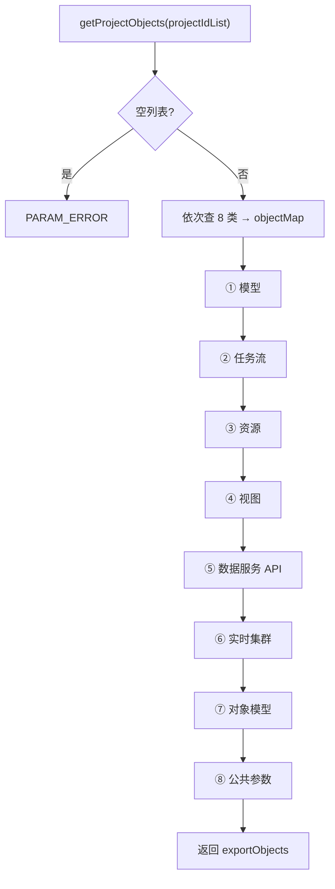

#### 0.5 子方法（按主编排顺序 ①–⑧）

统一包装形态（每条一样）：

- `objectId`：业务主键  
- `objectSource`：`MANUAL`  
- `objectContent`：给页面展示用的摘要 JSON（名称、编码、更新时间等），**不是**完整库表行  

本接口**只填候选列表**，不补数据源/板块，也不发 MQ。

##### 0.5.1 ① 模型 `getObjectsModelByProject`

| 项 | 说明 |
|---|---|
| **干什么** | 列出工程下可勾选的表模型 |
| **解决什么问题** | 工程下的表模型是迁出核心资产；页面要立刻看到可选模型 |
| **参数** | `projectIdList` |
| **怎么查** | Feign `metaModelFeignClient.listAllByProject`；`projectIdList` + **`isCommitted=true`（只要已提交版本）** |
| **查到什么** | 每个模型一条：`objectId=modelId`；content 含表名/编码/中文名/更新时间 |
| **写入 Map** | key = `MODEL` 对象类型 ID |

未提交草稿模型不会出现在列表里——避免用户勾到迁入后不可用的版本。

##### 0.5.2 ② 任务流 `getObjectsFlowTaskByProject`（最复杂）

| 项          | 说明                                                                                 |
| ---------- | ---------------------------------------------------------------------------------- |
| **干什么**    | 查工程下任务流 + 批量查任务，按技术类型拆成五类桶                                                         |
| **解决什么问题** | 页面要按「离线集成 / 离线开发 / 质量 / 实时集成 / 实时开发」勾选；实时流要求任务数==1，否则跳过；依赖任务本接口不自动带出（留给完整 preview） |
| **参数**     | `projectIdList`；内部用 `previewContext.flowList / taskList` 暂存                        |

分两步：**先查流和任务，再按技术类型拆桶**。

**第一步 `getFlowAndTaskByProject`**

1. `tcFlowFeignClient.listAllFlow(projectIdList)`：按工程拉任务流。  
2. 对每条流记下 `(flowId, versionId)`，再 `tcTaskFeignClient.queryTaskBatchByFlows` 批量查流下任务。  
3. **过滤掉 `TaskTypeEnum.DEPEND` 依赖任务**：本接口不自动带出依赖。  
4. 结果放进临时 `previewContext.flowList / taskList`。

**第二步 `processFlowTaskReturnValue`**

按流的 `flowTechnologyTypeId` 分组：

| 技术类型 | 写入 objectType | 展示 content 形态 | 特殊规则 |
|---|---|---|---|
| 离线集成 | `OFFLINE_INTEGRATE_TASK_FLOW` | 离线流摘要：flowId、名称、上下线、needCommit、更新时间 | 按流本身归类，不强制「一流一任务」 |
| 离线开发 | `OFFLINE_DEV_TASK_FLOW` | 同上 | 同上 |
| 数据质量 | `QUALITY_TASK_FLOW` | 同上 | 同上 |
| 实时集成 | `STREAM_INTEGRATE_TASK_FLOW` | 实时流摘要：额外带**任务**的 status、更新时间 | **该流下任务必须恰好 1 条**才加入；`taskMap` 为空则整段实时处理直接 return |
| 实时开发 | `STREAM_DEV_TASK_FLOW` | 同上 | 同上 |

实时流「一流一任务」：不是 1 条的流在本接口里会被 silently 丢掉，不会进 `exportObjects`。

**流程图：**

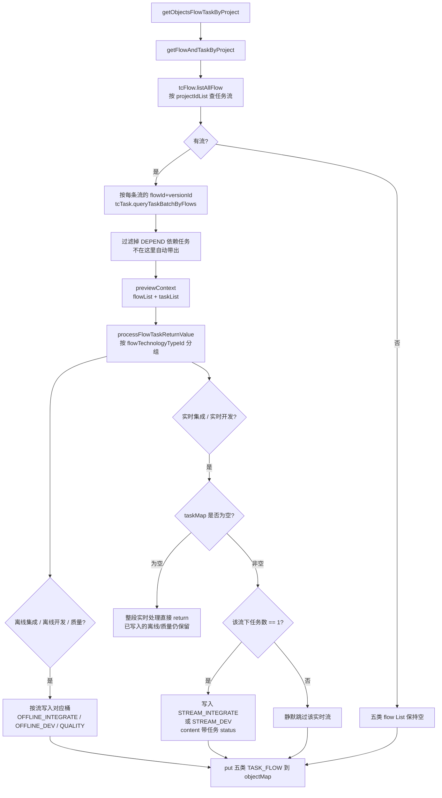

**和完整 preview 的差别：** 这里只是「工程下有哪些流可勾」。完整 preview 还会做依赖任务递归、子流程、跨工程依赖是否可导出等——**不在本接口做**。

##### 0.5.3 ③ 资源 `getResourceListByProject`

| 项 | 说明 |
|---|---|
| **干什么** | 列出工程下资源文件与资源目录 |
| **解决什么问题** | 任务脚本/文件资源挂在工程下；迁出要带资源文件和目录树 |
| **参数** | `projectIdList` |
| **怎么查** | `tcResourceInfoFeignClient.queryAllResources(projectIdList)` |
| **查到后怎么拆** | `insertResource`：`CATALOG` → `RESOURCE_CATALOG`；`FILE` → `RESOURCE` |
| **parentPath** | 用资源 `resourcePath`（`|` 分隔的祖先 id）拼成可读路径 `/目录/...`；祖先缺失时路径段写成 `"null"`，避免坏数据把整页打挂 |

无资源时方法直接 return，Map 里可能没有这两种 key。

##### 0.5.4 ④ 视图 `getObjectsModelViewByProject`

| 项 | 说明 |
|---|---|
| **干什么** | 列出工程下可勾选的视图 |
| **解决什么问题** | 视图和模型一样是工程级元数据，自选要单独勾 |
| **参数** | `projectIdList` |
| **怎么查** | `metaModelViewFeignClient.listAllByProject`；同样 **`isCommitted=true`** |
| **查到什么** | `objectId=viewId`；content：视图名/编码/中文名/更新时间 |
| **写入** | key = `VIEW` |

##### 0.5.5 ⑤ 数据服务 API `getDataServiceApiByProject`

| 项 | 说明 |
|---|---|
| **干什么** | 列出工程相关可勾选的数据服务 API |
| **解决什么问题** | API 挂在工程（或工程相关）上，自选要列出可选 API |
| **参数** | `projectIdList` |
| **怎么查** | 本地 `dataServiceApiService.dataServiceApiList(projectIdList)`（不是直接 Feign 裸调） |
| **查到什么** | `objectId=apiId`；content：`apiDefinitionId`、apiName、apiStatus、更新时间 |
| **写入** | key = `DATA_SERVICE_API` |

后面完整 preview 里会按 `apiDefinitionId` 再取最新定义；本接口只给勾选清单。

##### 0.5.6 ⑥ 实时集群 `getObjectsStreamClusterByProject`

| 项 | 说明 |
|---|---|
| **干什么** | 列出工程下可勾选的实时集群 |
| **解决什么问题** | 实时任务依赖计算/流集群；工程维度要能勾集群 |
| **参数** | `projectIdList` |
| **怎么查** | `baseStreamClusterFeignClient.list(projectIdList)` |
| **查到什么** | `objectId=集群id`；content：名称、编码、状态、更新时间 |
| **写入** | key = `STREAM_CLUSTER`；无数据则不 put |

##### 0.5.7 ⑦ 对象模型 `getModelObjectByProject`

| 项 | 说明 |
|---|---|
| **干什么** | 列出工程下可勾选的对象模型 |
| **解决什么问题** | 「对象模型」和「表模型 MODEL」是不同对象类型，自选要分开列 |
| **参数** | `projectIdList` |
| **怎么查** | `modelObjectClient.getModelObjectAllList(projectIdList)` |
| **查到什么** | `objectId`；content：名称、编码、更新时间 |
| **写入** | key = `MODEL_OBJECT` |

注意：这里**没有**像表模型那样传 `isCommitted`；以对象模型服务返回为准。

##### 0.5.8 ⑧ 公共参数 `getObjectsCommonParamByProject`

| 项 | 说明 |
|---|---|
| **干什么** | 列出工程下可勾选的公共参数 |
| **解决什么问题** | 任务流常用公共参数；工程下参数要能勾进导出包 |
| **参数** | `projectIdList` |
| **怎么查** | `tcCommonParamFeignClient.list`，条件 `projectIds` |
| **查到什么** | `objectId=参数id`；content：参数名（name/code 都用 paramName）、所属工程名、描述、更新时间 |
| **写入** | key = `COMMON_PARAM`（即使空列表也会 put） |

##### 0.5.9 返回给页面之后 / 易误解点

1. 前端按 objectType 展示可勾选项 → 用户勾完往往再调 **`preview`**（重查最新 + 依赖补齐）→ 最终 `export` 提交的是确认后的集合。  
2. **不是完整导出范围**：板块、业务源、数仓源、编目、权限等不会因选了工程而在这里出现。  
3. **质量任务流会查出来**：会写入 `QUALITY_TASK_FLOW`。  
4. **实时流过滤严**：非「一流一任务」的实时流本接口直接不返回。

---


### 1. `previewExportTask`（预览：依赖展开）

#### 1.1 干什么

按 `exportType` 选 Preview 策略，对用户选中范围做依赖展开/重查，返回最终可见 `exportObjects`。

#### 1.2 解决什么问题

用户勾选往往不全（只选工程或模型）；预览补齐任务流、模型、数据源等，避免导出包缺依赖。

#### 1.3 参数

| 项 | 说明 |
|---|---|
| HTTP | `POST .../export/task/preview` |
| Controller | `previewExportTask` |
| Service | `MigrationAssistantExportTaskServiceImpl.previewExportTask` |
| 入参 | `MigrationAssistantExportTaskPreviewRequest`：`exportType`、`exportObjects`、增量时 `dataUpdateTime` 等 |
| 出参 | `MigrationAssistantExportTaskPreviewVO` |
| 副作用 | 不落库、不发 MQ |

#### 1.4 流程图

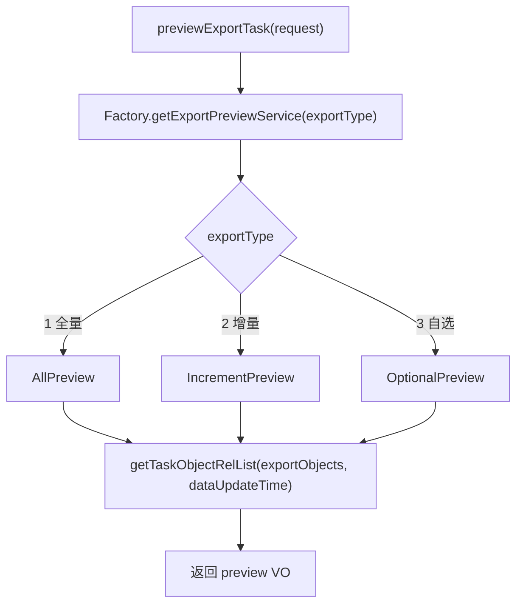

#### 1.5 子方法：`getTaskObjectRelList`

**干什么 / 问题：** Preview 主编排：拆 Context → 按固定顺序补依赖 → 组装返回。  
**参数：** `Map<objectTypeId, List<SimpleObjectVO>> exportObjects`，`Date dataUpdateTime`（增量用）。

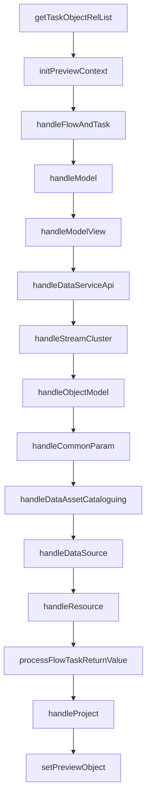

##### 1.5.1 再下钻：`handleFlowAndTask`

类：`MigrationAssistantExportBasePreviewServiceImpl#handleFlowAndTask`（private）

| 项 | 说明 |
|---|---|
| **干什么** | 收集任务流 → 合并去重 → 查流下任务并递归子流程/依赖 → 再按集成/开发/质量做专项补齐或过滤 |
| **解决什么问题** | 任务流不是孤立对象；少子流程、依赖流或实时上下游，迁入后流程图/链路不完整；质量里无效任务要提前剔掉 |
| **参数** | `MigrationAssistantExportPreviewContext`（`projectIdList`、`flowSet`/`flowList`、`taskSet`/`taskList`、`dataUpdateTime` 等） |
| **副作用** | 只改 PreviewContext 内存；不落库、不发 MQ |

**总流程：**

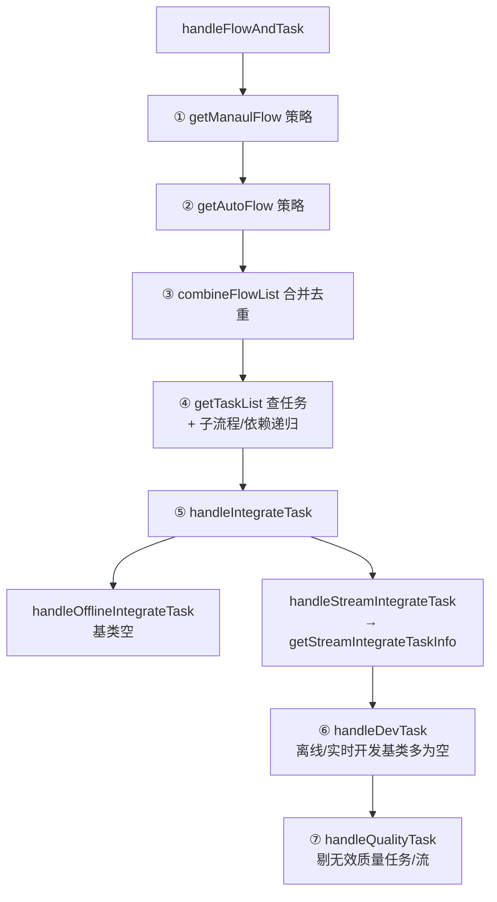

---

###### 1.5.1.1 `getManaulFlow` / `getAutoFlow`（策略差异）

抽象方法，三种 Preview 实现不同：

| 策略 | `getManaulFlow` | `getAutoFlow` |
|---|---|---|
| **全量** `AllPreview` | 返回 `null` | 按 `projectIdList` → `tcFlow.listAllFlow`，工程下任务流 |
| **增量** `IncrementPreview` | 返回空列表 | 同上 + `dataUpdateTime` 增量条件 |
| **自选** `OptionalPreview` | 用 Context 里已选 `flowSet` → `listAllFlow(idList)` 重查最新；标 `MANUAL`；并 **clear** 五类 UI 桶（后面用库数据重建） | 返回空列表 |

**干什么：** 决定「这批任务流从哪来」——手选重查 vs 按工程自动带出。  
**解决问题：** 全量/增量靠工程灌满；自选以用户勾选为准且用服务端最新流信息，避免页面缓存过期。

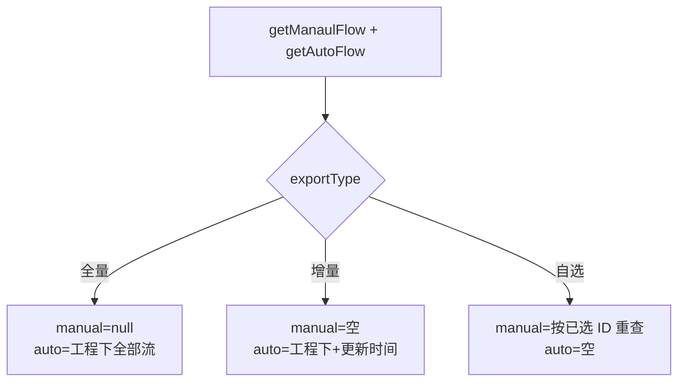

---

###### 1.5.1.2 `combineFlowList`

| 项 | 说明 |
|---|---|
| **干什么** | 把 manual + auto 合并进 `previewContext.flowList` / `flowSet`（按 flowId 去重），然后调用 `getTaskList` |
| **解决什么问题** | 同一条流可能既在手选又在自动结果里，避免重复 |
| **参数** | `manaulFlowList`, `autoFlowList`, `previewContext` |
| **顺序** | 先加 manual，再加不在 set 里的 auto → `getTaskList(flowList)` |

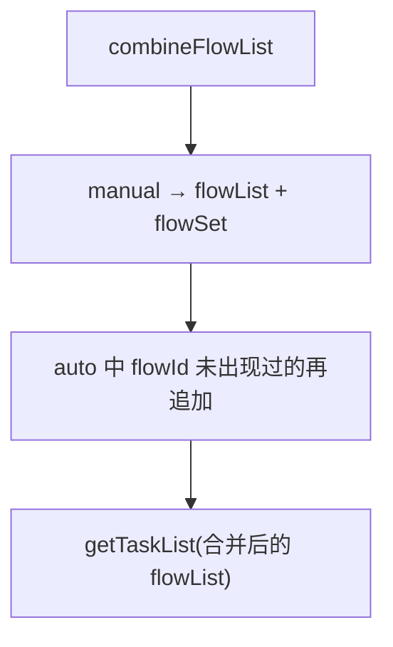

---

###### 1.5.1.3 `getTaskList`（查任务 + 触发递归）

| 项 | 说明 |
|---|---|
| **干什么** | 按每条流的 `flowId+versionId` 批量查任务，写入 `taskList`/`taskSet`，再对**本批新查出的任务**做子流程、依赖展开 |
| **解决什么问题** | 只有流没有任务，后续分类和依赖分析无法进行 |
| **参数** | `flowList`, `previewContext` |
| **Feign** | `tcTaskFeignClient.queryTaskBatchByFlows` |
| **重要差异** | **全量** `AllPreview` **重写了**本方法：只查任务塞进 Context，**不**调 `getSubTaskList` / `getDependTaskList`。子流程/依赖递归走基类实现（自选、增量） |

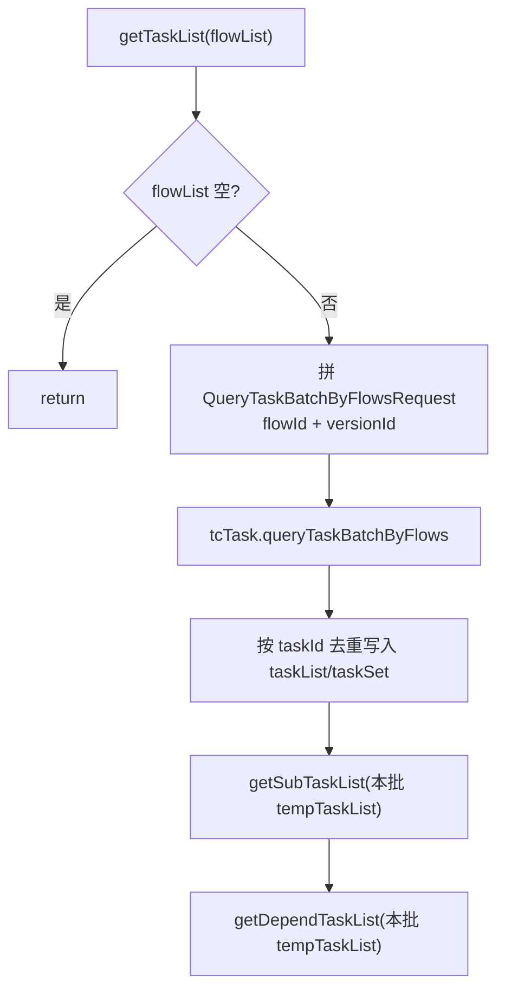

---

###### 1.5.1.4 `getSubTaskList`（子流程递归）

| 项 | 说明 |
|---|---|
| **干什么** | 从本批任务里筛 `TaskTypeEnum.SUBPROCESS`，查子流程 ID，拉子流程信息，再 **递归** `getTaskList(subFlowList)` |
| **解决什么问题** | 父流里嵌了子流程时，必须把子流及子流下任务一并纳入预览范围 |
| **参数** | `previewContext`, `tempTaskList`（本批刚查到的任务） |
| **Feign** | `tcTask.querySubTask` → `subFlowId`；`tcFlow.listAllFlow(flowIdList)` |
| **去重** | 已在 `flowSet` 的子流不再加入 |

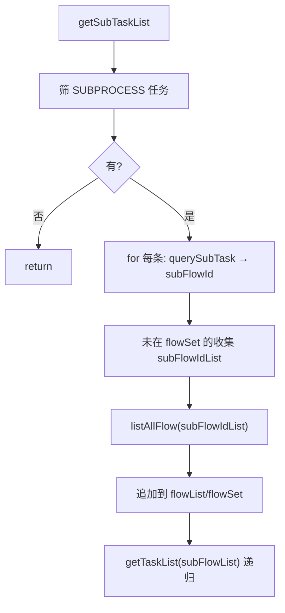

---

###### 1.5.1.5 `getDependTaskList`（依赖任务流递归）

| 项 | 说明 |
|---|---|
| **干什么** | 筛 `TaskTypeEnum.DEPEND`，查依赖配置；对仍在本组织且落在当前 `projectIdList` 内的依赖流，整条流（含其下任务）纳入，再递归 `getTaskList` |
| **解决什么问题** | 依赖节点指向另一条流时，只导当前流会断链 |
| **参数** | `previewContext`, `tempTaskList` |
| **Feign** | `tcTask.queryDependTaskList`；`tcFlow.listAllFlow` |
| **过滤** | `dependFlowOrgId != 当前组织` 或 `dependFlowProjectId ∉ projectIdList` → **跳过**（打日志：跨组织/跨工程暂不支持导出） |
| **策略** | 不论依赖的是流还是任务，都导出**依赖流 + 该流下全部任务** |

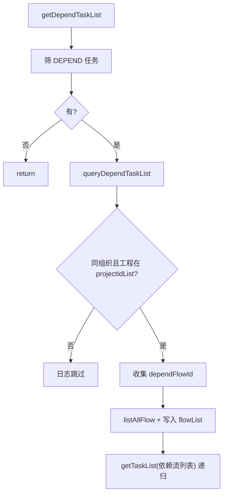

---

###### 1.5.1.6 `handleIntegrateTask` → 离线 / 实时集成

```text
handleIntegrateTask
  ├─ handleOfflineIntegrateTask   // 基类空实现（钩子，供子类扩展）
  └─ handleStreamIntegrateTask
        └─ getStreamIntegrateTaskInfo
```

**`getStreamIntegrateTaskInfo`（有实质逻辑）**

| 项 | 说明 |
|---|---|
| **干什么** | 找出实时集成技术类型的流及其任务，查上下游关系，把尚未在列表中的前置/后置任务及其所属流补进 Context |
| **解决什么问题** | 实时集成链路常跨多个任务/流，只导当前任务会缺上下游 |
| **参数** | `previewContext`（已有 flowList/taskList） |
| **Feign** | `dataIntegrateStreamTaskFeignClient.batchQueryRelations`；`tcTask.queryTaskBatchByTasks`；`tcFlow.batchQueryExportFlowInfo` |
| **版本** | 补查上下游任务时 version 用 `TcVersionConstants.DEFAULT_VERSION_ID` |

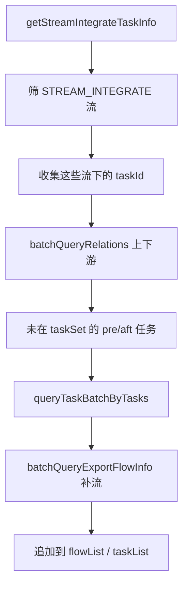

---

###### 1.5.1.7 `handleDevTask`

| 项 | 说明 |
|---|---|
| **干什么** | 编排离线开发 / 实时开发两个钩子 |
| **基类** | `handleOfflineDevTask`、`handleStreamDevTask` **均为空**（预留扩展） |
| **实际效果** | 当前默认实现下，开发类流的范围主要靠前面的 `getTaskList`（及子流程/依赖）已收齐，此处不再加逻辑 |

---

###### 1.5.1.8 `handleQualityTask`（质量过滤）

| 项 | 说明 |
|---|---|
| **干什么** | 对质量技术类型的流，查质量任务详情；剔除无效任务；若一流下可导出任务全被剔则整条流删除，并重建 `flowList`/`taskList`/`flowSet`/`taskSet` |
| **解决什么问题** | 无质量详情、或规则模板类型为 `2` 的任务不应进入导出预览 |
| **参数** | Context 中的 flowList/taskList |
| **查询** | `qualityCenterTaskService.queryTask(taskId, versionId)` |
| **剔除规则** | ① 详情为 null → 剔任务；② `ruleTemplateType == 2` → 剔任务；③ 一流下非 DEPEND/SUBPROCESS 任务全被剔（或无任务）→ 剔流 |

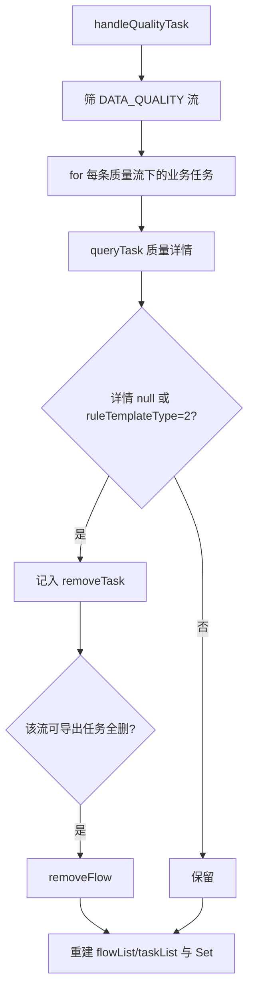

---

###### 1.5.1.9 读代码注意点

1. **方法名拼写：** 源码是 `getManaulFlow`（manual 少了一个 a），不是 `getManualFlow`。  
2. **全量不走子流程/依赖递归：** `AllPreview` 覆盖了 `getTaskList`，没有调用 `getSubTaskList` / `getDependTaskList`；自选/增量用基类才会递归。  
3. **`handleFlowAndTask` 之后**还有 `processFlowTaskReturnValue`（在 `getTaskObjectRelList` 更后面）：把统一的 flow/task 拆成五类返回对象——那一步不在本方法内。  
4. 跨组织/跨工程依赖：只打日志跳过，**不会**阻断整个 preview。

##### 1.5.2 再下钻：`handleModel`

| 项 | 说明 |
|---|---|
| **干什么** | manual + auto 两路查模型，经 `insertModelList` 写入 Context（展示 VO + `allModelList`） |
| **解决什么问题** | 任务读写依赖模型；预览必须收齐可见模型 |
| **参数** | `previewContext` |
| **模式** | 与任务流相同的「策略方法 + insert」 |

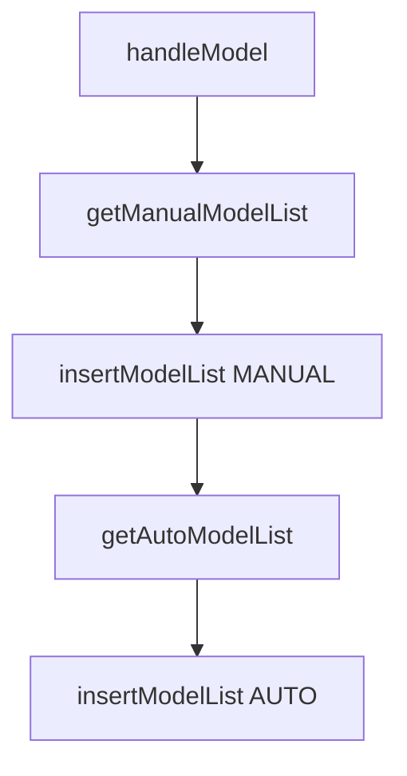

| 策略 | `getManualModelList` | `getAutoModelList` |
|---|---|---|
| 全量 | `null` | 按 `projectIdList` + `isCommitted=true` → `metaModel.listAllByProject`；写入 `modelSet` |
| 增量 | 空 | 同上 + `dataUpdateTime` |
| 自选 | 用已选 modelId → `listAllByProject(modelIdList)`；**clear** 原 UI `modelList` 后用最新 | 空 |

**`insertModelList`：** 拼 content（表名/编码/中文名/更新时间）→ `modelList`；原始 VO 进 `allModelList`；再对两个 List **distinct 去重**。

---

##### 1.5.3 再下钻：`handleModelView`

| 项 | 说明 |
|---|---|
| **干什么** | 与模型对称：manual/auto 查视图 → `insertModelViewList` |
| **解决什么问题** | 视图有独立版本与依赖，不能只靠模型带出 |
| **参数** | `previewContext` |

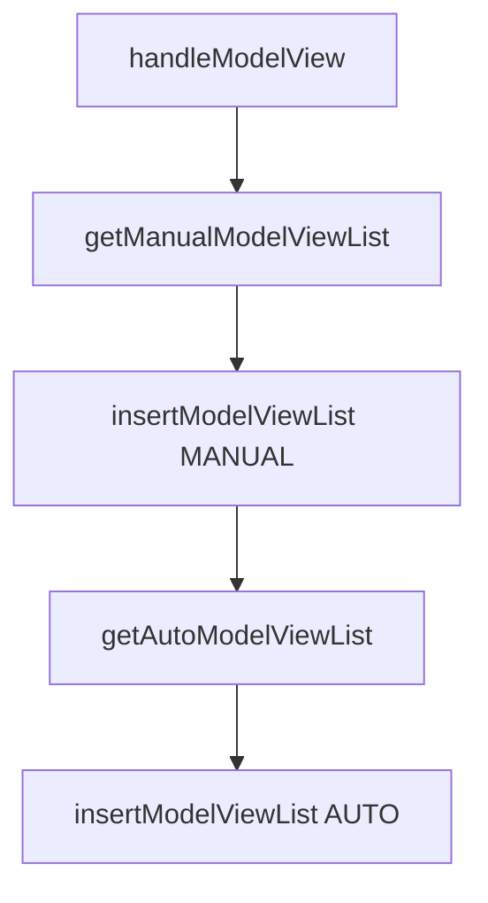

| 策略 | manual | auto |
|---|---|---|
| 全量 | `null` | 工程下视图 + `isCommitted=true`；写 `viewSet` |
| 增量 | 空 | 工程 + `dataUpdateTime` + committed |
| 自选 | 按已选 viewId 重查；clear 原列表 | 空 |

**`insertModelViewList`：** content 含视图名/编码/中文名/更新时间；同步维护 `allViewList` 并去重。

---

##### 1.5.4 再下钻：`handleDataServiceApi`

| 项 | 说明 |
|---|---|
| **干什么** | manual/auto 查数据服务 API → `insertDataServiceApiList` |
| **解决什么问题** | API 与工程、定义、数据源关联，预览要列出可导出 API |
| **参数** | `previewContext` |

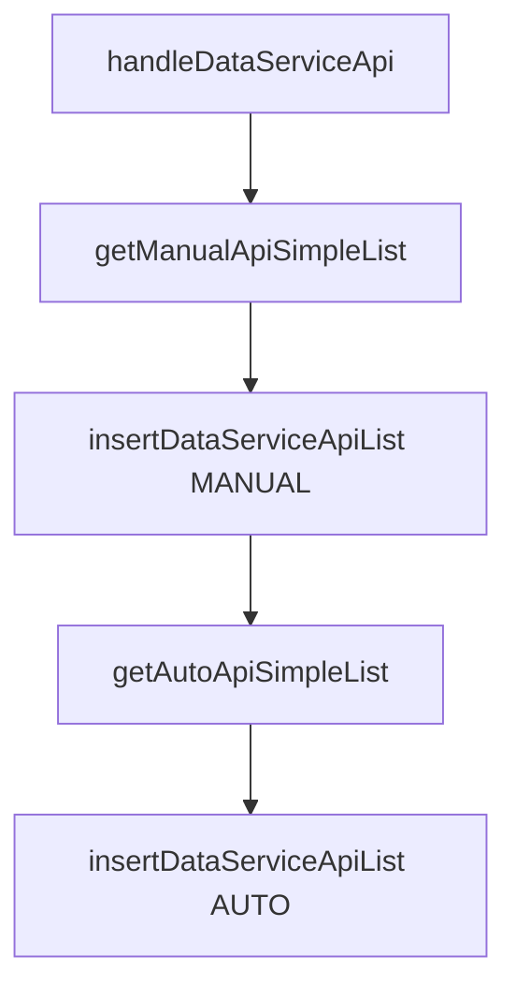

| 策略 | manual | auto |
|---|---|---|
| 全量 | 空 | `dataServiceApiService.dataServiceApiList(projectIdList)` |
| 增量 | 空 | `incrementDataServiceApiList`（带更新时间） |
| 自选 | 从已选 content 抽 `apiDefinitionId` → `getLatestApiByApiDefinitionIds`；clear 原列表 | 空 |

**`insertDataServiceApiList`：** content 含 `id` / `apiDefinitionId` / `apiName` / `apiStatus` / 更新时间；并追加到 `allApiSimpleList`（**无**模型那种二次 distinct 清桶，注意重复依赖上游）。

---

##### 1.5.5 再下钻：`handleStreamCluster`

| 项 | 说明 |
|---|---|
| **干什么** | ① 从已展开 **任务** 上的 `streamClusterId` 反查集群；② 再叠策略的 manual/auto 集群列表；③ insert |
| **解决什么问题** | 实时任务迁出后仍要能找到计算集群；用户未必手选集群 |
| **参数** | `previewContext`（尤其 `taskList`） |

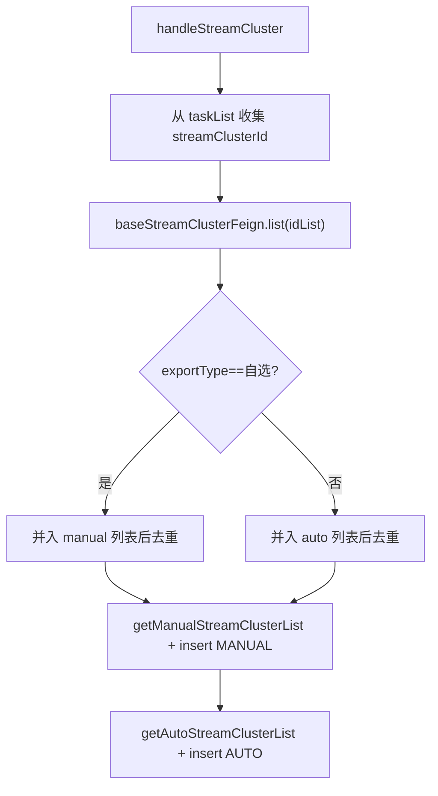

| 策略 | `getManualStreamClusterList` | `getAutoStreamClusterList` |
|---|---|---|
| 全量 | 空 ArrayList | 按 `projectIdList` → `baseStreamCluster.list` |
| 增量 | 空 | 同全量（工程维度；是否再滤时间看 Feign 实现） |
| 自选 | 空 ArrayList | 空 ArrayList（集群主要靠任务反查进 manual 侧） |

**`insertStreamClusterList`：** content = 名称/编码/状态/更新时间。

---

##### 1.5.6 再下钻：`handleObjectModel`

| 项 | 说明 |
|---|---|
| **干什么** | manual/auto 查对象模型 → `insertModelObjectList` |
| **解决什么问题** | 对象模型与表模型不同；视图等可能引用对象模型，且后面 `handleProject` 会按对象模型反推工程 |
| **参数** | `previewContext`（auto 常带上已有 `allViewList` 的 viewId） |

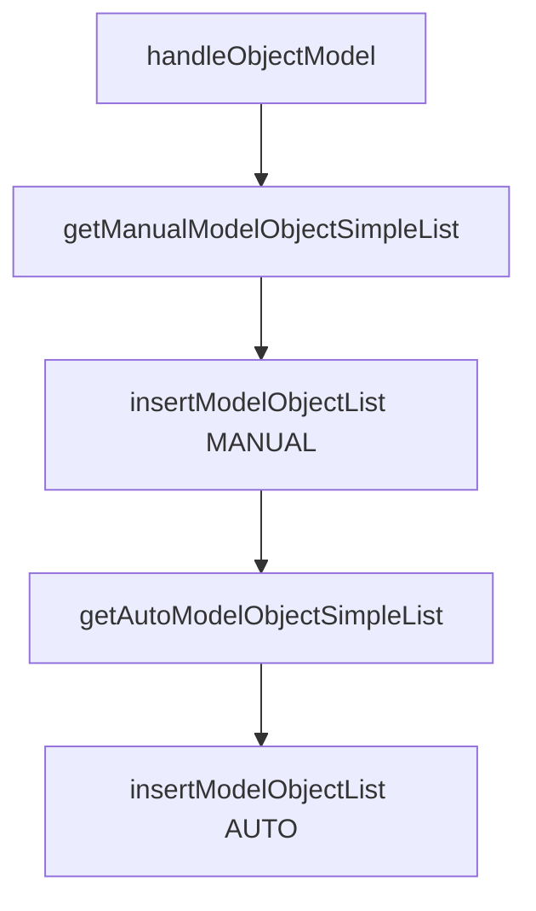

| 策略 | manual | auto |
|---|---|---|
| 全量 | 空 | `getModelObjectAllList(projectIdList + viewId 列表)` |
| 增量 | （同模式，见实现） | 工程/时间条件查对象模型 |
| 自选 | 按已选 ID + viewId → `getModelObjectManualLiat`（源码方法名如此）；clear 原列表 | 空 |

**`insertModelObjectList`：** content = id/名称/编码/更新时间；追加 `allModelObjectSimpleList`。

---

##### 1.5.7 再下钻：`handleCommonParam`

| 项 | 说明 |
|---|---|
| **干什么** | manual/auto 查公共参数 → `insertCommonParamList` |
| **解决什么问题** | 流/任务参数常引用公共参数，间接带出数据源（后续 `handleDataSource` 会扫参数） |
| **参数** | `previewContext` |

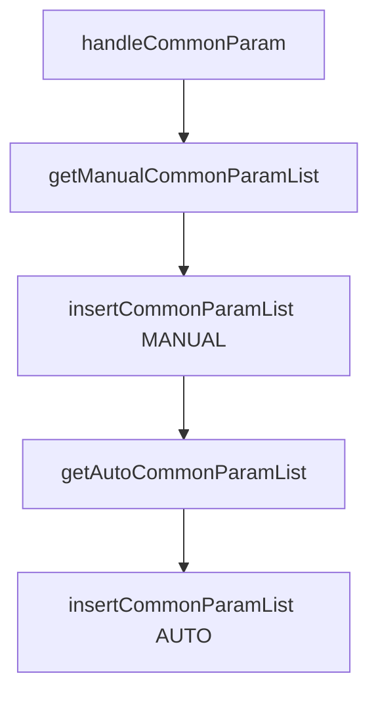

| 策略 | manual | auto |
|---|---|---|
| 全量 | 空 | `tcCommonParam.list(projectIds)` |
| 增量 | 空 | 工程维度 list（可带更新时间，视请求） |
| 自选 | 从 content 抽 id → `list(commonParamIds)`；clear 原列表 | 空 |

**`insertCommonParamList`：** content 的 name/code 都用 `paramName`，另有描述、工程名、更新时间。

---

##### 1.5.8 `handleDataAssetCataloguing`

基类 **空实现**（预留）。编目若已在 `initPreviewContext` 从请求拆进 `dataAssetCataloguingIdList`，仍会在后面的 `handleDataSource` 里被用来反查数据源。

---

##### 1.5.9 再下钻：`handleDataSource`（最重）

| 项 | 说明 |
|---|---|
| **干什么** | 从集成/开发/质量任务、SQL 开发任务、流/任务参数、模型/视图、数据服务、编目、对象模型等多路 **反查数据源**，分成业务源/数仓源；过程中还可能 **AUTO 补模型/视图** |
| **解决什么问题** | 用户很少勾全数据源；缺源则迁入后任务无法落地 |
| **参数** | `previewContext`（依赖前面已展开的 flow/task/model/view/api/编目/对象模型） |
| **过滤** | 先丢掉 `SUBPROCESS`、`DEPEND` 任务（注释：子任务没有数据源） |

**总流程：**

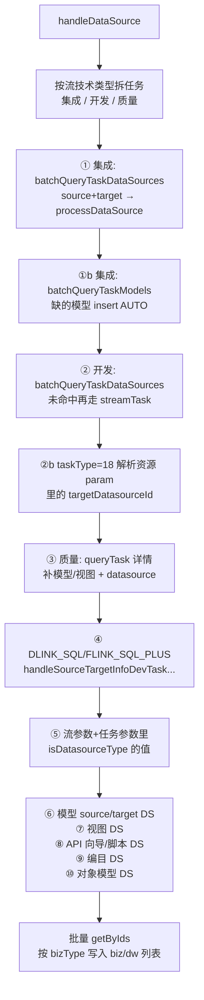

###### 1.5.9.1 任务拆桶

| 桶 | 流技术类型 | 后续 |
|---|---|---|
| `integrateList` | 离线集成 / 实时集成 | 集成数据源 + 关联模型 |
| `devTaskList` | 离线开发 / 实时开发 | 开发数据源；其中 type=18 另解析资源 JSON |
| `qualityTaskList` | 数据质量 | 质量详情里的 DS/模型/视图 |
| `sourceTargetInfoDevTaskList` | 开发桶内 `DLINK_SQL` / `FLINK_SQL_PLUS` | 专项补源端/目标 |

###### 1.5.9.2 集成任务数据源与模型

1. `dataIntegrateCommonTaskClient.batchQueryTaskDataSources` → 每条任务的 source/target → `processDataSource`（按 `bizType` 进业务源或数仓源 Set/List，已存在则跳过）。  
2. 同批 request 再 `batchQueryTaskModels` → 源/目标模型若不在 `modelSet`，`insertModelList(..., AUTO)`。

###### 1.5.9.3 开发任务数据源

1. `devTaskFeignClient.batchQueryTaskDataSources`；只处理返回里的 **source**。  
2. 未出现在上述结果中的 taskId，再调 `streamTaskFeignClient.batchQueryTaskDataSources`。  
3. **`taskTypeId == 18`：** `tcTask.queryTask` 取 `resourceList[0].param` JSON，遍历节点的 `targetDatasourceId` → `baseDataSource.detail` → `processDataSource`。

###### 1.5.9.4 质量任务

对每个质量任务 `qualityCenterTaskService.queryTask`：

- 模板参数里若 argumentId 落在 `TEMPLATE_ARGUMENT_MODEL_IDS` 且值为数字 → 当模型版本 ID 查版本 → 再查模型 detail → 待 insert。  
- `qualityTaskDetail.modelId`：按 `getModelTypeByRuleId` 为 1 补模型、为 2 补视图。  
- `datasourceId` → detail → `processDataSource`。  
- 最后把收集到的模型/视图 `insert* AUTO`。

###### 1.5.9.5 `handleSourceTargetInfoDevTaskDataSourceAndModel`

针对 `DLINK_SQL` / `FLINK_SQL_PLUS` 开发任务，补来源/目标侧数据源与模型（方法名即职责；实现紧挨在 `handleDataSource` 内调用）。

###### 1.5.9.6 参数 / 模型 / 视图 / API / 编目 / 对象模型 → 汇总 ID

| 来源 | 怎么取数据源 ID |
|---|---|
| 流参数 | `tcFlowParam.batchListFlowParam`，`param.isDatasourceType` → `paramValue` |
| 任务参数 | `tcTaskParam.batchListTaskParam`（`CUSTOM`），同上 |
| 模型 | `sourceDatasourceId`、`datasourceId` |
| 视图 | `datasourceId` |
| 数据服务 API | 向导表 `getDsGuideByApiId`、脚本表 `getDsScriptByApiId` |
| 数据编目 | `getDataSourceByCataloguingIdList`（若 Context 有编目 ID） |
| 对象模型 | `getDataSourceByModelObjectId` |

已在 `bizDatasourceSet` / `dwDatasourceSet` 中的 ID 不再加入待查集合。

###### 1.5.9.7 批量落桶

`baseDataSourceFeignClient.getByIds` → 按 `DataSourceBizTypeEnum`：

- `BIZ_DS` → `bizDatasourceList` + Set  
- `DW_DS` → `dwDatasourceList` + Set  

`objectSource` 一律 **AUTO**；content 为 code/name/更新时间。

###### 1.5.9.8 读代码注意点

1. **`handleDataSource` 会回头补模型/视图**，因此即使用户没选模型，集成/质量链路仍可能把模型塞进预览。  
2. **编目 handle 为空**，但请求里带的编目 ID 仍参与本方法反查 DS。  
3. 子流程/依赖任务在本方法开头被过滤，不参与 DS 反查。  
4. 开发任务先走 `devTask` Feign，剩余再走 `streamTask`，避免实时开发漏源。

---

### 2. `export`（提交导出：落库 + 发 MQ）

#### 2.1 干什么

登记任务与展示对象范围，发 Export Topic；**不**查业务库、不写 JSON、不打 ZIP。

#### 2.2 解决什么问题

打包很重，HTTP 不能同步扛；必须先固化「导什么」，再异步打包。

#### 2.3 参数

| 项 | 说明 |
|---|---|
| HTTP | `POST .../export/task/export` |
| Controller | `MigrationAssistantExportTaskController.export` |
| Service | `MigrationAssistantExportTaskServiceImpl.export` |
| 入参 | `MigrationAssistantExportTaskExportRequest`：任务名、`exportType`、`useType`、`exportObjects`、描述等 |
| 出参 | `Boolean true`（表示登记+发消息成功，**不是**打包完成） |

#### 2.4 流程图

```mermaid
flowchart TD
    A["Controller.export"] --> B["Service.export"]
    B --> C["① createTask"]
    C --> D["② createObjectRel"]
    D --> E["③ sendMqMsg"]
    E --> F["return true"]
```

#### 2.5 子方法

##### 2.5.1 `createTask`

| 项 | 说明 |
|---|---|
| 干什么 | INSERT `t_data_migration_export_task`，返回 `taskId` |
| 解决问题 | MQ 消息只带 taskId，任务头必须先落库 |
| 参数 | `MigrationAssistantExportTaskExportRequest` |
| 实现 | `MigrationAssistantExportTaskExportServiceImpl.createTask` → `DataMigrationExportTaskServiceImpl.save` |
| 要点 | 同组织任务名查重；`status` 默认 `0`（待执行） |

```mermaid
flowchart TD
    A["createTask(request)"] --> B["copy → SaveRequest"]
    B --> C["save：组织内任务名查重"]
    C --> D["INSERT export_task"]
    D --> E["返回 taskId"]
```

##### 2.5.2 `createObjectRel`

| 项 | 说明 |
|---|---|
| 干什么 | 遍历 `exportObjects`，批量写 `export_task_object_rel` |
| 解决问题 | 固化展示级范围（MANUAL/AUTO）；Consumer 按此 IN 查库 |
| 参数 | `taskId` + 完整 `export` 请求（含 exportObjects） |
| 要点 | rel 初始状态多为 EXECUTING |

```mermaid
flowchart TD
    A["createObjectRel(taskId, request)"] --> B["遍历 Map objectTypeId → List"]
    B --> C["组装 ObjectRel 行"]
    C --> D["batchSave object_rel"]
```

##### 2.5.3 `sendMqMsg` / `createTaskContext`

| 项 | 说明 |
|---|---|
| 干什么 | 组装 `DataMigrationTaskContext` 发到 Export Topic |
| 解决问题 | Consumer 线程没有 HTTP ThreadLocal，必须把租户/用户/token 放进消息 |
| 参数 | `taskId`；上下文：`appToken, token, tenantId, orgId, user, productCode, product` |
| Topic | `DATA-MIGRATION-EXPORT-TASK-TOPIC`（可配置） |
| 边界 | createTask/rel 已提交后才发 MQ；发失败会有孤儿待执行任务 |

```mermaid
flowchart TD
    A["sendMqMsg(taskId)"] --> B["createTaskContext"]
    B --> C["Producer.send(EXPORT Topic)"]
    C --> D{"发送成功?"}
    D -- 否 --> E["MQ_MESSAGE_ERROR<br/>任务已在库"]
    D -- 是 --> F["HTTP 返回 true"]
```

---

### 3. `DataMigrationTaskExportConsumer.process`（MQ 入口）

#### 3.1 干什么

反序列化消息 → 恢复线程上下文 → 调用 `processExportTask(taskId)`。

#### 3.2 解决什么问题

把「MQ 世界」还原成一次带完整租户身份的业务调用；Consumer 本身不写 JSON。

#### 3.3 参数

| 项 | 说明 |
|---|---|
| 入参 | `ConsumeMessage` → `DataMigrationTaskContext` |
| 关键字段 | `taskId` + 租户/组织/用户/产品/token |
| 下一跳 | `IDataMigrationFileExportService.processExportTask(taskId)` |

#### 3.4 流程图

```mermaid
flowchart TD
    A["process(message)"] --> B["getValueAsObject(Context)"]
    B --> C["setThreadContext(context)"]
    C --> D["processExportTask(taskId)"]
```

#### 3.5 子方法：`setThreadContext`

**干什么：** 把 Context 写回当前线程（AppToken/Token/租户等）。  
**问题：** 后续跨库 JDBC、Feign、审计字段都依赖它。  
**参数：** `DataMigrationTaskContext`。

---

### 4. `processExportTask`（打包主编排）

#### 4.1 干什么

按固定顺序：抢占任务 → 装规则 Context → 递归查库 → Pre → 写 JSON → Post → ZIP/OBS → 标 SUCCESS。

#### 4.2 解决什么问题

把「任务 + object_rel 范围」变成可下载的 ZIP（JSON + 可选 resource）。

#### 4.3 参数

| 项 | 说明 |
|---|---|
| 类 | `DataMigrationFileExportServiceImpl` |
| 入参 | `Long taskId` |
| 返回 | `void`（结果写库：任务状态 / download_file） |

#### 4.4 流程图

```mermaid
flowchart TD
    P["processExportTask(taskId)"] --> S1{"① checkExportTask"}
    S1 -- 已执行 --> STOP["return"]
    S1 -- 待执行 --> S1b["EXECUTING"]
    S1b --> N["notifyPublishCenter 可选"]
    N --> S2["② getExportObjectContext"]
    S2 --> S3["③ 筛 topObjectTypeList"]
    S3 --> S4["④ initDataFromDb"]
    S4 --> S5["⑤ prePorcess"]
    S5 --> S6["⑥ exportJsonFileFromData"]
    S6 --> S7["⑦ postProcess"]
    S7 --> S8["⑧ packageToZipFile"]
    S8 --> S9["⑨ updateExportTaskStatus SUCCESS"]
    S9 --> S10["⑩ callback 可选"]
    S10 --> S11["⑪ clearExportObjectContext"]
    S4 -.异常.-> FAIL["FAILURE + callback"]
    S5 -.异常.-> FAIL
    S6 -.异常.-> FAIL
    S7 -.异常.-> FAIL
    S8 -.异常.-> FAIL
```

#### 4.5 子方法（按顺序）

##### 4.5.1 `checkExportTask`

| 项 | 说明 |
|---|---|
| 干什么 | `f_status != 0` 则拒绝；否则改为 EXECUTING |
| 解决问题 | MQ 重复消费幂等；失败任务不会靠重复消息自动重试 |
| 参数 | `taskId` |
| DAO | `countExecutedTask` / `updateExportTaskStatus(EXECUTING)` |

```mermaid
flowchart TD
    A["checkExportTask"] --> B{"count status≠0"}
    B -- >0 --> F["return false"]
    B -- 0 --> C["UPDATE EXECUTING"]
    C --> T["return true"]
```

###### 4.5.1.1 `notifyPublishCenter`（check 通过后立刻）

| 项 | 说明 |
|---|---|
| **干什么** | 若存在「导出任务↔发布中心包」绑定，HTTP 通知发布中心状态=**打包中（EXECUTING）** |
| **解决什么问题** | 发布中心侧同步展示「正在打包」；**纯迁移助手页面任务无包信息则直接 return** |
| **类** | `DataMigrationFileExportServiceImpl#notifyPublishCenter`（private） |
| **判定** | `exportTaskPackageInfoService.info(taskId)` → `null` / 异常 → **静默 return**（不当作任务失败） |
| **请求** | `restTemplate.postForEntity(publishPackageNotifyStateUrl, NotifyPublishPackageStateRequest{packageId, packageVersionId, status=EXECUTING}, …)` + `Authorization: TokenContext` |
| **异常** | 接口失败只打日志；**外层 try 吞掉**，不中断后续打包 |

```mermaid
flowchart TD
    A["notifyPublishCenter"] --> B["packageInfo.info(taskId)"]
    B -- null/异常 --> R["return 跳过"]
    B -- 有绑定 --> C["POST 发布中心 EXECUTING"]
    C --> D{"HTTP/业务码"}
    D -- 失败 --> L["log only"]
    D -- 成功 --> OK["继续 getExportObjectContext"]
```

##### 4.5.2 `getExportObjectContext`

| 项 | 说明 |
|---|---|
| 干什么 | 加载任务、对象类型树、导出规则/字段，初始化空 `objectMap` 等 |
| 解决问题 | 递归查库前先备好「怎么查」的元数据，避免反复查规则库 |
| 参数 | `taskId` |
| 返回 | `DataMigrationExportObjectContext` |
| 不做什么 | **不**查业务对象数据行 |

```mermaid
flowchart TD
    A["getExportObjectContext"] --> B["查 export_task"]
    B --> C["查 object_type 树 + db/table"]
    C --> D["查 export_rule + field"]
    D --> E["装 org/tenant/product..."]
    E --> F["空 objectMap/栈/资源列表"]
```

##### 4.5.3 `initDataFromDb`

| 项 | 说明 |
|---|---|
| 干什么 | 按对象类型树递归查业务库，结果放入 `objectMap` |
| 解决问题 | 把展示范围展开成完整记录树，供写 JSON |
| 参数 | `taskId`, `List<objectType>`（本层）, `ExportObjectContext` |
| 入口 | 先传 `pid==null` 的顶层列表，内部对子类型递归 |

```mermaid
flowchart TD
    A["initDataFromDb(本层类型列表)"] --> B["for 每个 objectType"]
    B --> B1["stack.push(typeId)"]
    B1 --> C["getObjectListByRule"]
    C --> D["objectMap.put(getKey, list)"]
    D --> E["getObjectTypeListByPid → 子类型"]
    E --> F{"objectList 非空?"}
    F -- 否 --> P["stack.pop；顶层则 clear contextMap"]
    F -- 是 --> G["for 每条 row"]
    G --> H{"有子类型?"}
    H -- 是 --> I["contextMap.put(typeId, row)"]
    I --> J["initDataFromDb(子类型) 递归"]
    J --> K["contextMap.remove(typeId)"]
    K --> L["updateObjectRel SUCCESS"]
    H -- 否 --> L
    J -.异常.-> M["updateObjectRel FAILURE<br/>再抛 DATA_MIGRATION_EXPORT_TASK_OBJECT_TYPE_ERROR"]
    L --> G
    G --> P
```

###### 4.5.3.1 `getObjectListByRule`

| 项 | 说明 |
|---|---|
| 干什么 | 拼 SELECT，按规则条件查一张业务表 |
| 参数 | rule、objectType、ctx |
| 步骤 | 取主键/排除字段 → `getRealConditionValue` → isDisplay 则追加 object_rel IN → 按 dbName 选 JdbcTemplate |

```mermaid
flowchart TD
    A["getObjectListByRule"] --> B["取主键/排除字段"]
    B --> C["getRealConditionValue 替换占位符"]
    C --> D{"isDisplay?"}
    D -- 是 --> E["追加 object_rel 主键 IN"]
    D -- 否 --> F["不加展示限制"]
    E --> G["JdbcTemplate.query"]
    F --> G
    G --> H["剔排除字段 → List JSONObject"]
```

###### 4.5.3.2 `getRealConditionValue`

| 项 | 说明 |
|---|---|
| 干什么 | 替换 `${context.xxx}` / `${parent.xxx}` / `${global.type.field}` |
| 解决问题 | 规则 SQL 模板绑定运行时父子与全局已导出 ID |
| 参数 | 条件字符串 + ctx（栈、objectMap、任务上下文） |

###### 4.5.3.3 `getKey`

源码：`DataMigrationFileExportServiceImpl#getKey`（private）

| 项 | 说明 |
|---|---|
| **干什么** | 根据「当前类型栈 + 各层父行主键」拼出 `objectMap` 的复合 key |
| **解决什么问题** | 同一对象类型会挂在不同父记录下（如两个工程下各有一批 model）。若只用 `ot-{typeId}`，子数据会互相覆盖/串读；复合 key 把「路径」编码进去 |
| **参数** | 仅 `DataMigrationExportObjectContext`（读其中的栈与父行 Map） |
| **返回** | `String`，如 `ot-1`、`ot-1_100_ot-2`、`ot-1_100_ot-2_200_ot-5` |
| **调用时机** | `initDataFromDb` 在 `getObjectListByRule` 之后、`objectMap.put` 之前；此时当前类型已 `push` 进栈 |

**依赖的两个 Context 结构：**

| 结构 | 含义 | 谁维护 |
|---|---|---|
| `objectTypeContextStack`：`Stack<Long>` | 从顶层到当前层的 **对象类型 ID** 路径 | `initDataFromDb`：进入类型时 `push`，处理完 `pop` |
| `objectContextMap`：`Map<Long, JSONObject>` | key=对象类型 ID → 该层当前正在展开的 **父行** | 递归子类型前 `put(父类型Id, 父行)`，子树结束后 `remove` |

**常量：** `DataMigrationFileConstants.OBJECT_TYPE_PREFIX = "ot-"`  
**主键字段：** `ObjectContextUtils.getExportPrimaryFieldName(rule, ctx)`——规则字段里 `isPrimaryField=true` 的字段名，没有则默认 `f_id`（`DEFAULT_PRIMARY_KEY`）。

**算法（与源码一致）：**

```text
key = ""
for objectTypeId in objectTypeContextStack:   // 从栈底到栈顶（根 → 当前）
    if key 为空:
        key = "ot-" + objectTypeId
    else:
        key = key + "_ot-" + objectTypeId

    parentRow = objectContextMap.get(objectTypeId)
    if parentRow != null:
        primaryField = 该类型规则的主键字段名
        key = key + "_" + parentRow.getString(primaryField)
return key
```

要点：

1. **每一层类型 ID 都会进 key**（带 `ot-` 前缀）。  
2. **只有 `objectContextMap` 里已有该类型行时，才追加主键。** 当前正在查询的这一层，通常还没把自己放进 Map，所以末尾一般是 `..._ot-{当前类型Id}`，**不会**再拼当前行主键。  
3. 父行主键用的是 **规则配置的主键字段**，不一定永远是 `f_id`。

**流程图：**

```mermaid
flowchart TD
    A["getKey(ctx)"] --> B["key=''"]
    B --> C["for 栈中每个 objectTypeId"]
    C --> D{"key 空?"}
    D -- 是 --> E["key = ot-{typeId}"]
    D -- 否 --> F["key += _ot-{typeId}"]
    E --> G["objectContextMap.get(typeId)"]
    F --> G
    G --> H{"有父行?"}
    H -- 是 --> I["取规则主键字段名"]
    I --> J["key += _ + 主键值"]
    H -- 否 --> K["不拼主键"]
    J --> C
    K --> C
    C --> L["return key"]
```

**分层示例（板块 → 工程 → 模型）：**

假设类型 ID：section=1，project=2，model=5；某板块 `f_id=100`，其下工程 `f_id=200`。

| 调用场景 | 栈（底→顶） | objectContextMap | 得到的 key | put 进 objectMap 的是 |
|---|---|---|---|---|
| 查顶层板块列表 | `[1]` | （空） | `ot-1` | 所有板块行 |
| 在板块 100 下查工程 | `[1, 2]` | `{1: 板块100行}` | `ot-1_100_ot-2` | 该板块下的工程列表 |
| 在工程 200 下查模型 | `[1, 2, 5]` | `{1:板块100, 2:工程200}` | `ot-1_100_ot-2_200_ot-5` | 该工程下的模型列表 |

```text
objectMap 示意：
  "ot-1"                      → [ section100, section101, ... ]
  "ot-1_100_ot-2"             → [ project200, project201, ... ]   // 仅挂在 100 下
  "ot-1_101_ot-2"             → [ project300, ... ]               // 另一板块，不串
  "ot-1_100_ot-2_200_ot-5"    → [ model..., ... ]
```

**与写 JSON 的对齐（`createJsonArray`）：**

写文件时不再调 `getKey`，但按同一规则拼子 key：

```text
// 当前层已用 key 从 objectMap 取出 list
tempSubKey = key + "_" + 当前行主键
subKey     = tempSubKey + "_ot-" + 子类型Id
// 再 createJsonArray(子类型, subKey, ...)
```

例：顶层 `key=ot-1`，板块行主键 100，子类型 project=2 → `subKey=ot-1_100_ot-2`，与 init 时 `getKey` 写入的 key **完全一致**，才能把子数组嵌回 JSON。

**易错点：**

1. key **不是**业务表主键，也不是 object_rel 主键，只是内存索引。  
2. 栈顺序错误或父行未 `put`/`remove` 错乱 → 子数据挂错父节点或取到 null 列表。  
3. 主键字段名与规则不一致（或行里缺该字段）→ `getString` 得到 null，key 含 `_null`，写 JSON 时对不上。  
4. 顶层类型 `pid==null` 处理完后会 `objectContextMap.clear()`，避免下一个顶层类型仍带着上一段父行。

###### 4.5.3.4 `objectMap.put` 之后：按行递归子类型 + 更新 object_rel（源码 470–500）

`getKey` / `put` 只解决「本层查出的列表放哪」。接下来才是 **按每条父行下钻子树**，并给展示对象打成功/失败状态。对应 `initDataFromDb` 中约 470–500 行。

| 项 | 说明 |
|---|---|
| **干什么** | 取子类型列表；对 `objectList` 每一行：有子则挂父行并递归 `initDataFromDb`；无论有无子类型，成功路径都把该行标 SUCCESS；子树异常则标 FAILURE 并中断 |
| **解决什么问题** | ① 子查询的 `${parent.xxx}` / `getKey` 依赖「当前父行」；② 详情页要知道哪个展示对象导出失败 |
| **位置** | `objectMap.put(key, objectList)` 之后、本类型 `stack.pop()` 之前 |

**步骤拆解：**

1. **`getObjectTypeListByPid(全部类型树, 当前 objectTypeId)`**  
   筛出 `pid == 当前类型Id` 的子类型列表（可能为空，如叶子类型）。

2. **`objectList` 为空**  
   不进 for；本类型无行可标状态；随后出栈（见下节收尾）。

3. **对每一行 `row`：**  
   - 用规则主键字段取出 `objectId`（`getLong(primaryFieldName)`）。  
   - **若有子类型：**  
     ```text
     objectContextMap.put(当前类型Id, row)   // 子层 getKey / ${parent} 能读到本行
     initDataFromDb(taskId, subObjectTypeList, ctx)  // 递归：子类型们在本父行下查库
     objectContextMap.remove(当前类型Id)     // 换下一行父记录前必须摘掉
     ```  
   - **catch：**  
     - `initSuccess = false`  
     - `failReason` = BusinessException.message，否则固定「迁移对象导出失败」  
     - `updateExportTaskObjectRelStatus(taskId, objectType, objectId, FAILURE, failReason)`  
     - 再抛 `DATA_MIGRATION_EXPORT_TASK_OBJECT_TYPE_ERROR`（带类型名）——**不会**落到下面的 SUCCESS  
   - **成功路径（有子且递归正常，或无子）：**  
     `updateExportTaskObjectRelStatus(..., SUCCESS, null)`  

```mermaid
flowchart TD
    A["put 之后"] --> B["subTypes = getObjectTypeListByPid"]
    B --> C{"objectList 空?"}
    C -- 是 --> Z["跳过行循环"]
    C -- 否 --> D["for row in objectList"]
    D --> E["objectId = row 主键"]
    E --> F{"subTypes 非空?"}
    F -- 是 --> G["contextMap.put(typeId, row)"]
    G --> H["initDataFromDb(taskId, subTypes, ctx)"]
    H --> I["contextMap.remove(typeId)"]
    I --> J["DAO: object_rel SUCCESS"]
    F -- 否 --> J
    H -.异常.-> K["DAO: object_rel FAILURE"]
    K --> L["throw OBJECT_TYPE_ERROR"]
    J --> D
```

**和 `getKey` 的衔接：**  
递归进入子类型时，栈已是 `[…, 父类型, 子类型]`，且 `objectContextMap` 里挂着当前 `row`，子层 `getKey` 才会拼出 `ot-父_父主键_ot-子`。若漏 `put`/`remove`，子数据会串父或 key 对不上。

**状态落库（同一处调用的 DAO）：**  
`DataMigrationExportTaskDao#updateExportTaskObjectRelStatus` ——  
`UPDATE object_rel SET f_status, f_fail_reason WHERE task + type + objectId`。  
开头 `if (!objectType.getIsDisplay()) return;`，故非展示类型（如模型字段）**不会**单独立 rel 状态；其子树失败会冒泡到最近展示级父行的 catch，由父行那次 FAILURE 体现。

**注意：**

1. SUCCESS 写在 **每条 row 处理完之后**（含「无子类型」的叶子展示对象）。  
2. 子树失败只更新 **当前这行** 的 object_rel，然后整任务因异常向外失败。  
3. `objectList` 为空时不会给任何 objectId 写 SUCCESS——若该展示类型本应有选中项却查出 0 条，rel 可能仍停在 EXECUTING（与打包成功并存的边界，排障时留意）。

###### 4.5.3.5 出栈 / 清 Context / `initSuccess`（源码 501–511）

紧接在行循环之后：

1. **`objectTypeContextStack.pop()`** — 本类型处理结束，栈回到父层。  
2. **若 `objectType.pid == null`（顶层类型）** — `objectContextMap.clear()`，避免下一个并列顶层类型（如 `section` 之后的 `bizDataSource`）仍带着上一段父行。  
3. 本层 for 全部类型走完后，若曾置 `initSuccess=false`，再抛 `DATA_MIGRATION_JSON_FILE_EXPORT_ERROR`（通常前面 FAILURE 路径已先抛过，此分支作兜底）。

##### 4.5.4 `prePorcess`（注意拼写；`service/file/fileexport/preprocessor`）

| 项 | 说明 |
|---|---|
| 干什么 | 按 order 调度全部 Export Pre，只改内存 |
| 解决问题 | 规则 SQL 不便表达的补字段/过滤/资源登记 |
| 参数 | `DataMigrationExportObjectContext` |
| 注入 | `Map<String, IDataMigrationFileExportPreProcessor>` |
| 异常 | 统一 `PRE_PROCESS_ERROR` |

```mermaid
flowchart TD
    A["prePorcess"] --> B["sorted Pre by order"]
    B --> P1["1 ResourcePre"]
    P1 --> P2["2 ModelPre"]
    P2 --> P3["3 ModelViewPre"]
    P3 --> P4["4 DataQualityTaskPre"]
    P4 --> P5["5 DataQualityModelPre"]
    P5 --> P6["6 DataServiceApiPre"]
    P6 --> P7["7 DataServiceDefinitionPre"]
```

| order | 全类名 | 干什么 | 深钻 |
|---:|---|---|---|
| 1 | `DataMigrationFileExportResourcePreProcessor` | FILE→`f_resource_file_id`+`resourceList` | **4.5.4.1** |
| 2 | `DataMigrationFileExportModelPreProcessor` | 版本 basicInfo 回填模型字段 | **4.5.4.2** |
| 3 | `DataMigrationFileExportModelViewPreProcessor` | 版本 basicInfo 回填视图名 | **4.5.4.2** |
| 4 | `DataMigrationFileExportDataQualityTaskPreProcessor` | 剔空壳质量任务/流 | **4.5.4.3** |
| 5 | `DataMigrationFileExportDataQualityModelPreProcessor` | 随保留流裁剪模型链 | **4.5.4.4** |
| 6 | `DataMigrationDataServiceApiPreProcessor` | DS 行补 `f_biz_section_id` | 4.5.4.5 |
| 7 | `DataMigrationDataServiceDefinitionPreProcessor` | 只留被 API 引用的 definition | 4.5.4.5 |

> Post 仅 1 个：`DataMigrationFileExportResourcePostProcessor`，见 §4.5.6.1。

###### 4.5.4.1 ResourcePre（order=1）

| 项 | 说明 |
|---|---|
| **读** | `objectTypeMap.resource` → `getExportJsonObjectList`（key 以 `ot-10` 结尾） |
| **改** | `f_resource_type=="FILE"` → `DataMigrationIDGenerator.getNextLongId("ResourceFile")` 写入 `f_resource_file_id`；`resourceList.add` |
| **非 FILE** | 跳过 |

###### 4.5.4.2 ModelPre / ModelViewPre（2 / 3）

| 类 | 读版本 key | 改字段 |
|---|---|---|
| ModelPre | `ot-5_{modelId}_ot-502` → `f_model_basic_info`→`ModelVO` | `f_model_zh_name`、`f_manager_id`；可选 compression/store/external |
| ModelViewPre | `ot-17_{viewId}_ot-1702` → `f_view_basic_info`→`MetaModelViewVO` | `f_view_zh_name` |

无版本 / basicInfo 空 → 该行不改、不删。

###### 4.5.4.3 DataQualityTaskPre（order=4，过滤逻辑）

| 项 | 说明 |
|---|---|
| **enrich** | 保留流：`f_online_status=0`，`f_need_commit=1` |
| **taskIdSet** | 规则行全部 `f_task_id` |
| **删任务** | `f_task_id∉taskIdSet` 且类型非 `DEPEND(4)`/`SUBPROCESS(10)` → `removeTaskIdSet` |
| **删流** | 某 flow 下任务全删 → `removeFlowIdSet`，连带 flowParam/schedule/ruleAlarm/variable |
| **早退** | `qualityTaskFlow` 空 → return |

```mermaid
flowchart TD
    A["DQ Task Pre"] --> B{"flow 空?"}
    B -- 是 --> R["return"]
    B -- 否 --> C["标记 online/need_commit"]
    C --> D["无规则且非 DEPEND/SUB → removeTask"]
    D --> E{"flow 任务全空?"}
    E -- 是 --> F["removeFlow + 整链过滤写回"]
    E -- 否 --> G["按 removeTask 过滤写回"]
```

###### 4.5.4.4 DataQualityModelPre（order=5）

| 项 | 说明 |
|---|---|
| **锚** | Pre4 后仍保留的 `qualityTaskFlow.f_flow_id` |
| **链** | modelRule(flow)→ruleModel→variableModel→ruleSetting→model/param→alarm |
| **补挂** | 任务侧/模型侧变量 `f_template_mid_table_input_meta_id∈{111}` 且 `f_value` 数字 → 按 `f_model_version_id` 额外保留模型 |

###### 4.5.4.5 DataService Pre（6 / 7）

| order | 逻辑 |
|---:|---|
| 6 ApiPre | `DataServiceApiDsGuide/DsScript`：从 objectMap key（`ot-1_{sectionPk}_…`）解析 index=1 写入 `f_biz_section_id`；含未调用的死代码 `createResourceFileRel` |
| 7 DefinitionPre | API 的 `f_api_definition_id` 集合 → 只保留命中的 `DataServiceApiDefinition` |

##### 4.5.5 `exportJsonFileFromData`

| 项 | 说明 |
|---|---|
| 干什么 | `objectMap` → 顶层 `{typeName}.json` + `exportTask.json` |
| 解决问题 | 迁入侧按顶层 JSON 解析；不再查库 |
| 参数 | `taskId`, `topObjectTypeList`, `ctx` |
| 要点 | 空数组不落盘；失败标 task_file + rel FAILURE |

```mermaid
flowchart TD
    A["exportJsonFileFromData"] --> B["for 顶层类型"]
    B --> C["createJsonArray(递归)"]
    C --> D{"非空?"}
    D -- 是 --> E["writeJsonToFile"]
    D -- 否 --> F["不落盘"]
    E --> G["saveJsonFile SUCCESS"]
    F --> G
    B --> H["createExportTaskFile"]
```

###### 4.5.5.1 `createJsonArray`

**干什么：** 按与 init 相同的 key，拼 `{record, 子类型:[...]}` 嵌套数组。  
**参数：** objectType、composite key、rule、ctx。

```mermaid
flowchart TD
    A["createJsonArray(key)"] --> B["objectMap.get(key)"]
    B --> C["for row"]
    C --> D["node.record = row"]
    D --> E["for 子类型: createJsonArray(subKey)"]
    E --> F["挂到 node[typeName]"]
```

##### 4.5.6 `postProcess`（主编排方法本身）

源码：`DataMigrationFileExportServiceImpl#postProcess`（private）

| 项 | 说明 |
|---|---|
| **干什么** | 按 `order` 调度 `Map<String, IDataMigrationFileExportPostProcessor>` 里全部 Post，**方法体只有调度，不写死下载资源** |
| **解决什么问题** | 与 `prePorcess` 对称：JSON 写完后的副作用（如下载 FILE）做成可插拔 Post，便于扩展 |
| **参数** | `DataMigrationExportObjectContext` |
| **注入** | `exportPostProcessorMap`（Spring 注入全部 `IDataMigrationFileExportPostProcessor` Bean） |

**方法体逻辑（与源码一致）：**

```text
log 后置处理开始
if exportPostProcessorMap 非空:
    try:
        exportPostProcessorMap.values()
            .sorted(by order())
            .forEach(p -> p.postProcess(ctx))
    catch Exception e:
        if e 是 BusinessException → 原样再抛
        else → 包装为 DATA_MIGRATION_POST_PROCESS_ERROR 再抛
log 后置处理结束
```

```mermaid
flowchart TD
    A["postProcess(ctx)"] --> B{"exportPostProcessorMap 空?"}
    B -- 是 --> Z["直接结束"]
    B -- 否 --> C["values 按 order 排序"]
    C --> D["forEach p.postProcess(ctx)"]
    D --> E{"异常?"}
    E -- BusinessException --> F["原样抛出"]
    E -- 其它 --> G["包装 POST_PROCESS_ERROR"]
    E -- 无 --> H["结束"]
```

与文档里常写的「下载 resource」关系：**下载不在本方法里**，而在当前唯一的 Post 实现里（见下一小节）。Map 为空则整段跳过。

###### 4.5.6.1 当前唯一实现：`DataMigrationFileExportResourcePostProcessor#postProcess`

| 项 | 说明 |
|---|---|
| **干什么** | 读 Pre 阶段收集的 `ctx.resourceList`，把 FILE 下载到本地 `{localExportFilePath}/{taskId}/resource/`，路径加入 `ctx.resourceFileList` 供打 ZIP |
| **解决什么问题** | JSON 里只有资源元数据；真实文件要进包才能迁入 |
| **order** | `1` |
| **输入** | `resourceList`（Pre 改过的行，含 `f_id` / `f_resource_name` / `f_resource_file_id`）；**不扫 objectMap** |
| **配置** | `data-migration.export.task.localExportFilePath`（默认 `/usr/app/data/gdmp_file/migration/export/`） |

**步骤：**

1. 取 RESOURCE 对象类型 VO（供失败时更新 object_rel）。  
2. `resourceList` 空 → **直接 return**。  
3. 对每条资源：  
   - 从 `f_resource_name` 取后缀（最后一个 `.` 之后）；  
   - 本地路径：`{localExportFilePath}/{taskId}/resource/{f_resource_file_id}{suffix}`（`RESOURCE_ZIP_FILE_PATH` = `resource`）；  
   - `iResourceService.downloadResourceFile(path, resourceJson)`；  
   - 返回非 null → `resourceFileList.add(file)`；  
   - 返回 **null → 只打 error 日志，不抛**，任务仍可能继续 SUCCESS（ZIP 可能缺该文件）。  
4. **download 抛异常** → 更新该资源 `object_rel` FAILURE（原因「资源文件下载失败:…」）→ 抛 `DATA_MIGRATION_RESOURCE_DOWNLOAD_ERROR`。  
5. 外层再 catch 一次，包装成「后置处理资源文件下载失败」。

**`ResourceServiceImpl#downloadResourceFile`：**

| 项 | 说明 |
|---|---|
| **读** | `f_project_id`、`f_linkis_resource_id`、`f_linkis_resource_version` |
| **登录** | `BaseLinkisFeignClient.adminLogin()` 最多 3 次；失败 `LINKIS_GET_ADMIN_FAILED` |
| **下载** | id 非空：`GET …/bml/download?resourceId&version` 写本地；**id 空 → 返回 null（不抛）** |
| **HTTP 非 200** | 常返回 null（任务可 SUCCESS 但 ZIP 缺文件） |

```mermaid
flowchart TD
    A["ResourcePost.postProcess"] --> B{"resourceList 空?"}
    B -- 是 --> R["return"]
    B -- 否 --> C["for 每条资源"]
    C --> D["拼本地路径"]
    D --> E["downloadResourceFile"]
    E --> F{"返回值"}
    F -- 非 null --> G["加入 resourceFileList"]
    F -- null --> H["只打日志，不抛"]
    E -.异常.-> I["object_rel FAILURE"]
    I --> J["抛 RESOURCE_DOWNLOAD_ERROR"]
```

##### 4.5.7 `packageToZipFile`

| 项 | 说明 |
|---|---|
| 干什么 | JSON+resource → ZIP → OBS → 写 `download_file`；删本地临时目录 |
| 解决问题 | 页面可按 OBS 路径下载；不绑执行机本地盘 |
| 参数 | `ctx`（exportFileList、已下载资源） |
| 注意 | **不改**任务状态；SUCCESS 在下一步 |

**关键分支：**

1. `fileName=UUID.zip`；`exportFileList`→ZIP 根；`resourceFileList`→`resource/` 目录。  
2. IO 失败 → `DATA_MIGRATION_ZIP_FILE_CREATE_ERROR`。  
3. `obsService.upload(PROGRAM, …)` 失败 → `DATA_MIGRATION_UPLOAD_OBS_ERROR`。  
4. finally：删 `{localExportFilePath}/{taskId}/` 与本地 zip。  
5. `saveZipFile` 写 `download_file`（SUCCESS 状态在下一步）。

```mermaid
flowchart TD
    A["packageToZipFile"] --> B["UUID.zip"]
    B --> C["压根目录 JSON"]
    C --> D["压 resource/"]
    D --> E["上传 OBS PROGRAM"]
    E --> F["INSERT download_file"]
    F --> G["finally 删本地"]
```

##### 4.5.8 `updateExportTaskStatus(SUCCESS)` + `sendPublishPackageCallback`

| 项 | 说明 |
|---|---|
| 干什么 | `UPDATE export_task SET f_status=SUCCESS` |
| 解决问题 | 页面看到成功并可下载 |
| 参数 | `taskId`, `SUCCESS`, `failReason=null` |
| DAO | `DataMigrationExportTaskDao#updateExportTaskStatus` |

###### 4.5.8.1 `sendPublishPackageCallback`（SUCCESS / FAILURE 都会调）

| 项 | 说明 |
|---|---|
| **干什么** | 有发布中心包绑定时，回调包管理（成功带下载 URL / 开放信息 / resources；失败带 errorMsg） |
| **解决什么问题** | 发布中心拿到成品包或失败原因；**纯迁移助手任务无 packageInfo → return** |
| **类** | `DataMigrationFileExportServiceImpl#sendPublishPackageCallback`（private） |
| **成功路径组装** | `getDataMigrationOutTaskDownloadFileInfo` → `setFilePath(getDownloadUrl(..., 604800))`；`getDataServiceDataMap` + `dataServiceExportInfo`；拼 dataSource / cataloguing / commonParam **resources** |
| **注意** | `setFileMd5(downloadFileVO.getFilePath())`——**字段名是 fileMd5，实际写入的是 OBS `filePath`，不是内容哈希** |
| **随后** | SUCCESS 路径再 `clearExportObjectContext`；失败路径通常不 clear |

```mermaid
flowchart TD
    A["sendPublishPackageCallback"] --> B["packageInfo.info"]
    B -- null --> R["return"]
    B -- 有 --> C{"status"}
    C -- SUCCESS --> D["filePath=临时URL 604800s<br/>fileMd5字段=OBS path<br/>+ exportInfo/resources"]
    C -- FAILURE --> E["填 errorMsg"]
    D --> F["HTTP 回调发布中心"]
    E --> F
```

##### 4.5.9 异常收尾

`catch`：`updateExportTaskStatus(FAILURE, failReason)` → **同样** `sendPublishPackageCallback(..., FAILURE, failReason)`；失败路径通常不 `clearExportObjectContext`。

##### 4.5.10 `service/file` 迁出侧落点

| 相对路径 | 落点 |
|---|---|
| `impl/DataMigrationFileExportServiceImpl` | **§4** 主编排 |
| `impl/DataMigrationObjectContextServiceImpl` | §3.5 / §4.5.2 |
| `impl/ObsServiceImpl` | §4.5.7 上传；§5 下载 URL/流 |
| `impl/ResourceServiceImpl` | §4.5.6.1 资源下载 |
| `fileexport/preprocessor`×7 | §4.5.4 |
| `fileexport/postprocessor`×1 | §4.5.6.1 |
| `fileimport/*` | **不在本文** → [import-callchain.md §1 / §6.5.6](./import-callchain.md) |

---

### 5. 下载（打包成功之后）

#### 5.1 `getDownloadUrl` / `getDownloadStream`

| 项 | 说明 |
|---|---|
| 干什么 | 读 `export_task_download_file`，向 OBS 要临时 URL 或流 |
| 解决问题 | 用户拿到 ZIP |
| 参数 | `taskId`（及下载接口约定参数） |
| 要点 | URL 默认约 600 秒；stream 实现可能全量读入内存 |

```mermaid
flowchart TD
    A["页面点下载"] --> B["查 download_file"]
    B --> C{"url 或 stream"}
    C -- url --> D["OBS 临时链接"]
    C -- stream --> E["OBS InputStream"]
```

---

## 第三部分：数据库表与 ER

> 库：`gdmp_governance`。业务库表由规则元数据定位，此处不逐张列业务表。  
> 完整说明见 [appendix.md 附录 I](./appendix.md)。  
> 编号用 **E.** 前缀，避免与第二部分「### 3. Consumer」在目录里撞号。

### E.1 迁出用到的表

#### 共用元数据（读）

| 表名 | 作用 |
|---|---|
| `t_data_migration_db` | 业务库名 |
| `t_data_migration_table` | 业务表名 |
| `t_data_migration_object_type` | 对象类型树（父子、是否展示） |
| `t_data_migration_object_type_rule_rel` | 类型 ↔ 规则 |
| `t_data_migration_export_object_rule` | 导出条件模板 |
| `t_data_migration_export_object_rule_field` | 主键 / 排除字段 |

#### 任务运行时（写/改）

| 表名 | 何时 | 要点 |
|---|---|---|
| `t_data_migration_export_task` | `createTask` 写；Consumer 改状态 | `f_export_type` / `f_use_type` / `f_status` |
| `t_data_migration_export_task_object_rel` | `createObjectRel` 写；打包更新 | 展示范围；MANUAL/AUTO |
| `t_data_migration_export_task_file` | `saveJsonFile` | 顶层 json 生成状态 |
| `t_data_migration_export_task_download_file` | `packageToZipFile` 后 | OBS ZIP 路径 |
| `t_data_migration_export_task_package_info` | 有发布包时 | 页面手动常无 |

`project/objects`、`preview` **不写** `export_task*`；只有点「导出」才落任务与 object_rel。

### E.2 `getObjectTypeList` 大 SQL（四表 JOIN）

Consumer 装 Context 时，`DataMigrationObjectRuleDao#getObjectTypeList(EXPORT)` 用**一条内连接 SQL** 一次取出：对象类型树节点 + 业务表名 + 业务库名 + 规则 ID。  
四表 ER 见 **[E.3](#e3-getobjecttypelist-四表-er)**。

```sql
SELECT a.f_id, a.f_pid, a.f_type_name, a.f_type_desc, a.f_order, a.f_level, a.f_is_display,
       b.f_table_name, c.f_db_name, d.f_rule_id
FROM t_data_migration_object_type a,
     t_data_migration_table b,
     t_data_migration_db c,
     t_data_migration_object_type_rule_rel d
WHERE a.f_table_id = b.f_id          -- 对象类型 → 业务表
  AND b.f_db_id = c.f_id             -- 业务表 → 业务库
  AND a.f_id = d.f_object_type_id    -- 对象类型 → 规则关系
  AND d.f_migration_type = ?         -- 迁出=1 / 迁入=2
  AND a.f_is_deleted = 0
  AND b.f_is_deleted = 0
  AND c.f_is_deleted = 0
  AND d.f_is_deleted = 0
ORDER BY a.f_order
```

| 别名 | 表 | 本 SQL 用到的关键字段 |
|---|---|---|
| a | `t_data_migration_object_type` | `f_id` / `f_pid` / `f_table_id` / `f_type_name` / `f_is_display` / `f_order` |
| b | `t_data_migration_table` | `f_id` / `f_db_id` / `f_table_name` |
| c | `t_data_migration_db` | `f_id` / `f_db_name` |
| d | `t_data_migration_object_type_rule_rel` | `f_object_type_id` / `f_rule_id` / `f_migration_type` |

读结果时记住：

1. **内连接**：缺 table、db、或对应 `migration_type` 的 rule_rel → 该 object_type **整行不会出现**。  
2. **`f_pid`**：父子树在 `object_type` 自关联；本 SQL **不 join 父行**，内存里用 `pid` 组树。  
3. 本 SQL **只取出** `f_rule_id`；规则正文另查 `export_object_rule` / `export_object_rule_field`。  
4. 查出的 `f_db_name` / `f_table_name` 供后续 `JdbcTemplate` 选库、拼 `SELECT * FROM ...`。

### E.3 `getObjectTypeList` 四表 ER

对应代码：`DataMigrationObjectRuleDao#getObjectTypeList`。  
**仅 SQL 涉及的 4 张表**（不含规则正文表）。

```mermaid
erDiagram
    t_data_migration_db ||--o{ t_data_migration_table : "b.f_db_id = c.f_id"
    t_data_migration_table ||--o{ t_data_migration_object_type : "a.f_table_id = b.f_id"
    t_data_migration_object_type ||--o{ t_data_migration_object_type : "a.f_pid 自关联父子"
    t_data_migration_object_type ||--o{ t_data_migration_object_type_rule_rel : "d.f_object_type_id = a.f_id"

    t_data_migration_db {
        bigint f_id PK
        string f_db_name "业务库名"
        string f_db_desc
        tinyint f_is_deleted
    }

    t_data_migration_table {
        bigint f_id PK
        bigint f_db_id FK "→ db.f_id"
        string f_table_name "业务表名"
        string f_table_desc
        tinyint f_is_deleted
    }

    t_data_migration_object_type {
        bigint f_id PK
        bigint f_pid "父类型ID，空=顶层"
        bigint f_table_id FK "→ table.f_id"
        string f_type_name "如 section / model"
        string f_type_desc
        tinyint f_order "排序"
        tinyint f_level
        tinyint f_is_display "是否展示级"
        tinyint f_is_deleted
    }

    t_data_migration_object_type_rule_rel {
        bigint f_id PK
        bigint f_object_type_id FK "→ object_type.f_id"
        bigint f_rule_id "→ 迁出/迁入规则表"
        tinyint f_migration_type "1=迁出 2=迁入"
        tinyint f_is_deleted
    }
```

人话链路：

```text
t_data_migration_db                 (业务库 c)
        │
        │ n   b.f_db_id = c.f_id
        ▼
t_data_migration_table              (业务表 b)
        │
        │ n   a.f_table_id = b.f_id
        ▼
t_data_migration_object_type        (对象类型 a)
        │
        ├── 自关联：a.f_pid → 另一个 object_type.f_id（顶层 pid 为空）
        │
        └── n   d.f_object_type_id = a.f_id
                ▼
        t_data_migration_object_type_rule_rel (d)
                └── d.f_rule_id + d.f_migration_type
                    → 迁出：export_object_rule / 迁入：import_object_rule
                      （本 SQL 只取 rule_id，规则正文另查）
```

### E.4 迁出任务 ER（运行时写/改）

任务侧表挂在 `object_type` 上（选了哪些展示对象、哪个顶层 json、ZIP 在哪）。  
库表定位与四表关系见 **E.3**。

```mermaid
erDiagram
    EXPORT_TASK ||--o{ EXPORT_OBJECT_REL : "f_task_id"
    EXPORT_TASK ||--o{ EXPORT_TASK_FILE : "f_task_id"
    EXPORT_TASK ||--o{ EXPORT_DOWNLOAD_FILE : "f_task_id"
    EXPORT_TASK ||--o| EXPORT_PACKAGE_INFO : "f_export_task_id"
    OBJECT_TYPE ||--o{ EXPORT_OBJECT_REL : "f_object_type_id"
    OBJECT_TYPE ||--o{ EXPORT_TASK_FILE : "f_object_type_id"

    EXPORT_TASK {
        bigint f_id PK
        string f_name
        tinyint f_export_type
        tinyint f_use_type
        tinyint f_status
    }
    EXPORT_OBJECT_REL {
        bigint f_task_id FK
        bigint f_object_type_id FK
        bigint f_object_id
        tinyint f_object_source
        tinyint f_status
    }
    EXPORT_TASK_FILE {
        bigint f_task_id FK
        bigint f_object_type_id FK
        string f_file_name
        tinyint f_status
    }
    EXPORT_DOWNLOAD_FILE {
        bigint f_task_id FK
        string f_file_path
        tinyint f_status
    }
    EXPORT_PACKAGE_INFO {
        bigint f_id PK
        bigint f_export_task_id FK
        bigint f_package_id
        bigint f_package_version_id
    }
    OBJECT_TYPE {
        bigint f_id PK
        string f_type_name
        tinyint f_is_display
    }
```

### E.5 迁出全景（元数据 + 任务 + 发布中心）

```mermaid
flowchart LR
    subgraph Meta["元数据 只读 · getObjectTypeList"]
        DB[(db)] --> TBL[(table)]
        TBL --> OT[(object_type)]
        OT --> REL[(rule_rel)]
        REL --> ER[(export_rule)]
        ER --> ERF[(rule_field)]
    end
    subgraph Task["任务 读写"]
        ET[(export_task)] --> REL2[(object_rel)]
        ET --> TF[(task_file)]
        ET --> DF[(download_file)]
        ET --> EPI[(package_info)]
        OT -.->|f_object_type_id| REL2
        OT -.->|f_object_type_id| TF
    end
    EPI -.->|有绑定才| PC[发布中心 HTTP]
    Meta --> Task
```

### E.6 表与调用对照（数据流）

```text
createTask          → INSERT export_task
createObjectRel     → INSERT object_rel
（可选）绑发布包     → INSERT package_info（task_id + package_id）
checkExportTask     → UPDATE export_task EXECUTING
notifyPublishCenter → 读 package_info；有则 HTTP「打包中」
getExportObjectContext
                    → getObjectTypeList：JOIN object_type+table+db+rule_rel
                    → 另查 export_rule / rule_field
initDataFromDb      → 按 db_name/table_name 查业务库；UPDATE object_rel 状态
prePorcess          → Pre×7（内存；质量过滤等）
exportJsonFileFromData
                    → INSERT/UPDATE task_file；本地 JSON
postProcess         → Post×1 Resource：业务库资源 → OBS/本地
packageToZipFile    → INSERT download_file；OBS
updateExportTaskStatus
                    → UPDATE export_task SUCCESS/FAILURE
sendPublishPackageCallback
                    → 读 package_info；有则 HTTP 成功(URL/resources；fileMd5 字段实为 OBS path)或失败(errorMsg)
detail / pageList   → 读 export_task + object_rel 聚合报告
getExportTaskId     → 读 package_info(packageId, versionId) → export_task_id
download            → 读 download_file → OBS（页面 url 约 600s）
```

---

## 与其它文档的关系

| 需要 | 去哪 |
|---|---|
| 产品能力 / 流程概要 | [概要设计.md](./概要设计.md) |
| Processor 清单、规则 SQL、附录 I 全文 | [appendix.md](./appendix.md) |
| 迁入调用链 | [import-callchain.md](./import-callchain.md) |
| **按「第 N 个方法」下钻 + 表/ER（E.x）** | **本文** |
