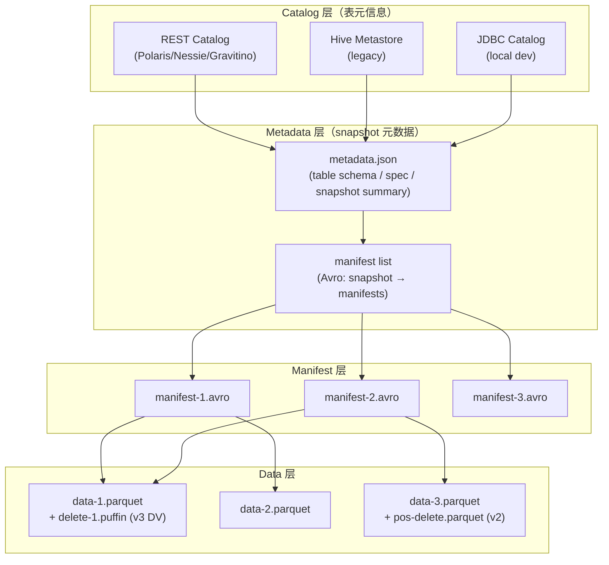

> 本文件是 Iceberg 学习的"入口文档"。目标：2–3 小时通读，建立完整的 Iceberg 心智模型；之后任何深入问题都能从这个图谱出发。
>
> 适用范围：W02–W03.5（深入实现层学习期间）。
>
> 阅读对象：已掌握 HDFS / Parquet / Spark 基本使用；目标在 1–2 周后能在团队内讲清楚 Iceberg v3 的设计动机与源码关键路径。

---

## 一、为什么是 Iceberg（vs Hive / Delta / Hudi）

> 一句话：**Iceberg 是把"表的状态"和"文件目录"解耦的开放表格式**，让 Hive 的"目录即表"被彻底替换。

| 维度 | Hive | Delta Lake | Hudi | **Iceberg** |
| --- | --- | --- | --- | --- |
| 表状态存储 | Metastore（外部依赖） | `_delta_log/` 目录 JSON | Timeline Server / Metadata Table | **metadata.json + manifest list + manifest**（纯文件，可独立） |
| 分区演进 | 不支持（drop & recreate） | 不支持 | 部分支持 | **完全支持（partition spec evolution）** |
| Hidden Partitioning | 不支持 | 不支持 | 不支持 | **原生支持**（按数据值而非目录名） |
| 行级更新（v2+） | 不支持 | ✓ Delete 文件 | ✓（MoR / CoW） | ✓（v2: position/equality delete；**v3: binary deletion vectors**） |
| 开放表格式 | 否（绑定 Hive） | 否（Databricks 控制） | 否 | **是（REST Catalog Open API 标准化）** |
| 引擎互操作 | Hive/Spark/Trino | 主要是 Databricks | Spark/Flink 为主 | **最广**：Spark / Flink / Trino / StarRocks / Doris / Dremio / Snowflake |
| Time Travel | 弱 | ✓ | ✓ | ✓（snapshot / tag / branch） |

**关键判断**：在国内大厂选型里，Iceberg 已是事实标准之一。优势在于：(1) 引擎中立（不被某一厂商绑定）；(2) 开放 Catalog 协议（Polaris / Nessie / Gravitino / Unity 都实现）；(3) Flink 流式读写最成熟。

---

## 二、架构分层（一图看全）

**5 层关系一句话**：表 = 多个 snapshot；snapshot = 一个 manifest list；manifest list = 多个 manifest；manifest = 多个 data file + 可选的 delete file（v2 position/equality delete 或 v3 deletion vector 存在 Puffin 里）。

> 面试常见追问："v3 的 deletion vector 放在哪？"答：Puffin 文件里（`deletion-vector-v1` blob），由 delete manifest 通过 `file_path / content_offset / content_size_in_bytes` 三元组定位。**和 v2 的 position delete file（独立 Parquet 文件）是本质不同。**

---

## 三、关键概念 glossary（10 个）

| 术语 | 1 句话定义 |
| --- | --- |
| **Snapshot** | 表在某时刻的完整状态，由 catalog 分配一个唯一 snapshot_id，每次 commit 都产生新 snapshot。 |
| **Manifest List** | 一个 Avro 文件，列出一个 snapshot 包含的所有 manifest，含每个 manifest 的 partition stats 与 data file count（用于 plan-time pruning）。 |
| **Manifest** | 一个 Avro 文件，列出若干 data file + 可选 delete file 的元数据（含每列 min/max、null count、record count）。 |
| **Data File** | Parquet / ORC / Avro 真实数据文件，按 partition / sort 写入。 |
| **Delete File** | v2 起支持；position delete（按 file_path + position）或 equality delete（按列值）。 |
| **Puffin** | 副文件格式，存放 bitmap 索引（deletion vectors、bloom filter、column stats）。v3 把 DV 放这里。 |
| **Sequence Number** | 每个 commit 分配的乐观递增序号，用于判断数据/删除文件的相对年龄。manifest list 写死，data file 读取时填充。 |
| **Row Lineage（v3 新）** | 每行带 `_row_id` 与 `_last_updated_sequence_number` 两个隐藏字段；前者全表唯一，后者记录"最后一次被改的 snapshot 序号"。是 CDC / incremental processing 的基础。 |
| **Variant（v3 新）** | 半结构化类型，编码走 Parquet 规范；类似 JSON 但支持 date / timestamp / decimal / binary 等更宽的原始值集合。 |
| **Deletion Vector（v3 新）** | 用 32-bit RoaringBitmap 编码"文件内被删的 row position"；一个文件最多一个 DV；存放在 Puffin 里。 |

---

## 四、版本特性时间线（重点）

| 版本 | 发布 | 核心新增 | 解决了什么 |
| --- | --- | --- | --- |
| **v1** | 2018 | 基础 spec：snapshot / manifest / hidden partition / schema evolution | 替代 Hive "目录即表"，实现 O(1) plan |
| **v2** | 2022 | Row-level deletes（position + equality delete file） | 不重写 data file 就能删/改单行；CDC 友好 |
| **v3** | 2024–2026 | Binary deletion vectors（Puffin）+ Row Lineage + Variant + Geometry/Geography + 默认值 + 多参数 transform + 表加密 | (1) DV 取代 v2 position delete，写放大更小；(2) Row lineage 让 incremental / CDC 无需读旧 snapshot；(3) Variant 应对 AI 多模态半结构化数据；(4) 加密应对合规 |
| **v4（草案）** | 未来 | Metadata 相对路径（relative locations） | 减少 metadata.json 体积 |

**v3 的核心价值排序**（按面试高频程度）：

1. **Deletion Vectors**（RoaringBitmap + Puffin）— 写放大比 v2 小一个数量级，update 性能跃升
2. **Row Lineage**（`_row_id` + `_last_updated_sequence_number`）— CDC 与增量处理的基础，无需依赖外部 sequence
3. **Variant** — AI 时代必备，处理 JSON / 半结构化数据不再强转 string
4. **Encryption** — 表级密钥、AES-GCM 流式加密

---

## 五、5 个主流 Catalog 实现差异

| Catalog                  | 维护方                       | 定位                                                                                        | 关键差异                                                                               |
| ------------------------ | ------------------------- | ----------------------------------------------------------------------------------------- | ---------------------------------------------------------------------------------- |
| **Apache Polaris**       | Apache（incubating，2024 进） | "开放数据 + AI catalog"，REST + 多引擎（**支持 Doris / Flink / Spark / Dremio / StarRocks / Trino**） | 最新版本 1.7.0（2026）；JDBC backend（Postgres / CockroachDB）；Polaris MCP Server（AI 时代加分项） |
| **Nessie**               | Cloudera 系                | "Git-like catalog"，branch / tag / merge                                                   | 最适合实验性场景；与 Iceberg REST 协议全兼容                                                      |
| **Gravitino**            | Apache                    | "统一元数据"，多 catalog 类型                                                                      | 关注多 catalog 联邦                                                                     |
| **Unity Catalog（OSS 版）** | Databricks                | Databricks 体系下                                                                            | 与 Polaris 在功能上趋同，但治理倾向更强                                                           |
| **HMS / Glue / JDBC**    | Hive / AWS / Iceberg      | 传统实现                                                                                      | 兼容老生态；不支持 REST Catalog 高级特性                                                        |

**选型建议**：
- 国内大厂 + 多引擎互操作 → **Polaris**（社区活跃 + 支持 Doris / SR）
- 实验 + 多分支 → **Nessie**
- 不愿脱离 Hive 体系 → **HMS** + Iceberg REST 适配

---

## 六、推荐阅读路径（3 层）

### 第一层：建立全局观（30 分钟）

1. 官方 spec §Overview（上面已总结）
2. 官方 multi-engine compatibility matrix（确认你用的引擎已支持 v3）
3. Polaris Quickstart（https://polaris.apache.org/guides/quickstart）

### 第二层：动手验证（2 小时）

1. `docker compose up` 起 Spark + Iceberg + Nessie（推荐 docker-compose-from-official）
2. 建一张 v3 表：`CREATE TABLE ... USING iceberg TBLPROPERTIES ('format-version'='3')`
3. insert / select / `AS OF TIMESTAMP` time travel
4. 手动 `cat` manifest list 文件看 Avro 字段

### 第三层：源码 + 调优（第二三周）

1. 读 `TableOperations` / `SnapshotProducer` / `BaseTable`（建立 commit 流）
2. 读 `ManifestReader` / `ManifestWriter`（建立 filter pushdown 心智）
3. 读 `DeleteFileIndex`（v3 DV 索引解析）
4. 跑 4 个调优实验（manifest 膨胀 / v2 vs v3 删除 / compaction 策略 / REST Catalog 延迟）

---

## 七、官方链接索引（必查）

### 规范层

- **Iceberg v3 spec**：https://iceberg.apache.org/spec/
- **REST Catalog Open API spec**：https://editor.ics.uci.edu/srv/stunts/papers/api.pdf（注：链接以官方 GitHub 仓库 OpenAPI YAML 为准）
- **Puffin spec**：Iceberg repo `format/puffin-spec.md`
- **AES GCM Stream spec**：Iceberg repo `format/encryption-spec.md`

### Catalog 实现

- **Apache Polaris**：https://polaris.apache.org/（最新 1.7.0）
- **Nessie**：https://projectnessie.org/
- **Gravitino**：https://gravitino.apache.org/

### 引擎连接器

- **Spark**：Iceberg `iceberg-spark` 模块（Iceberg 1.5+ 已支持 v3）
- **Flink**：Iceberg `iceberg-flink` 模块（1.18+ 实验性 v3 写；1.20+ 稳定）
- **Trino**：trino-iceberg connector（440+ 起）
- **StarRocks**：external catalog（3.x 支持 Iceberg REST）
- **Doris**：同上（2.x+ 支持）

### 重要 RFC

- **RFC-0001**：v2 row-level deletes 设计动机
- **RFC-0003**：variant 数据类型讨论
- **Spec v3 commit `c2501fd`**（2024-10）：Add deletion vectors and requirements
- **Spec v3 commit `5c463b0`**（2026-07）：Add deletion vectors and requirements（更新版）

### 社区资源

- **dev 邮件列表**：dev@iceberg.apache.org
- **Slack**：https://join.slack.com/t/apache-iceberg/shared_invite/...
- **JIRA**：https://issues.apache.org/jira/projects/ICEBERG

---

## 八、面试速答卡（背下来）

> 这些是 W03.5 自检演练的硬性题目。

**Q1：snapshot / manifest / data file 三层关系？**
答：snapshot 是"表在某时刻的完整状态"，由 catalog 分配 ID；snapshot 引用一个 manifest list（Avro），里面列出该 snapshot 包含的所有 manifest；每个 manifest 列出若干 data file（Parquet）+ 可选 delete file（v2 position/equality；v3 DV 存 Puffin）。

**Q2：v3 deletion vector 在哪个包里？**
答：Puffin 文件里（`deletion-vector-v1` blob），编码用 32-bit RoaringBitmap。源码在 `org.apache.iceberg.DeleteFileIndex` 与 `org.apache.iceberg.puffin.PuffinReader`。

**Q3：Iceberg v3 比 v2 的删除性能好在哪？**
答：v2 position delete 是独立 Parquet 文件（按 file_path + position 标记删除），读时需 join；v3 DV 是 RoaringBitmap 存 Puffin，读时位图查询，O(1) 判定；写放大更小（不写新 Parquet）。

**Q4：REST Catalog 三个核心 endpoint？**
答：`POST /v1/namespaces/{ns}/tables`（建表）、`GET /v1/namespaces/{ns}/tables/{table}`（加载）、`POST /v1/namespaces/{ns}/tables/{table}/commit`（提交）。

**Q5：Row Lineage 怎么支持 CDC？**
答：每行带 `_row_id`（全表唯一）+ `_last_updated_sequence_number`（修改时的 snapshot 序号）；增量读取只需 `WHERE _last_updated_sequence_number > X`，无需依赖外部 sequence。

---

## 九、本周（W02）行动清单

- [ ] 读完本文档
- [ ] docker compose 起实验环境（Spark + Iceberg + Nessie + MinIO）
- [ ] 跑通 v3 表的最小 demo（建表 / insert / select / time travel）
- [ ] 写《iceberg-源码笔记.md》第一个类（`TableOperations`）
- [ ] 提交：`study(w2): phase1 冰山之核完成`

---

*最后更新：2026-08-18 / 作者：remond*
